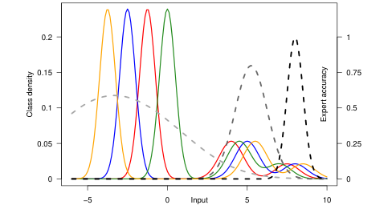

# mild：不平衡专家路由的margin目标

## 论文信息

| 字段 | 内容 |
|---|---|
| 论文链接 | [Optimized Deferral for Imbalanced Settings](https://arxiv.org/abs/2604.27723) |
| 公司 / 机构 | Google Research；首列作者 Corinna Cortes |
| 首次公开日期 | 2026-04-30（arXiv v1） |
| 原作者开源代码 | 已审读原文未找到作者实现链接；明确记为未找到 |
| 本地 adapter | `mild`，独立CPU路由目标组件，无 reproduce adapter |
| 本地复现代码 | `src/auto_research/foundation_models/google16_mild.py` |

## 方法摘要

将多专家选择改写为输入—专家的cost-sensitive分类，以每个专家不同的margin尺度缓解样本覆盖不平衡。本地实现论文logistic surrogate、解析梯度与有界线性router训练；推理接口只接收特征和训练后的参数，不读取答案或专家真实代价。

## 原始论文总结

### 背景与主要改动

少数覆盖的专用专家容易被多数专家淹没。论文通过对不同专家设置不同margin约束来平衡学习。保留训练奖励而非以argmin成本生成单一硬标签；这是[v1 §5.3 mild目标、§4.2 margin建议](https://arxiv.org/html/2604.27723v1#S5.SS3)的低成本实现。


<!-- paper-figure:start -->
### 原论文关键图

[](https://arxiv.org/pdf/2604.27723v1#page=2)

> **Figure 1，PDF第2页**：类别分布、专家准确率与成本共同决定路由，不等同于“类别就是专家”。本地不把示意图当真实benchmark结果。版权归原作者；[来源、裁剪与hash](assets/provenance.json)。
<!-- paper-figure:end -->

### 核心公式

$$
\bar c_k=\sum_{k'\ne k}c_{k'},\quad
L(f)=\frac1m\sum_{i,k}\bar c_{ik}\log\sum_{k'}
\exp\left(\frac{f_{ik'}-f_{ik}}{\rho_k}\right)+\lambda\|f\|^2.
$$

margin建议按$\rho_k\propto(m_kX_k^2)^{1/3}$。计数和特征界仅由训练数据提供；参数选择不能读取test。实现用稳定log-sum-exp，不将$\rho_k$变成普通类别权重，也不把所有专家成本交给推理router。

### 论文离线与线上效果

原文在图像数据的合成/真实专家及MMLU LLM路由比较mild与tdef；合成专家使用真实标签的理想化设定不是实际推理系统。未报告生产A/B。本地未进行这些完整实验或声称论文提升复现。

## 本地复现

```bash
PYTHONPATH=src python scripts/run_google16_statistics.py --seed 42 --output runs/google16-statistics.json
```

### 数据协议与结果

4条自建线性可分夹具，仅作100步目标优化与解析梯度有限差分检查，不是泛化test。对齐原文分数并列时选择最高专家索引。稳定结果见`metrics/component-cpu-seed42.json`，`diagnostic_only=true`，不提供真实专家能力或evolve改善证据。

### 代码映射与边界

`surrogate_and_gradient`实现完整logistic目标；`margin_schedule`为理论比例，`fit_router`为有界线性CPU优化器，`route`不接收cost或label。原完整图像200epoch、多专家、5run及多LLM评测成本过高，不复现（审查DONE），不为这轮下载大型专家。它与廉价数学组件的实现状态分开登记。
