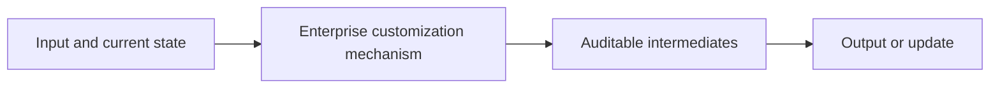
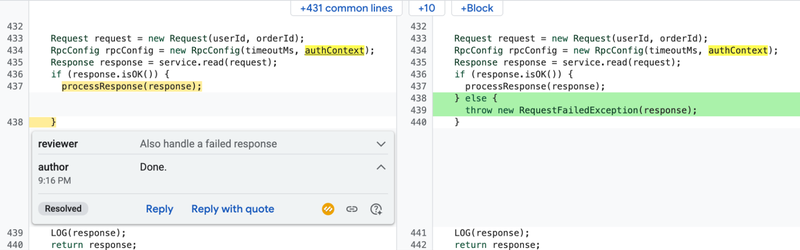

# Customizing an LLM for Enterprise Software Engineering

<!-- source-sha256: bd87cf9dca9a53de221343297c8cd1c769339d18369c820c9394ecfe6d3ee618 -->

[简体中文](README.md)

> **L1 core-mechanism diagnostic.** Tests the mid-training replay objective and its invariants only. No private Google trillion-token dataset, Gemini weights, or internal developer environment is used, and the paper's A/B is not a local result.

## Paper information

| Field | Details |
|---|---|
| Paper | [arXiv 2605.16517](https://arxiv.org/abs/2605.16517) |
| Organization | Google (first-author affiliation) |
| First public release | 2026-05-15 (arXiv v1) |
| Authors' code | No public author implementation was found as of 2026-10-02. |
| Adapter / method | `gemini-for-google` |
| Local reproduction code | [`src/auto_research/foundation_latest_20261002.py`](https://github.com/daiwk/auto-research/blob/main/src/auto_research/foundation_latest_20261002.py) |

## Original paper

### Motivation and method

Extract high-value code and interaction signals from enterprise development history. Deduplication, quality filtering, and contamination controls produce mid-training data. General-data replay limits catastrophic forgetting, followed by post-training for internal tools and deployment evaluation.

<!-- paper-figure:start -->
### Key figure from the paper

> **Key figure:** Original architecture, training flow, or system protocol. From the [original paper](https://arxiv.org/abs/2605.16517); copyright remains with the authors.
<!-- paper-figure:end -->

### Core equation

$L=(1-\lambda)L_{enterprise}+\lambda L_{replay}$. The local operator exposes the mixture between enterprise adaptation and general-capability retention.

### Paper results

In a blinded A/B test with 29,000 developers, mean interactions per round fell 23% and code survival rose 16.8%.

## Local reproduction

> **Local comparison:** The baseline disables the mechanism or uses default state, and the treatment enables the core operator. Relative percentages are not applicable. Metrics check invariants, gradients, or state transitions, not paper-scale outcomes.

- [Three-seed diagnostic](metrics/mechanism-seeds42-44.json).
- `diagnostic_only=true`; ineligible for formal capability ranking.

## Reproduction boundaries

Only the mid-training replay objective and invariants run. No Google private trillion-token data, Gemini weights, or internal development environment was used; original A/B outcomes are not local.
