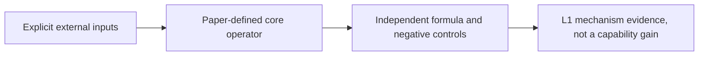
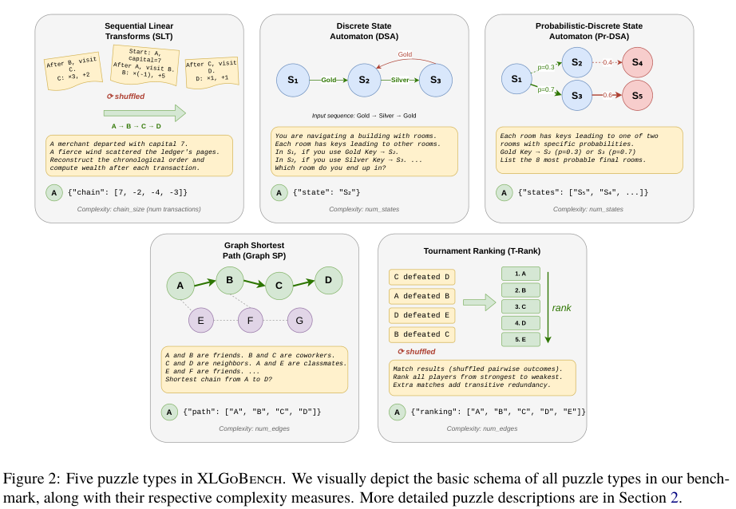

# XLGoBench: Detecting Cross-Lingual Skill Gaps with Algorithmic Tasks

<!-- source-sha256: 12c2082c37310106a20523d6a6845ba8f75628d01b7386fb40617c965c5df153 -->

[简体中文](README.md)

## Paper information

| Field | Details |
|---|---|
| Paper | [arXiv 2605.30788 v1](https://arxiv.org/abs/2605.30788v1); [pinned v1 PDF](https://arxiv.org/pdf/2605.30788v1) |
| Organization | First author Purvam Jain: Google DeepMind (affiliation 1 on p. 1 of the pinned v1 PDF). |
| First public release | 2026-05-29 03:25:32 UTC (arXiv v1) |
| Authors' code | [Author supplement v1 on Zenodo](https://zenodo.org/records/20423110), file MD5 `1fd5dd56c216a407dd5a13f08b0f1065`; no Git SHA. Only the paper and public metadata were checked. The independently written scorer does not copy templates. The Zenodo page has no clear license and the 82.2 MB package was not downloaded to inspect internal licensing. Paper: arXiv non-exclusive license. |
| Adapter / method | `xlgobench`; `adapter: null`; `component_only`. |
| Local reproduction code | `src/auto_research/evaluation/xlgobench.py` |
| Version | Method checked against pinned v1. |
| Full experiment | Not reproduced due to cost (review complete); excluded from automatic retry and implementation queues. |

XLGoBench presents the same abstract algorithmic problem in different languages and varies complexity to expose cross-lingual gaps. Local scope is structured examples and exact JSON scoring for SLT, DSA, probabilistic DSA, unique shortest paths, and unique tournament ranking. Gold is computed only inside the scorer, never passed to the model. The official seven-language prompts, LLMs, and SMD capability matrix were not run.

## Original paper

### Motivation and method

Pinned v1 Section 2 and Appendix C: SLT jumbles transaction chains with integer wealth and coefficients from −9 to 9. DSA has equal counts of states and actions; Pr-DSA uses 15 actions, propagates the full state distribution, and matches an unordered top-eight set. Graph-SP requires a unique shortest path, and T-Rank uses a Hamiltonian DAG with transitive edges and a 1:3 node-to-edge ratio. The local callback receives deep copies of allowlisted task/problem fields; exact JSON scoring needs no LLM judge.



<!-- paper-figure:start -->
### Key figure from the paper

[](https://arxiv.org/pdf/2605.30788v1#page=3)

> **Figure 2:** Pinned v1, p. 3. Original scientific content and annotations, not a redraw. From the [original paper](assets/provenance.json); copyright remains with the authors.
<!-- paper-figure:end -->

[Source, crop, and SHA-256](assets/provenance.json).

### Core computation

- SLT follows the shuffled transactions with $w_{t+1}=a_tw_t+b_t$ and returns the complete chain including initial wealth as in Figure 2. Coefficients and wealth are integers in $[-9,9]$.
- DSA follows deterministic action transitions and has as many states as actions. Pr-DSA propagates the complete probability distribution over states with 15 actions; the top-eight output is unordered but must not contain duplicates.
- Graph-SP solves a unique shortest path. The local example fixes 12 nodes and uses the Appendix C.1 $\rho=0$ backbone-plus-bypass case; it does not implement the full noise/complexity generator.
- T-Rank solves a unique topological ordering; a Hamiltonian backbone and transitive edges use a 1:3 node-to-edge ratio.

The scorer matches complete JSON results and alone computes gold. Model callbacks only see a deep copy of allowlisted `task/problem` fields and cannot modify the scorer.

### Paper results

The paper's results rely on its own models, data, and protocol. The complete matrix was not executed, and no author metrics are presented as local measurements. No production online A/B is reported.

## Local reproduction

This delivers structured problems, five exact scorers, and gold isolation. It does not download the Zenodo package, copy its templates, label automatic translations as human-verified, run the full complexity sweep, fit gamma/SMD confidence intervals, or compare LLM capabilities.

```bash
PYTHONPATH=src python -c 'from auto_research.evaluation.xlgobench import diagnostic; print(diagnostic(42))'
python -m pytest tests/test_google_emnlp25_foundation.py
```

`diagnostic(seed, device='cpu')` tests independent formulas and negative controls on generated examples. This is a CPU reference/protocol without an advertised CUDA path. Diagnostics do not establish formal model accuracy, writing or cross-lingual quality, or Evolve promotion.

## Limits and cost

The original runs span four models × five algorithms × seven languages × 20 complexity levels × 50 items per level, with frontier APIs, Gemma31B, repetitions, and interval fitting. Neither this matrix nor its manually verified translations are reproduced. The local five-task diagnostic yields no cross-lingual accuracy.

**Full experiment not reproduced due to cost (review complete)**; no full cost-estimation run. A tensor/protocol pass does not establish full method, data pipeline, or benchmark integration. Flags: `diagnostic_only=true`, `promotion_eligible=false`, `evolve_integrated=false`.

This is a historical lead from Google's official EMNLP page, not a new release. Affiliation evidence comes from the paper and is recorded above.
