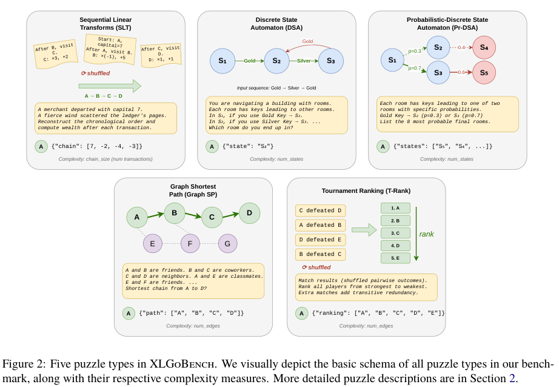

# XLGoBench: Detecting cross-lingual skill gaps with algorithmic tasks

用同一个抽象算法实例在不同语言表述，扫描复杂度来暴露跨语言差距；本地保留SLT、DSA、概率DSA、唯一最短路和唯一锦标赛排序的结构化小题与exact JSON scorer。gold仅scorer计算，不发给model；未运行官方七语模板、LLM或SMD能力矩阵。

## 论文信息

| 字段 | 内容 |
| --- | --- |
| 论文链接 | [arXiv 2605.30788 v1](https://arxiv.org/abs/2605.30788v1)；[固定核对版本 v1](https://arxiv.org/pdf/2605.30788v1) |
| 公司 / 机构 / 学校 | 一作 Purvam Jain：Google DeepMind。固定v1 PDF第一页Purvam Jain上标1=Google DeepMind。 |
| 首次公开日期 | 2026-05-29 03:25:32 UTC（arXiv v1） |
| 本轮版本 | 本轮方法核对固定v1。 |
| 原作者代码 | [作者公开资源](https://zenodo.org/records/20423110)；作者补充材料v1公开：Zenodo20423110，文件MD5=1fd5dd56c216a407dd5a13f08b0f1065；无Git SHA，不伪造。只核正文与公开元数据，独立实现结构化scorer，不复制官方多语模板；Zenodo页面未给清晰license，未下载82.2MB包核验内部许可证；论文arXiv non-exclusive license |
| 本地 adapter / 稳定键 | `xlgobench`；`adapter: null`；`component_only` |
| 本地复现代码目录 | `src/auto_research/evaluation/xlgobench.py` |
| 完整实验 | **成本过高，不复现（审查 DONE）**，不进入自动重试或实现队列 |

## 原始论文总结

### 背景与主要改动

固定v1 Section2+AppendixC：SLT财富/系数整数−9..9并jumbled chain；DSA状态/动作数相同；PrDSA15动作、传播完整状态概率、top8集合顺序无关；GraphSP唯一最短路（本地rho0 backbone+bypass固定例）；T-RankHamiltonian DAG+transitive edges、nodes:edges1:3。callback只收task/problem白名单深拷贝，score完整JSON，无LLMjudge。


<!-- paper-figure:start -->
### 原论文关键图

[](https://arxiv.org/pdf/2605.30788v1#page=3)

**Figure 2**，固定v1第3页。图片来自[原论文](https://arxiv.org/pdf/2605.30788v1)，版权归原作者所有；保留原图科学内容与标注，未重绘。[来源、裁切与SHA256](assets/provenance.json)。
<!-- paper-figure:end -->

### 核心公式

五任务都保留确定性算法答案：SLT按打乱交易链计算 $w_{t+1}=a_tw_t+b_t$；DSA逐动作确定性转移；Pr-DSA传播完整状态概率，返回top8集合；Graph-SP求唯一最短路径；T-Rank求唯一拓扑排序。核心范围为：
- SLT的系数/财富是 $[-9,9]$ 整数；本地输出含初始财富的完整chain，与原Figure2示例一致。
- DSA状态数=动作数；Pr-DSA固定15种动作，完整top8集合匹配时忽略顺序、拒绝重复。
- Graph-SP只实现AppendixC.1允许的 $\rho=0$ backbone+bypass小实例，固定12节点，不宣称完整noise复杂度生成器。
- T-Rank由Hamiltonian backbone和transitive edges构造唯一顺序，nodes:edges为1:3。
所有JSON结果整项匹配；scorer内部才计算答案，model callback只收到白名单 `task/problem` 深拷贝，不能访问gold或修改scorer对象。

### 论文离线与线上效果

原文结论来自其真实模型、数据与协议；本页未运行完整矩阵，不将原文指标抄成“本地实测”。未报告生产线上 A/B。

## 本地复现

只交付结构化小题、五个精确scorer与gold隔离接口。没有下载Zenodo补充包，不复制其模板，不自动翻译成七语后声称已人工校验；也未实现完整复杂度扫描、gamma/SMD置信区间拟合或任何LLM能力比较。

```bash
PYTHONPATH=src python -c 'from auto_research.evaluation.xlgobench import diagnostic; print(diagnostic(42))'
python -m pytest tests/test_google_emnlp25_foundation.py
```

`diagnostic(seed, device='cpu')`只执行生成数据上的独立公式/负控。这是纯CPU参考/协议，不advertise CUDA路径。 指标是算子误差、梯度/参数更新或scorer对照，不是正式模型accuracy、写作质量、跨语言能力或Evolve晋级证据。

## 复现边界

原文4模型×5算法×7语言×20复杂度×每级50题，包含frontierAPI和Gemma31B，另有重复/置信区间拟合。完整矩阵和人工验证翻译不跑；本地仅5任务结构化诊断、没有代造已验证翻译或跨语言accuracy。

**成本过高，不复现（审查 DONE）**。以上为论文配置/资源判断，未为了测成本而启动完整试跑。本地小张量或CPU协议通过不等于完整方法/数据管线或benchmark已接入；`diagnostic_only=true`、`promotion_eligible=false`、`evolve_integrated=false`。

本轮来自Google EMNLP官方会议页的历史线索补漏，不是今天新首发，也不单凭会议页就认定作者具有Google署名；机构证据在信息块逐条注明。
