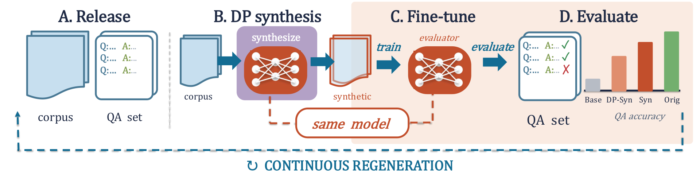

# ContinuousBench: measuring new capability from synthetic text

<!-- source-sha256: fa56a473668f84deaab923893e1c5a9fc33a84364d304290740b05d2ee2ae759 -->

[简体中文](README.md)

> **L1 mechanism/evaluation component, diagnostic only—not a complete capability reproduction.** CPU component tests passed. There is no CUDA execution path and no GPU claim. Not integrated with Evolve; fixture results cannot justify promotion.

## Paper information

| Field | Value |
| --- | --- |
| Paper | [arXiv:2606.01849v1](https://arxiv.org/abs/2606.01849v1); [fixed v1 source](https://arxiv.org/html/2606.01849v1) |
| First author / institution | **Peihan Liu**, first affiliation **Columbia University**; Google participation is verified from the author block, not model names |
| Original publication date | **2026-06-01 08:00:01 UTC**, arXiv v1 record; historical official-source backfill, not today's first publication |
| Author code | [Author evaluation repository](https://github.com/plau666/ContinuousBenchEval) and [curation repository](https://github.com/plau666/ContinuousBenchCuration). Pinned evaluation tree: `0f8a521cfef8c3f500ece717b626ad7c9124dee4`. No repository LICENSE was found; public visibility is not a license grant. |
| Local adapter / key | `continuousbench`; `adapter: null`, independent component |
| Local code | `src/auto_research/foundation_models/continuousbench.py` |
| Validation | CPU component tests passed. There is no CUDA execution path and no GPU claim. |

## Original paper summary

### Background and main change

Saturated benchmarks cannot reveal whether synthetic text transfers new knowledge. ContinuousBench periodically releases fresh corpora and derived QA, standardizes evaluator training and compares against the same unchanged base model. Utility centers on repeated facts rather than memorizing singleton private records.

<!-- paper-figure:start -->
### Key original-paper figure

[](https://arxiv.org/html/2606.01849v1)

Figure 2, fixed v1 HTML: recurring corpus releases, DP synthesis and same-model capability evaluation. Source and image hashes are in [assets/provenance.json](assets/provenance.json). Figure from the [original paper](https://arxiv.org/html/2606.01849v1); copyright belongs to the original authors. Full-paper findings are not local component results.

<!-- paper-figure:end -->

### Defining mechanism and formula

Checkpoint selection uses validation contains accuracy only; paired test reporting is final. Geminon uses string scoring, whereas News needs an external semantic judge. The pinned author-code tree is 0f8a521cfef8c3f500ece717b626ad7c9124dee4. Its cleaner truncates subsequent Q: continuations and keeps the first nonempty line; the fine-grained parser separates exact from type-wise containment. This differs from the appendix's unit-cleaning prose, so the local protocol explicitly binds the code revision.

```text
gain = EM_adapted(same release, same questions) - EM_unchanged_base
```

### Original results and limitations

The study trains 1B/4B evaluators for 10,000 steps and DP generators for 3,000 steps at batch 512 across privacy/model/LoRA settings. Full synthesis, privacy accounting, training and quarterly curation are not reproduced. Exact-match gains establish neither a privacy guarantee nor public-benchmark performance when computed on fixtures.

## Local reproduction

### Data protocol and code mapping

The component independently implements the pinned cleaner/matcher semantics. Paired gains require identical IDs, questions, references and release revisions, with an explicit base arm. Test rows cannot select checkpoints. 'Flying and Normal' may contain both required types but is not the exact string 'Normal and Flying'. No model calls, large downloads, DP-SGD or automatic News judge are included.

```bash
PYTHONPATH=src python -c 'from auto_research.foundation_models.continuousbench import diagnostic; print(diagnostic(42, device="cpu"))'
PYTHONPATH=src python -m pytest -q tests/test_colm_foundation_components.py
```

### Results, negative controls and boundaries

The component test set has 44 passes and six locally skipped CUDA cases; skipping is not passing. Standard three-seed outputs use `metrics/component-cpu-seeds42-44.json`, not training or public-benchmark results. CPU component tests passed. There is no CUDA execution path and no GPU claim. All metrics are L1 diagnostics. No gold is exposed to an actor, no test-based selection is authorized, and no model improvement is claimed.

### Full-experiment disposition

1B/4B models, rank128 LoRA/full evaluation 10000 steps, DP generation 3000 steps with batch512 and sweeps; full synthesis/privacy/training matrix not reproduced.

**Full experiment not reproduced due to cost (review DONE).** No large checkpoint/corpus downloads, scaled-down substitute presented as replication, or automatic full-training retries.
