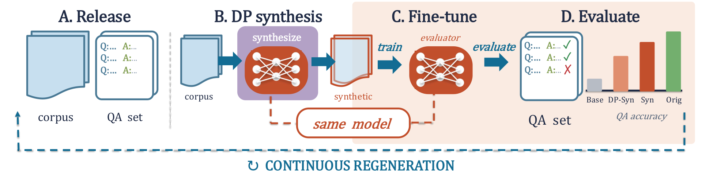

# ContinuousBench：衡量合成文本带来的新能力而非旧题记忆

[English](README-en.md)

> **L1 机制/评测组件，diagnostic only，不是完整模型能力复现。** CPU组件专测已通过；没有CUDA路径，不需要GPU验收。 未接入Evolve，不可据本地fixture成绩晋级。

## 论文信息

| 字段 | 内容 |
| --- | --- |
| 论文链接 | [arXiv:2606.01849v1](https://arxiv.org/abs/2606.01849v1)；[固定v1原文](https://arxiv.org/html/2606.01849v1) |
| 公司 / 作者机构 | 一作 **Peihan Liu**，第一单位 **Columbia University**；论文有Google相关作者，按原文作者栏确认，不凭模型名归属 |
| 首次公开日期 | **2026-06-01 08:00:01 UTC**，依据arXiv v1记录；本次是历史官方源补漏，不是今天新首发 |
| 原作者开源代码 | [作者评测仓库](https://github.com/plau666/ContinuousBenchEval)；[curation仓库](https://github.com/plau666/ContinuousBenchCuration)。固定评测tree `0f8a521cfef8c3f500ece717b626ad7c9124dee4`；公开仓库未发现LICENSE，不能据此推定代码许可。 |
| 本地 adapter / key | `continuousbench`；`adapter: null`，独立组件 |
| 本地复现代码 | `src/auto_research/foundation_models/continuousbench.py` |
| 验收范围 | CPU组件专测已通过；没有CUDA路径，不需要GPU验收。 |

## 原始论文总结

### 背景与主要改动

若benchmark已经被基座模型做得很好，合成数据是否真正传递新知识就难以区分。ContinuousBench定期生成或整理未见知识语料及相应QA，统一训练/evaluator设置，并与未经该语料训练的同一基座比较；关注高重复公共事实的utility，不要求DP模型记住单条私有记录。

<!-- paper-figure:start -->
### 原论文关键图

[](https://arxiv.org/html/2606.01849v1)

Figure2，固定v1 HTML；持续更新语料、DP合成、同模型评估的原始工作流。 来源与图像SHA见[assets/provenance.json](assets/provenance.json)。图片来自[原论文](https://arxiv.org/html/2606.01849v1)，版权归原作者所有；图中的完整实验结论不等于本地组件结果。

<!-- paper-figure:end -->

### 核心机制与公式

checkpoint只根据validation contains accuracy选择，test只作最终配对报告。Geminon用字符串评测；News需要外部LLM语义judge，不能拿本地exact match冒充News。作者公开代码固定tree为0f8a521cfef8c3f500ece717b626ad7c9124dee4；该代码的清洗器先截断后续Q:并取首个非空行，finegrained parser区分完整exact与类型集合contains。它与论文附录的单位清洗描述并非完全相同，本地明确绑定代码版本，不混成一种协议。

```text
gain = EM_adapted(same release, same questions) - EM_unchanged_base
```

### 原文结果与限制

作者的1B/4B evaluator训练10000步，DP generator训练3000步、batch512，并有隐私预算、模型和LoRA/full等矩阵。完整DP合成、隐私会计、训练和季度发布流程不复现。本地不是隐私保证，不能从exact-match gain推导满足某个ε/δ，也不能把fixture的提升当公开数据成绩。

## 本地复现

### 数据协议与代码映射

`score_geminon` 独立实现固定作者代码的清洗/匹配语义；`capability_gain`要求两臂题目ID、问题、gold与release revision完全一致，基线必须显式给出；`select_validation_checkpoint`拒绝test行。不得把contains与exact混为一谈：Flying and Normal可覆盖Normal and Flying的两类型，但不是相同字符串。无模型调用、HF大下载、DP-SGD或News自动judge。

```bash
PYTHONPATH=src python -c 'from auto_research.foundation_models.continuousbench import diagnostic; print(diagnostic(42, device="cpu"))'
PYTHONPATH=src python -m pytest -q tests/test_colm_foundation_components.py
```

### 结果、负控与边界

本批组件专测为44项通过、6项CUDA本机跳过；跳过不等于通过。三种子标准产物统一使用 `metrics/component-cpu-seeds42-44.json`；没有训练或公开benchmark成绩。CPU组件专测已通过；没有CUDA路径，不需要GPU验收。 所有metric仅属L1诊断，无gold给actor、无test选择、无模型效果提升声明。

### 完整实验处置

固定v1 Appendix C.1–C.3包含1B/4B evaluator每配置10000步，DP generator训练3000步、batch512，另有ε=10/100、LoRA128/full与学习率搜索。完整合成、DP会计、训练和周期发布矩阵不复现。

**完整实验成本过高，不复现（审查 DONE）**。不下载大权重/语料、不以缩水模型冒充原论文、不自动重试完整训练。
