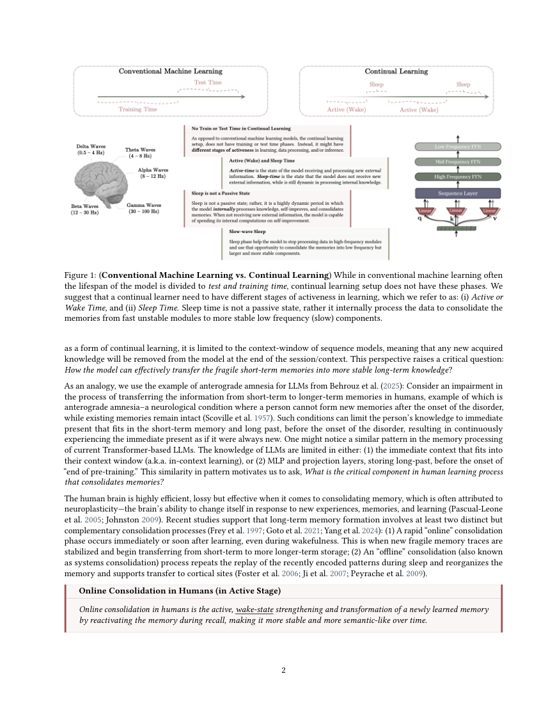
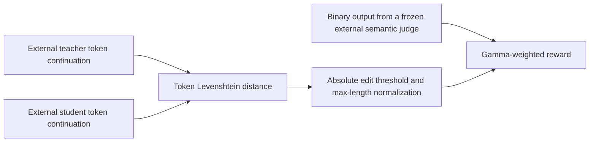

# Sleep: Offline memory consolidation and the Learning to Imitate reward

<!-- source-sha256: cccbb45f84c92c7e776cc7bfa1b4a4fb1f8e7cd521f9b1c1314849a7a111d411 -->

[简体中文](README.md)

> Only the **CPU L1 LTI reward component** is implemented. There is no CMS, expansion, dream generation, semantic judge model, or LLM training. The full Sleep experiment is **not reproduced due to cost (review DONE)**. No Evolve integration.

## Paper information

| Field | Value |
| --- | --- |
| Paper | [Pinned v2](https://arxiv.org/abs/2606.03979v2), [full text](https://arxiv.org/html/2606.03979v2) |
| Original title | Language Models Need Sleep: Learning to Self-Modify and Consolidate Memories |
| Organization | First author Ali Behrouz: Google Research, in collaboration with Cornell University. Author affiliations are shown as logos; Google's official blog confirms its affiliation. |
| First published | arXiv v1: 2026-06-02 17:56:55 UTC; pinned v2: 2026-07-10 17:52:03 UTC. The paper mentions a September 2025 OpenReview version, whose exact first-publication date was not verified. The arXiv date is not substituted for that earlier date. |
| Discovery lead | [Google's 2026-10-27 official post](https://research.google/blog/the-sleep-framework-a-new-way-for-llms-to-retain-knowledge-in-continual-learning/); historical backfill rather than an October paper |
| Original author code | No author code link found in the pinned full text, abstract, or official blog. Do not confuse this with the HOPE repository for a different Hilbert compression paper. |
| Local adapter / key | `sleep-lti`; `adapter: null` |
| Local code | `src/auto_research/foundation_models/sleep_lti.py`; `tests/test_oct29_root_components.py` |
| Local evidence | [Three-seed CPU mechanism metrics](metrics/component-cpu-seeds42-44.json); the CPU-only path needs no GPU receipt |

## Original paper summary

### Background and main changes

Short-term knowledge is lost when a context ends, while direct backbone updates can overwrite older knowledge. Sleep adds offline consolidation to active learning. Across multi-frequency memory modules, it computes future base updates without applying them, expands low-rank experts, consolidates from the pre-update teacher into the intended updated student, then applies the update and clears experts in the sending layer.

Knowledge seeding combines teacher data and distillation on student-generated prefixes. LTI has the student complete teacher dreams and rewards a frozen semantic judgment and thresholded token edit similarity. Only the **reward formula** is implemented here. Being able to compute it does not establish self-modification, resistance to forgetting, or consolidation.

<!-- paper-figure:start -->
### Key figure from the paper



Full-page screenshot from the original PDF without redrawing. Source and page number: `assets/provenance.json`. The paper is CC BY 4.0; copyright belongs to the authors.
<!-- paper-figure:end -->



### Core equation

In Eqs. 3–4, $z$ is token Levenshtein distance. Threshold $z_0$ is an **absolute count of edits**, not a normalized distance:

$$
r_{abs}=\begin{cases}1-z(\hat d,d)/\max(|\hat d|,|d|),&z\le z_0\\0,&z>z_0,\end{cases}\qquad
r=\gamma r_{sem}+(1-\gamma)r_{abs}.
$$

The semantic reward is the external frozen judge's binary output and cannot be faked with lexical similarity. Exceeding the edit threshold zeroes only the lexical branch, not the semantic branch. The paper does not define the denominator for two empty sequences. The local implementation requires nonempty continuations rather than inventing a default.

### Offline and online results in the paper

The authors study consolidation on knowledge updates, BABILong long-context tasks, and ARC, among others, with 3B/8B models and up to 10M context. The work reports no production A/B for search, ads, or recommendation and is not an industrial-deployment gain paper. The local component does not recompute or inherit capability metrics.

## Local reproduction and limits

```bash
PYTHONPATH=src python -c 'from auto_research.foundation_models.sleep_lti import diagnostic; print(diagnostic(42))'
```

Pretokenized integer sequences check insertion, deletion, substitution, an inclusive threshold, normalization by the longer sequence, and independence of the semantic branch. Seeds 42/43/44 test a synthetic mechanism, not LLM comparisons. Semantic labels are reward-side input only and do not affect an evaluated agent's action generation.

### High-cost full experiment

The full method requires Hope/CMS multi-frequency weights, parameter expansion, dream sampling, knowledge seeding, per-dream LoRA training and selection, and multitask long-context evaluation. This is not a short single-A100/A30 or Mac component check, and no total GPU-hour estimate is invented. **Not reproduced due to cost (review DONE)**; no model download, exploratory training, or automatic retry.
