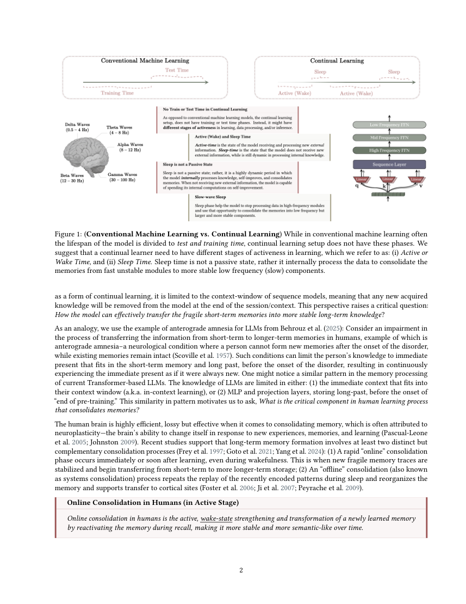
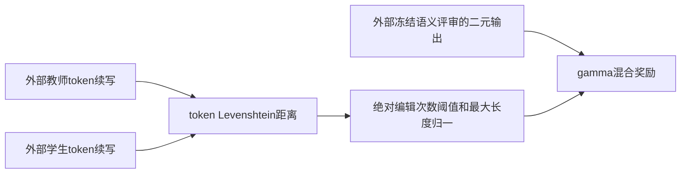

# Sleep：离线记忆巩固与 Learning to Imitate 奖励

> 本地仅实现 **LTI奖励的纯CPU L1组件**，没有CMS、扩容、梦境生成、语义评审模型或LLM训练。完整Sleep实验**成本过高，不复现（审查 DONE）**；不接入Evolve。

## 论文信息

| 字段 | 内容 |
| --- | --- |
| 论文链接 | [固定v2](https://arxiv.org/abs/2606.03979v2)、[全文](https://arxiv.org/html/2606.03979v2) |
| 原始标题 | Language Models Need Sleep: Learning to Self-Modify and Consolidate Memories |
| 公司 / 作者机构 | 一作Ali Behrouz：Google Research；合作Cornell University；作者块以logo列单位，官网博客确认Google归属 |
| 原始发布日期 | arXiv v1：2026-06-02 17:56:55 UTC；固定v2：2026-07-10 17:52:03 UTC。论文声明2025年9月已有OpenReview版本，精确首次公开日未确认；不把arXiv日期冒充该更早首发 |
| 本轮触发 | [Google 2026-10-27官网介绍](https://research.google/blog/the-sleep-framework-a-new-way-for-llms-to-retain-knowledge-in-continual-learning/)，属于历史补漏而非10月新论文 |
| 原作者代码 | 本轮核对固定全文、摘要与官网博客未找到作者源码链接，明确记为未找到；不与另一篇Hilbert压缩HOPE仓库混淆 |
| 本地 adapter / 稳定键 | `sleep-lti`；`adapter: null` |
| 本地代码位置 | `src/auto_research/foundation_models/sleep_lti.py`；`tests/test_oct29_root_components.py` |
| 本地证据 | [CPU三种子机制指标](metrics/component-cpu-seeds42-44.json)，纯CPU路径不需要GPU回执 |

## 原始论文总结

### 背景与主要改动

上下文结束会丢失短期知识，直接更新基础权重又可能覆盖旧知识。Sleep在活跃学习之外增加离线巩固：多频率记忆模块间先计算未来基础更新但不应用，再扩展低秩专家、用更新前教师巩固到拟更新学生，最后应用更新并清理发送层专家。

知识播种结合教师数据和学生自生成前缀上的蒸馏；LTI再让学生补全教师梦境，以冻结语义评审和阈值化token编辑相似度提供奖励。本地只实现后一个**奖励公式**，不能因为奖励可计算，就声称自修改、抗遗忘或知识巩固已完成。

<!-- paper-figure:start -->
### 原论文关键图



整页原始PDF截图，未重绘，来源与页码见 `assets/provenance.json`；论文CC BY 4.0，版权归原作者。
<!-- paper-figure:end -->



### 核心公式

Eqs.3–4中 $z$ 是token序列Levenshtein距离，阈值 $z_0$ 是**绝对编辑次数**，不是距离比例：

$$
r_{abs}=\begin{cases}1-z(\hat d,d)/\max(|\hat d|,|d|),&z\le z_0\\0,&z>z_0,\end{cases}\qquad
r=\gamma r_{sem}+(1-\gamma)r_{abs}.
$$

语义奖励来自外部冻结模型的0/1判断，不能用字面相似度伪造。编辑距离超阈值仅清零字面分支，不清零语义分支。原文没有定义双空序列分母边界，本地要求非空token续写，避免擅自补算法。

### 论文离线与线上效果

作者在知识更新、BABILong长上下文及ARC等任务分析巩固效果，完整实验包含3B/8B模型及最高10M上下文。未报告搜广推生产线上A/B；本文不是工业部署收益论文。本地不复算或继承其能力指标。

## 本地复现与边界

```bash
PYTHONPATH=src python -c 'from auto_research.foundation_models.sleep_lti import diagnostic; print(diagnostic(42))'
```

用已分词整数序列检查插入、删除、替换、阈值包含等号、按最大长度归一，以及语义分支独立性。42/43/44是合成机制种子，不是LLM模型比较。语义标签只在奖励侧输入，不参与被评测Agent的行动生成。

### 高成本完整实验

完整方法需要Hope/CMS多频率权重、参数扩展、梦境采样、知识播种、逐梦境LoRA训练和筛选，以及多任务长上下文评测。单卡A100/A30或Mac无法把此链路当成本轮便宜组件验证；无总GPU小时数据则不编造。**成本过高，不复现（审查 DONE）**，不下载模型、不启动试训、不自动重试。
