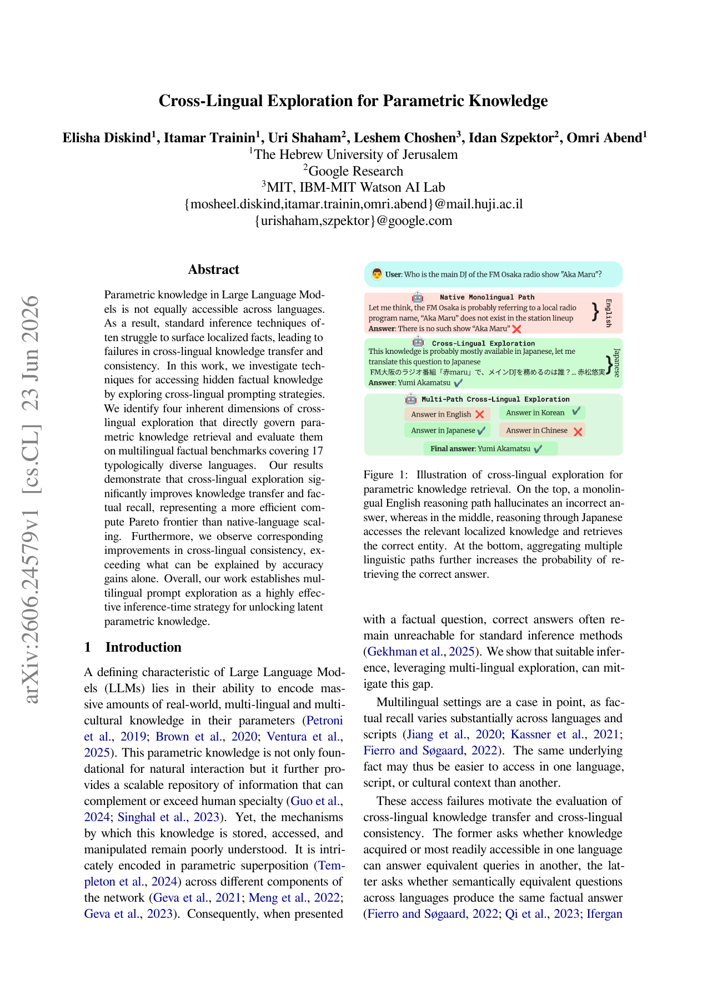

<!-- source-sha256: c64a84b3e9130ed3f7ab81496488749d6e1cae274215491ec33806d0679044e9 -->

[简体中文](README.md) · English

# Cross-Lingual Exploration for Parametric Knowledge

Treat reasoning language as a search dimension. Combine fixed or autonomous language selection, single-path, multi-path, or sequential exploration, and majority or minority-aware aggregation. Compare with repeated sampling in the original language at the same total token budget.

> **Literature and cost record only.** No executable capability adapter or heuristic substitute for the defining model. The full experiment is **too costly; not reproduced (review DONE)**, with no weight/data downloads or automatic retries. This is a user-identified historical conference omission, not a new publication today.

## Paper information

| Field | Details |
|---|---|
| Paper | [Original arXiv v1](https://arxiv.org/abs/2606.24579v1) |
| Pinned method version | [v1 full text](https://arxiv.org/pdf/2606.24579v1); the original release date follows v1, not an update |
| Institution | First author Elisha Diskind: The Hebrew University of Jerusalem. Uri Shaham and Idan Szpektor list Google Research; Leshem Choshen lists MIT / IBM-MIT Watson AI Lab. |
| First public release | **2026-06-23 13:42:40 UTC**, arXiv v1 |
| Author code | No author code link found in the pinned v1 PDF or abstract. The authors' personal pages link the paper and model/paper indexes, not author source. |
| Author code license | No verified author repository, so source license and pinned SHA are not applicable. Paper and figure license: CC BY 4.0. |
| Local adapter or method key | `cross-lingual-exploration`; `adapter=null`; `promotion_eligible=false`; `evolve_integrated=false` |
| Local reproduction code | None. The full method is not implemented; no fake capability entry point. |
| Local verification | Not applicable: review and documentation only; no training, GPU receipts, or invented metrics. |

## Original paper summary

### Background and main changes

Sections 3.1–4.4 and Appendices C/E keep the prompt in the original question language. Majority and minority-aware aggregation use language-model prompting, not simple string counts. Gemini judges semantic correctness and cross-language consistency. A counter or string translator would break the defining mechanism, so no heuristic component is invented.

<!-- paper-figure:start -->
### Key figure from the paper

Figure 1 from its original page in the pinned v1 PDF, including the original table/figure and context. From the [paper](https://arxiv.org/pdf/2606.24579v1), copyright the authors, CC BY 4.0. See `assets/provenance.json` for source, SHA256, and visual verification.
<!-- paper-figure:end -->

### Core equations

$$
S(q,L_q)=\mathcal A(\{\mathcal T_{L_e}(q):L_e\in\mathcal L_e\}),\qquad Budget=\sum_{paths}(tokens_{in}+tokens_{out})+tokens_{aggregation}.
$$

The formula explains the original method, not implemented training or a large-model semantic module.

### Offline and online results

The paper reports better recall and consistency from multilingual paths, but aggregation remains a bottleneck. The relative performance of majority and minority-aware approaches varies by dataset, and aggregation tokens must count toward the budget. No local knowledge recall or consistency gain is established. No production internet A/B is reported; offline analysis and local numerical tests are not online gains.

## Local reproduction

This batch provides no runnable model, loss wrapper, or fake test. Generic KL, RL, and statistics tools in the repository do not constitute the defining workflow. Handwritten rules cannot replace semantic models, multi-turn API generation, or large-scale training. Only the verified method, resources, source status, and original figure are recorded. Terminal status is `not_reproduced_high_cost`; do not automatically move it back into the training queue.

### High-cost full experiment

Section 4 and Appendix C cover about 2K CLIKE entities, 18K multilingual queries, and roughly 234K multi-path explorations. ECLeKTic and CLIKE span 17 languages. Six frontier models include Qwen3-235B, Gemini, GPT, and Grok, used through batch APIs. The full multi-model inference, LLM aggregation, and judging pipeline exceeds the budget and is not run.

The resource baseline is one A100/A30 or a local Mac. These are paper configurations and public reports, not measured local runtimes. Undisclosed GPU models or training hours are not invented. **Full experiment too costly; not reproduced (review DONE).** No large weights are downloaded or long trial launched just to demonstrate expense.
