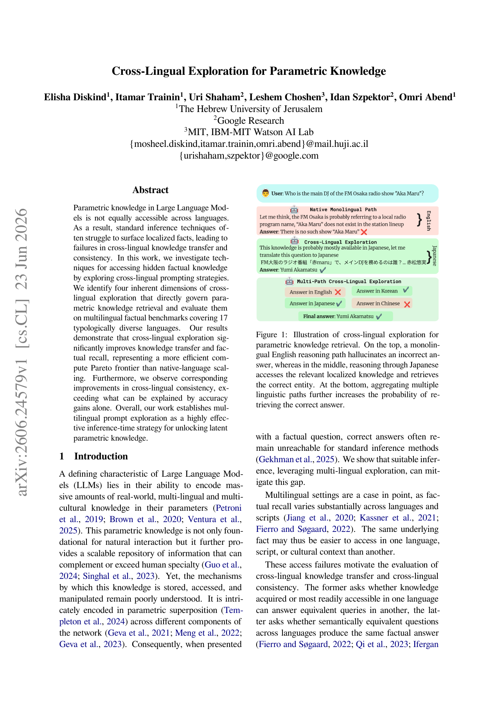

# Cross-Lingual Exploration for Parametric Knowledge

把推理语言视为搜索维度，组合固定/自主语言选择、单路/多路/顺序探索、majority或minority-aware聚合，并以总token预算对照原语言多次采样。

> 状态：**仅文献与成本收录**，没有可执行能力adapter，不以heuristic冒充核心模型。完整实验：**成本过高，不复现（审查 DONE）**，不下载权重/数据、不自动重试。此为用户指定的历史会议补漏，不是本日新发表。

## 论文信息

| 字段 | 内容 |
|---|---|
| 论文链接 | [原始 arXiv v1](https://arxiv.org/abs/2606.24579v1) |
| 固定方法版本 | [v1正文](https://arxiv.org/pdf/2606.24579v1)；原始发布日期仍按v1，不把更新版日期当首发 |
| 公司 / 作者机构 | 一作Elisha Diskind为The Hebrew University of Jerusalem；Uri Shaham与Idan Szpektor列Google Research；Leshem Choshen列MIT/IBM-MIT Watson AI Lab。 |
| 原始发布日期 | **2026-06-23 13:42:40 UTC**，arXiv v1 |
| 原作者代码 | 固定v1 PDF/摘要未找到作者源码链接；作者个人页面只链接论文与模型/论文索引，不当作作者代码。 |
| 原作者代码许可 | 未核实作者源码仓库，源码许可与固定SHA不适用。论文/原图许可：CC BY 4.0 |
| 本地 Adapter / key | `cross-lingual-exploration`；`adapter=null`；`promotion_eligible=false`；`evolve_integrated=false` |
| 本地代码 | 无：未实现完整方法，不发布伪能力入口 |
| 本地验证 | 不适用：只审查和文档，不训练、不生成GPU收据或虚构metrics |

## 原始论文总结

### 背景与主要改动

Sec.3.1–4.4与Appendix C/E：完整提示保持原问题语言，majority/minority-aware实际使用语言模型提示聚合而非简单字符串计数，语义正确性和跨语言一致性也由Gemini判定。把counter或字符串翻译器当主模型会破坏核心；本轮不造heuristic组件。

<!-- paper-figure:start -->
### 原论文关键图

Figure 1取自固定v1的原始PDF对应页，包含原表/图及上下文。图片来自[原论文](https://arxiv.org/pdf/2606.24579v1)，版权归原作者所有。许可 CC BY 4.0。来源、SHA256与实际目视核验见 `assets/provenance.json`。
<!-- paper-figure:end -->

### 核心公式

$$
S(q,L_q)=\mathcal A(\{\mathcal T_{L_e}(q):L_e\in\mathcal L_e\}),\qquad Budget=\sum_{paths}(tokens_{in}+tokens_{out})+tokens_{aggregation}.
$$

上述公式仅解释原方法，不表示已经实现该训练或大模型语义模块。

### 论文离线与线上效果

原文报告多语路径改善recall与consistency，但aggregation仍是瓶颈，majority和minority-aware胜负随数据集而变；必须把聚合token计入预算。没有本地知识召回/一致性收益证据。 未报告互联网生产线上A/B；不得将离线分析或本地数值测试写成线上收益。

## 本地复现

本轮不提供可运行模型、loss包装或伪测试。库里已有通用KL/RL/统计工具并不构成本文核心流程；原文语义模型、API多轮生成或大规模训练不能用手工规则替换。仅保存经过核验的方法、资源、源码状态与原图，终态为 `not_reproduced_high_cost`。后续不得自动移回待训练队列。

### 高成本完整实验

Sec.4 / Appendix C：CLIKE约2K实体、18K多语query，multipath约234K探索路径；ECLeKTic与CLIKE共17语言，6种前沿模型含Qwen3-235B、Gemini、GPT、Grok，经BatchAPI。完整多模型推理与LLM聚合/判定超预算，不运行。

资源基准为单张A100/A30或本地Mac。上述为原论文配置/公开报告，不是本地实测耗时，也不推造未披露的GPU型号或训练小时。完整实验结论：**成本过高，不复现（审查 DONE）**。没有为了证明它昂贵而先下载大权重或启动长跑。
