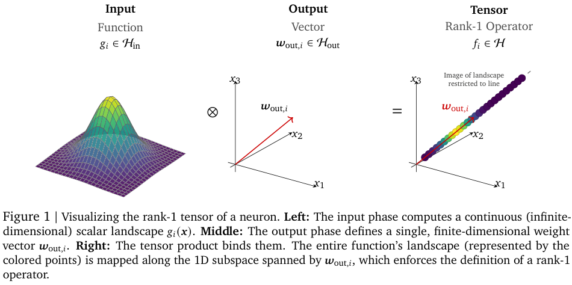
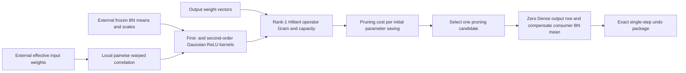

<!-- source-sha256: 3a7d72d893b7fee736a7c441fc3a02a4ef8a3a94e031520698ef89515e59bd56 -->

[简体中文](README.md) · English

# HOPE: Data-free pruning by treating neurons as Hilbert operators

> **CPU-only, exact L1 subcomponent; diagnostic only.** This is not the complete HOPE encoder, DEFT, or an ImageNet benchmark. The full experiment is **too costly and will not be reproduced (review DONE)** or retried automatically. This is not the identically named Hope network in Nested Learning / Sleep.

## Paper information

| Field | Details |
| --- | --- |
| Paper | [Hilbert Operator for Progressive Encoding (HOPE): A Mathematical Framework for Deconstructing Learned Representations in Deep Networks](https://arxiv.org/abs/2607.21366v1) |
| Institution | First author Hossein Mobahi: Google DeepMind. Peter L. Bartlett: Google DeepMind / UC Berkeley. |
| First public release | **2026-07-23 14:31:16 UTC**, arXiv v1. The official repository was newly released on 2026-10-27. This is a historical discovery triggered by code publication, not a first publication in October. |
| Author code | [google-deepmind/hope](https://github.com/google-deepmind/hope), pinned to `f3c4b251d0c9dae05fb165b9bc645a5a52955e62` |
| Author code license | Apache-2.0; other repository materials CC-BY-4.0. This is an independent implementation from the paper, not a copy of the upstream library. |
| Local adapter or method key | `hope-hilbert`; standalone subcomponent, `adapter=null`, `evolve_integrated=false` |
| Local reproduction code | `src/auto_research/foundation_models/hope_hilbert.py` |
| Local entry points | `relu_moments`, `relu_cross_kernel`, `operator_pair_gram`, `pruning_rates`, `prune_dense_neuron`, `restore_dense_neuron` |
| Results and contract | [Batch audit](../../research-audits/oct29-components/README.md); `tests/foundation_models/test_hope_hilbert.py` |

## Original paper summary

### Background and main changes

Input-weight magnitude alone can rank two functionally identical neurons differently just because their parameters were rescaled. HOPE writes a neuron as a rank-1 tensor of its activation function and output vector. Its action across all inputs better describes the functionality to preserve than its parameter coordinates alone.

The paper uses batch-normalization statistics to constrain a Gaussian surrogate, computes a functional ReLU kernel analytically, and compares PRUNE, MERGE, and residual-block EVICT at a common distortion scale. Each greedy decision divides distortion by the **parameter savings measured on the initial model** to avoid selection bias as adjacent layers shrink. The newer upstream implementation also provides reversible instruction sequences and DEFT transfer with a fixed core and plastic slack. Those full pipelines are not implemented locally.

<!-- paper-figure:start -->
### Key figure from the paper



Figure 1 and its complete caption from page 8 of the original PDF, visually checked and not redrawn. See the [original figure](https://arxiv.org/pdf/2607.21366v1#page=8) and `assets/provenance.json` for crop bounds and hash. Copyright belongs to the authors; the code license does not replace figure attribution.
<!-- paper-figure:end -->



### Core equations

Section 5 and Eq. 3 / Appendix E.2: $f_i=g_i\otimes w_{out,i}$, $Y_i\sim\mathcal N(\beta_i,\gamma_i^2)$; write $s_i=|\gamma_i|$ and $c_i=\beta_i/s_i$. Then

$$
m_i=s_i\phi(c_i)+\beta_i\Phi(c_i),\qquad
K_{ii}=(s_i^2+\beta_i^2)\Phi(c_i)+\beta_i s_i\phi(c_i).
$$

When $s_i=0$, use deterministic ReLU rather than dividing by zero. The local maximum-entropy correlation from Appendix E.3 is not the raw cosine of the effective input weights:

$$
\kappa={\rho_{eff}\over1-\rho_{eff}^2}
{s_i\over\|w_{in,i}^{eff}\|_2}{s_j\over\|w_{in,j}^{eff}\|_2},\qquad
\widehat\rho={2\kappa\over1+\sqrt{1+4\kappa^2}}.
$$

The local implementation uses the biased bivariate truncated Gaussian moment in Eq. 83. Its bivariate CDF uses deterministic one-dimensional quadrature, not Monte Carlo. The zero-bias approximation from Eq. 85 is not presented as the exact biased kernel. The Gram entry for two neurons is

$$
G_{ij}=K_{ij}\langle w_{out,i},w_{out,j}\rangle.
$$

There are two conventions. `centered=False` retains the paper's uncentered $K$. The default `centered=True` uses the newer open implementation's $C_{ij}=K_{ij}-m_im_j$, with capacity $\|w_{out,i}\|_2\sqrt{C_{ii}}$. Consumer BN compensation accounts for the mean contribution; it cannot silently be discarded. A local pairwise construction is not claimed to define a globally consistent covariance for arbitrary neuron sets.

Numerically, variance for a positive mean uses an equivalent Gaussian tail expression to avoid cancellation in $E[a^2]-E[a]^2$ at large $\beta$. Independent marginals have exactly zero covariance, and identical perfectly positively correlated marginals use the stable variance directly. For other extreme means, if float64 rounding error in $K-m_im_j$ exceeds a fixed tolerance, the interface rejects the input rather than silently zeroing, repairing positive semidefiniteness, or claiming that a neuron is dead. This limits numerical support without changing the paper's kernel.

Pruning and Dense consumer compensation in Eq. 6/23:

$$
J_{prune}(i)={N\|f_i\|\over E_a-\|f_i\|},\quad
i^*=\arg\min_i{J_{prune}(i)\over\Delta P_i^{init}},\qquad
\mu_b'=\mu_b-m_iw_{out,i}.
$$

If the denominator is exhausted, an infeasible action keeps infinite cost. No arbitrary epsilon makes removal of the last capacity-bearing neuron appear safe. Here $N$ is the number of live neurons supplied, while $\Delta P^{init}$ must come from the initial model's record.

### Offline and online results

Section 11 gives concept experiments for ResNet-50/ImageNet compression and cross-domain transfer, with no industrial search, ad, or recommendation A/B test. The newer open README reports 71.25% top-1 at original density and 66.92% at density 0.9010 using its fixed preprocessing and the first 10,144 ImageNet validation images. These are not local measurements and should not be directly compared against different preprocessing or the full validation split. The paper figure and the later source release are distinct experimental records.

## Local reproduction

### Implemented mechanisms and interfaces

- Exact first moments and self-kernels, biased pairwise kernels, pairwise warped correlation, and 2×2 operator Gram. The centered and uncentered conventions can be chosen explicitly.
- Selects pruning candidates by paper rate-distortion given external capacity and fixed initial parameter savings.
- Zeros one real Dense output row and compensates the consumer BN mean, returning an immutable undo package. Restoration requires an exact match with the post-pruning state and rejects stale packages. Inputs remain unchanged.

The local implementation does not perform MERGE, EVICT, parent neuron synthesis, the full encoding loop, 3×3 convolution padding compensation, or DEFT. Array shapes do not physically shrink; there is no claimed sparse hardware speedup. Callers provide statistics, effective weights, and the initial footprint. The component does not load checkpoints, calibration data, or ImageNet.

### Data protocol, results, and negative controls

```bash
pip install -e '.[research-components]'
PYTHONPATH=src python -m pytest tests/foundation_models/test_hope_hilbert.py
PYTHONPATH=src python -c 'from auto_research.foundation_models.hope_hilbert import diagnostic; print(diagnostic(42))'
```

Seeds 42/43/44 initialize only small matrices and a specified Gaussian surrogate. Independent conditional integration verifies cross moments, and the analytical arc-cosine kernel verifies the zero-bias limit. Tests cover positive and negative perfect correlation, deterministic boundaries, and Cauchy–Schwarz. They also check positive-scale gauge invariance, centered versus uncentered differences, the capacity-only selection negative control, static parameter savings, BN mean preservation, unchanged inputs, and exact undo.

These numerical contracts are L1 mechanism tests, not measurements of ImageNet accuracy, cross-domain forgetting, compression curves, or real model capability. The component is CPU-only and rejects CUDA input explicitly. CPU results are not GPU receipts or Evolve promotion evidence.

### Cost of the full experiment and scope

The pinned official README reports roughly 7–10 minutes to encode on a shared 64-core CPU. Its default evaluation scores 10,144 images every 10 encoding steps, 308 times in total, taking roughly 13–24 hours. There are also 7 compression baselines, a separate DEFT pre-search, and 20 transfer scenarios. Total GPU time was not disclosed, so there is no invented single-GPU estimate. This exceeds the project's low-cost budget on one A100/A30 or a local Mac: **full experiment too costly; not reproduced (review DONE)**. No model or ImageNet is downloaded, the full curriculum is not run, and the experiment is not retried automatically.
