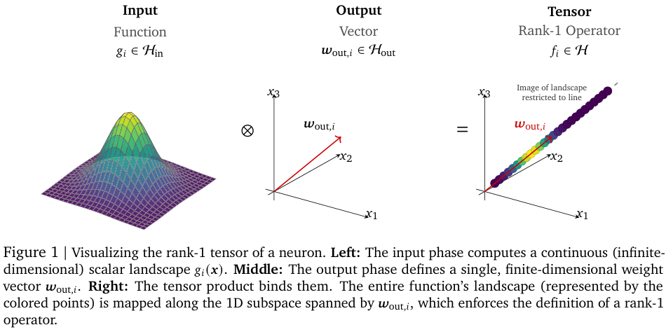
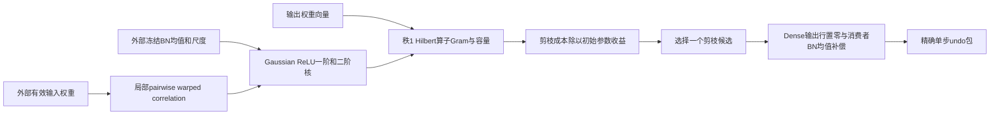

# HOPE：把神经元作为 Hilbert 算子进行数据无关剪枝

> 本地状态：**纯 CPU、L1 精确子组件，diagnostic only**。不是完整 HOPE 编码器、DEFT 或 ImageNet benchmark；完整实验为**成本过高，不复现（审查 DONE）**，不自动重试。它也不是 Nested Learning / Sleep 中同名的 Hope 网络。

## 论文信息

| 字段 | 内容 |
| --- | --- |
| 论文 | [Hilbert Operator for Progressive Encoding (HOPE): A Mathematical Framework for Deconstructing Learned Representations in Deep Networks](https://arxiv.org/abs/2607.21366v1) |
| 公司 / 作者机构 | 一作 Hossein Mobahi：Google DeepMind；Peter L. Bartlett：Google DeepMind / UC Berkeley |
| 原始发布日期 | **2026-07-23 14:31:16 UTC**，arXiv v1。官方仓库于2026-10-27新公开，本轮是源码触发的历史补漏，不是10月论文首发 |
| 原作者代码 | [google-deepmind/hope](https://github.com/google-deepmind/hope)，固定 `f3c4b251d0c9dae05fb165b9bc645a5a52955e62` |
| 原作者代码许可 | Apache-2.0；仓库中其它材料CC-BY-4.0。本地据论文独立实现，不复制上游库 |
| 本地 Adapter / key | `hope-hilbert`；独立子组件，`adapter=null`、`evolve_integrated=false` |
| 本地代码 | `src/auto_research/foundation_models/hope_hilbert.py` |
| 本地入口 | `relu_moments`、`relu_cross_kernel`、`operator_pair_gram`、`pruning_rates`、`prune_dense_neuron`、`restore_dense_neuron` |
| 结果与合同 | [本批审计](../../research-audits/oct29-components/README.md)；`tests/foundation_models/test_hope_hilbert.py` |

## 原始论文总结

### 背景与主要改动

单看输入权重大小，可能把“函数完全相同、只是参数重新缩放”的神经元排出不同重要性。HOPE把一个神经元写成激活函数与输出向量的秩1张量：它在所有输入上的作用方向，比参数坐标本身更接近需要保留的功能。

论文利用BN统计约束Gaussian surrogate，解析计算ReLU的功能核，并在同一失真尺度下比较PRUNE、MERGE和残差块EVICT。每次按失真除以**初始模型参数收益**做贪心选择，避免相邻层缩小后参数收益变化导致的选择偏差。上游新实现还提供可逆指令序列与DEFT的固定核心/可塑slack迁移流程；本地没有把这些完整流程冒充为已实现。

<!-- paper-figure:start -->
### 原论文关键图



来自原始PDF第8页Figure 1及完整图注，已目视核对、未经重绘。[原论文图源](https://arxiv.org/pdf/2607.21366v1#page=8)；裁剪范围与哈希见`assets/provenance.json`。版权归原作者所有，代码许可证不替代论文图片的来源说明。
<!-- paper-figure:end -->



### 核心公式

Section5与Eq.3 / AppendixE.2：$f_i=g_i\otimes w_{out,i}$，$Y_i\sim\mathcal N(\beta_i,\gamma_i^2)$；令$s_i=|\gamma_i|$、$c_i=\beta_i/s_i$，则

$$
m_i=s_i\phi(c_i)+\beta_i\Phi(c_i),\qquad
K_{ii}=(s_i^2+\beta_i^2)\Phi(c_i)+\beta_i s_i\phi(c_i).
$$

若$s_i=0$，直接使用确定性ReLU，不通过除零制造NaN。AppendixE.3的局部最大熵相关性不是有效输入权重的裸cosine：

$$
\kappa={\rho_{eff}\over1-\rho_{eff}^2}
{s_i\over\|w_{in,i}^{eff}\|_2}{s_j\over\|w_{in,j}^{eff}\|_2},\qquad
\widehat\rho={2\kappa\over1+\sqrt{1+4\kappa^2}}.
$$

本地用Eq.83的含偏置二元截断Gaussian矩；其中二元CDF用确定性一维求积计算，不采用随机蒙特卡洛，也不把Eq.85的零偏置近似说成精确含偏置核。两个神经元的Gram为

$$
G_{ij}=K_{ij}\langle w_{out,i},w_{out,j}\rangle.
$$

需区分两种口径：`centered=False`保留正文未中心化的$K$；默认`centered=True`明确改用新开源实现的$C_{ij}=K_{ij}-m_im_j$，容量为$\|w_{out,i}\|_2\sqrt{C_{ii}}$。均值作用由消费者BN补偿处理，不能静默丢弃，也不能把局部pairwise构造声称为任意多神经元的全局一致协方差。

数值上，正均值的方差用Gaussian尾部的等价式计算，避免大$\beta$时$E[a^2]-E[a]^2$消减成零；独立边际的协方差精确为零，相同边际完全正相关时直接用稳定方差。其他极端大均值若$K-m_im_j$的float64舍入误差已超过固定容差，接口明确拒绝，不静默置零、修补PSD或假称神经元死亡。这是数值支持边界，不是改变论文核。

Eq.6/23的剪枝子集与Dense消费者补偿：

$$
J_{prune}(i)={N\|f_i\|\over E_a-\|f_i\|},\quad
i^*=\arg\min_i{J_{prune}(i)\over\Delta P_i^{init}},\qquad
\mu_b'=\mu_b-m_iw_{out,i}.
$$

分母耗尽时保留不可行动作的无限代价；不加任意epsilon让最后一个有容量神经元看似可安全删除。这里的$N$是当前传入的live神经元数，$\Delta P^{init}$则必须由初始模型记录提供。

### 论文离线与线上效果

原文Section11展示ResNet-50/ImageNet压缩与跨域迁移的概念实验，未报告搜广推生产线上A/B。新开源README给出其固定预处理、前10,144张ImageNet验证图像的结果：原密度top1为71.25%，密度0.9010为66.92%；这些不是本地测量，也不应与不同预处理或完整验证集数字直接比较。论文图与较晚源码的实验细节需分别读取，不能把两者自动当同一轮结果。

## 本地复现

### 保留机制与接口

- 精确一阶/自核、含偏置pair核、pairwise warped correlation与2×2算子Gram；支持中心化和未中心化口径的显式切换。
- 给定外部容量和固定初始参数收益，执行论文剪枝候选的rate-distortion选择。
- 对Dense消费者执行一个真实输出行置零和BN均值补偿，返回不可变undo包；仅在精确匹配的剪枝后状态上恢复，拒绝过期包。所有输入保持不变。

本地不执行MERGE、EVICT、父神经元合成、完整编码循环、3×3卷积padding补偿或DEFT。数组shape没有物理缩减，不宣称稀疏硬件加速。调用者提供统计、有效权重和初始footprint；组件不会加载checkpoint、校准数据或访问ImageNet。

### 数据协议、结果与负控

```bash
pip install -e '.[research-components]'
PYTHONPATH=src python -m pytest tests/foundation_models/test_hope_hilbert.py
PYTHONPATH=src python -c 'from auto_research.foundation_models.hope_hilbert import diagnostic; print(diagnostic(42))'
```

三种子42/43/44只初始化小矩阵和明确的Gaussian surrogate。独立条件积分核对交叉矩，解析arc-cosine核验证零偏置极限；覆盖正负完美相关、确定性边界和Cauchy–Schwarz。另验证正尺度gauge不变、带/不带中心化的差异、只按容量挑选的负控、静态参数收益、BN均值守恒、输入不变和undo精确恢复。

这些数值合同属于L1机制验证；不测ImageNet准确率、跨域遗忘、压缩率曲线或真实模型能力。组件只支持CPU，传入CUDA会明确拒绝，不用CPU结果冒充GPU回执；不参与evolve晋级。

### 高成本完整实验与复现边界

固定官方README报告：共享64核CPU编码约7–10分钟；默认每10编码步评估10,144张图像，共308次，完整评估约13–24小时。还有7个压缩基线、DEFT独立预搜索和20迁移场景；GPU总耗时未公开，不编造其单卡耗时。与本项目单张A100/A30或本地Mac的低成本预算不匹配，因此**完整实验成本过高，不复现（审查 DONE）**，不下载模型/ImageNet，不运行完整curriculum，不自动重试。
