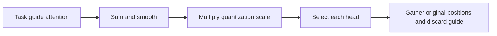
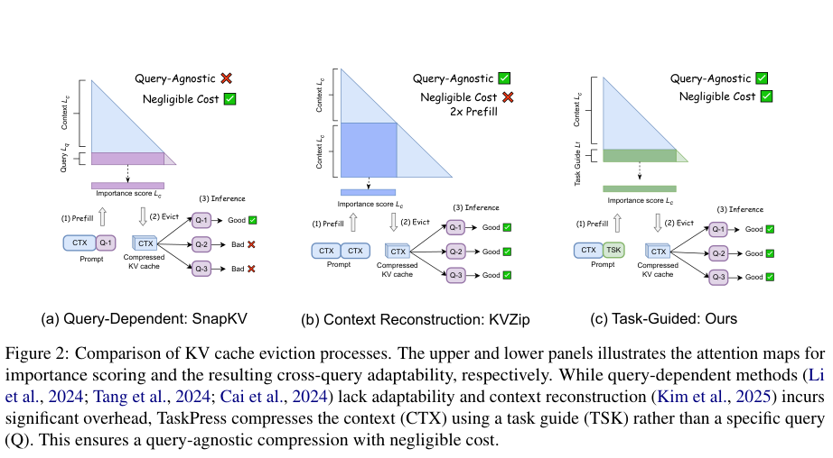

# TaskPress: Query-agnostic KV cache compression via task-guided pruning

<!-- source-sha256: cbf1f5c2031eb63b6581320db9a87ab3373b57ca4fa871e3f42ad12ee53c5af8 -->

[简体中文](README.md)

> **Standalone `component_only`; `adapter: null`.** Real small-tensor K/V and position gathering without an LLM or end-to-end speed claim. Full experiment too costly and not reproduced (review DONE); no retry queue. Google EMNLP historical backfill, not a new publication.

## Paper information

| Field | Details |
|---|---|
| Paper | [Original arXiv v1](https://arxiv.org/abs/2608.03276v1); [pinned v2 full text](https://arxiv.org/html/2608.03276v2) |
| Institution | First author Wonpyo Park: Google (pinned v2 byline) |
| First public release | 2026-08-04 07:51:37 UTC (arXiv v1) |
| Author code | The paper builds on kvpress but does not provide TaskPress-specific source or a verifiable license for it. Third-party kvpress code/license is not author method code. Paper: arXiv non-exclusive license. |
| Local adapter or method key | `taskpress` |
| Local reproduction code | `src/auto_research/foundation_models/taskpress.py` |

## Paper method and evidence

At prefill, sum task-guide attention to the context, smooth with an odd-width zero-padded average pool, then multiply by per-token quantized value scale. Each KV head independently keeps its top-k within the same budget. Gather original K/V in chronological order, preserve original position IDs and discard guide K/V. The input is task-to-context sliced attention, never the actual downstream query. Caller supplies actual guides and GQA query-head to KV-head aggregation. Lower-index tie-breaking is a local convention. The method/resources follow v2 Section 3 Eqs. 1–3; no assertion of line-by-line identity to v1.



<!-- paper-figure:start -->
### Original paper figure

[](https://arxiv.org/pdf/2608.03276v2#page=2)

Original Figure 2, pinned v2 page 2; no redrawing. [Crop, source and SHA-256](assets/provenance.json). From the [original paper](https://arxiv.org/html/2608.03276v2); copyright remains with the authors.
<!-- paper-figure:end -->

### Core equation

$$
s_i^{key}=\frac1K\sum_{k=-\lfloor K/2\rfloor}^{\lfloor K/2\rfloor}\sum_{j=1}^{L_t}A_{j,i+k},
\quad \gamma_i=\frac{\max|v_i|}{2^{b-1}-1},\quad s_i=s_i^{key}\gamma_i.
$$

Guide length is $L_t$ and sliced attention is $A\in\mathbb R^{L_t\times L_c}$. Boundary smoothing divides by a fixed odd $K$.

### Reported results

The authors evaluate real models/data, with no production A/B. Llama 3.1-8B and Qwen3-8B/32B, LongBench/RULER with 16K–64K contexts, methods and compression ratios make a broad matrix. The paper reports about 25.2 minutes on one A100 40GB for guide evolution plus Gemini calls; this is not local timing or a full-campaign cost estimate.

## Local reproduction

`taskpress_scores` consumes sliced attention and explicit value scales; `symmetric_value_scale` is a floating-point reference, not an int4 kernel. `prune_taskpress` really gathers K/V/positions, but no production Transformer cache integration or natural-language guide evolution is provided. CPU diagnostics use generated inputs and negative controls; CUDA requires real A100/A30, fails rather than falling back, and acceptance depends on frozen-source three-seed artifacts and a receipt. Operator agreement is not model capability, accuracy, writing quality or Evolve promotion. `diagnostic_only=true`, `promotion_eligible=false`, `evolve_integrated=false`. The full model and timing matrix was not launched.

```bash
PYTHONPATH=src python -c 'from auto_research.foundation_models.taskpress import diagnostic; print(diagnostic(42))'
python -m pytest tests/test_google_emnlp25_foundation.py
```
