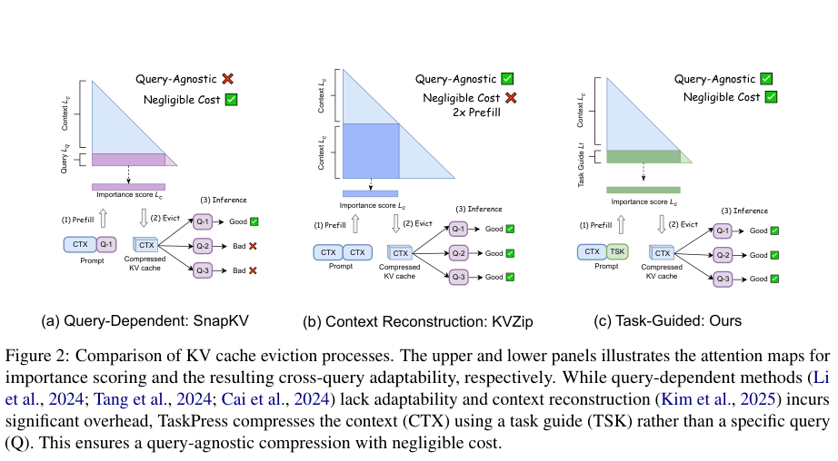

# TaskPress: Query-Agnostic KV Cache Compression via Task-Guided Pruning

prefill时用task guide对context的注意力求和并局部均值池化，与每token量化value scale相乘，在各KV head独立top-k保留context；task guide随后丢弃。本地实际收集小K/V张量及原position IDs，不加载LLM或声称端到端速度收益。

## 论文信息

| 字段 | 内容 |
| --- | --- |
| 论文链接 | [arXiv 2608.03276 v1](https://arxiv.org/abs/2608.03276v1)；[固定核对版本 v2](https://arxiv.org/html/2608.03276v2) |
| 公司 / 机构 / 学校 | 一作 Wonpyo Park：Google。固定v2作者栏一作Wonpyo Park署名Google。 |
| 首次公开日期 | 2026-08-04 07:51:37 UTC（arXiv v1） |
| 本轮版本 | 本轮方法/资源按固定v2核对，规范身份与首发时间仍为v1；未逐行声称v2与v1相同。 |
| 原作者代码 | 正文只说明构建在kvpress之上；未提供TaskPress专属仓库，不把第三方kvpress仓库或许可证当作者方法开源；未找到TaskPress专属方法源码或可核验源码许可证；论文arXiv non-exclusive license |
| 本地 adapter / 稳定键 | `taskpress`；`adapter: null`；`component_only` |
| 本地复现代码目录 | `src/auto_research/foundation_models/taskpress.py` |
| 完整实验 | **成本过高，不复现（审查 DONE）**，不进入自动重试或实现队列 |

## 原始论文总结

### 背景与主要改动

固定v2 Section3 Eqs1–3：sum over guide→odd-K零padding平均池化；γ=max|v|/(2^(b−1)−1)，scores=keyimportance×γ，各head同budget独立topk。输入显式是task-to-context sliced attention，不看真实下游query；真实K/V按时间排序gather，guideKV不保留，原position不能重编号。K/GQA聚合由调用方显式给出，tie按低index为本地约定。


<!-- paper-figure:start -->
### 原论文关键图

[](https://arxiv.org/pdf/2608.03276v2#page=2)

**Figure 2**，固定v2第2页。图片来自[原论文](https://arxiv.org/html/2608.03276v2)，版权归原作者所有；保留原图科学内容与标注，未重绘。[来源、裁切与SHA256](assets/provenance.json)。
<!-- paper-figure:end -->

### 核心公式

task guide长度为 $L_t$，只读其对context的注意力 $A\in\mathbb R^{L_t\times L_c}$：
$$
s_i^{key}=\frac1K\sum_{k=-\lfloor K/2\rfloor}^{\lfloor K/2\rfloor}\sum_{j=1}^{L_t}A_{j,i+k},
\quad \gamma_i=\frac{\max|v_i|}{2^{b-1}-1},\quad s_i=s_i^{key}\gamma_i.
$$
本组件要求显式奇数 $K$；边缘零padding且除以固定 $K$。各KV head独立同预算top-k，实际gather context K/V，guide对应缓存丢弃，原position ID保留。相同scores时低index优先是本地可复现约定，不宣称作者指定tie-break。GQA query-head到KV-head聚合与真实task guide生成由调用方明确提供。

### 论文离线与线上效果

原文结论来自其真实模型、数据与协议；本页未运行完整矩阵，不将原文指标抄成“本地实测”。未报告生产线上 A/B。

## 本地复现

taskpress_scores消费task-to-context attention与既有per-token value_scale；symmetric_value_scale是显式浮点数值参考，不是假装已运行int4 kernel。prune_taskpress确实收集K/V和原positions，但不接入任何具体Transformer cache类，也不做自然语言guide演化。

```bash
PYTHONPATH=src python -c 'from auto_research.foundation_models.taskpress import diagnostic; print(diagnostic(42))'
python -m pytest tests/test_google_emnlp25_foundation.py
```

`diagnostic(seed, device='cpu')`只执行生成数据上的独立公式/负控。CUDA路径必须由真实A100/A30执行，CUDA不可用时失败、不回退CPU；本轮验收以提交的冻结源码三种子原始结果和GPU收据为准。 指标是算子误差、梯度/参数更新或scorer对照，不是正式模型accuracy、写作质量、跨语言能力或Evolve晋级证据。

## 复现边界

Llama3.1-8B/Qwen3-8B/32B，LongBench/RULER16K至64K上下文多压缩比例/方法矩阵；guide演化单A10040GB原文约25.2min加Gemini调用，完整多任务矩阵更大。只做算子，不跑全量加载/演化、无速度计时复现。

**成本过高，不复现（审查 DONE）**。以上为论文配置/资源判断，未为了测成本而启动完整试跑。本地小张量或CPU协议通过不等于完整方法/数据管线或benchmark已接入；`diagnostic_only=true`、`promotion_eligible=false`、`evolve_integrated=false`。

本轮来自Google EMNLP官方会议页的历史线索补漏，不是今天新首发，也不单凭会议页就认定作者具有Google署名；机构证据在信息块逐条注明。
