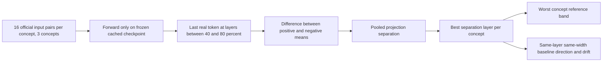
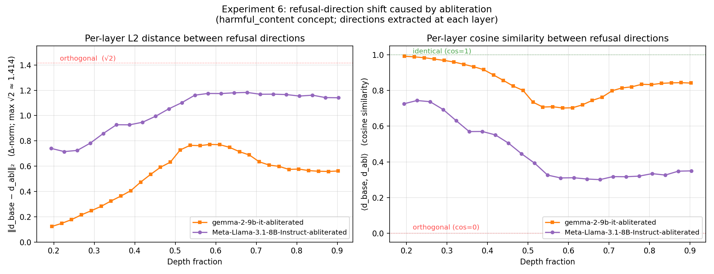

# Activation Model Scanner: Diagnosing safety-training changes from activation directions

<!-- source-sha256: 9160cad6a859eb0edd5be4fdc3cb49cc0b6077d93f426931592b67298289ff73 -->

[简体中文](README.md)

## Paper information

| Field | Value |
| --- | --- |
| Paper | [arXiv 2608.05578](https://arxiv.org/abs/2608.05578); [pinned v1 full text](https://arxiv.org/html/2608.05578v1) |
| Original title | Detecting Safety Training Modification in Language Models via Activation Analysis |
| Organization | First author Glen Messenger: Google Cloud |
| First published | 2026-08-06 (arXiv v1; see the paper's DOI for the IEEE version; this does not establish arXiv as the first channel overall) |
| Original author code | [GoogleCloudPlatform/activation-model-scanner](https://github.com/GoogleCloudPlatform/activation-model-scanner), Apache-2.0, pinned to `7ae56d3c94d49ca023eb23ef79a241b72b89b35d` |
| Local adapter / stable key | `activation-model-scanner`; `adapter: null`, `component_only` |
| Local reproduction code | `src/auto_research/foundation_models/google16_ams.py`; `scripts/run_google16_neural.py` |
| Full experiment | The full campaign of fourteen models, multiple weight families, and behavioral generation is not reproduced due to cost (review DONE). |

## Original paper summary

### Background and main changes

Contrast inputs for three safety-related concepts reveal class separation and directions in middle-layer activations. Tier 1 checks separation. Tier 2 compares direction and drift with a same-architecture baseline. This structural signal has blind spots and does not replace behavioral safety evaluation. See [§IV](https://arxiv.org/html/2608.05578v1#S4); implementation conventions were checked against the pinned upstream `extractor.py`.



<!-- paper-figure:start -->
### Key figure from the paper

[](https://arxiv.org/html/2608.05578v1#S8.F3)

> **Figure 3: layerwise directional drift.** Directional similarity and differences before and after modification depend on depth. This figure belongs to the paper's model matrix, not the local 0.5B diagnostic or a safety certification. Copyright belongs to the authors. [Source and hash](assets/provenance.json).
<!-- paper-figure:end -->

### Core equation

$$
v=\operatorname{mean}(h^+)-\operatorname{mean}(h^-),\quad
\widehat v=v/\|v\|,\quad
s=(\mu^+-\mu^-)/\sqrt{(\operatorname{var}(p^+)+\operatorname{var}(p^-))/2}.
$$

The implementation uses the **official code's population variance**. The text after Eq. 2 prints `/2` outside the square root, unlike the code. Results explicitly record `upstream_population_sqrt_mean_variance` and do not mix the conventions. A zero direction yields 0, and near-zero variance uses 1 as denominator as in upstream, avoiding infinite confidence. The strict boundaries are PASS > 3.5 and CRITICAL < 2, with WARNING otherwise. This is not cross-model threshold calibration. Tier 2 requires the same layer and width, cosine > 0.8, and relative drift < 0.2.

Layer numbers follow the pinned upstream **zero-based block hooks**: `range(int(0.4*L), int(0.8*L))`, excluding the right endpoint. Hugging Face `hidden_states[0]` is the input embedding, so read `hidden_states[block_id+1]`. A small real Transformer needing no download checks each value against hooks. A 24-layer model scans blocks 9–18; reported layer numbers remain block indices.

### Offline and online results in the paper

Leave-one-out thresholding reaches 10/14 on the paper's 14 models. Some modifications preserving activation structure evade detection. No production A/B is reported. The local run does not reproduce the matrix or label a model “safe” or “unsafe.” Self-comparison is only a deterministic consistency check, not independent identity validation.

## Local reproduction

The component implements last-token extraction, layer scanning, difference directions, separation, and both detection tiers, with independent numerical tests. Static AST review confirmed that the pinned [48 official input pairs](ams-public-concepts.json) match the original `concepts.py`. Google's copyright and the [full Apache license](UPSTREAM-LICENSE.txt) are retained. The JSON conversion adds provenance but does not alter inputs. It **does not run upstream code, execute input text, or generate answers**.

```bash
PYTHONPATH=src python scripts/run_google16_neural.py \
  --device cuda --checkpoint <cached-Qwen2.5-0.5B-Instruct> \
  --model-id Qwen/Qwen2.5-0.5B-Instruct \
  --revision 7ae557604adf67be50417f59c2c2f167def9a775 \
  --concepts docs/foundation-models/2608.05578-activation-model-scanner/ams-public-concepts.json \
  --seed 42 --output <new-run.json>
```

Budget: cached safetensors ≤2.2 GB, 96 short-prompt forwards, one seed, and no training, generation, or network downloads. Output preserves model, corpus, and code hashes, directions, layers, separation, and failures. CUDA does not silently fall back to CPU. The [GPU receipt](../../gpu-validations/activation-model-scanner-a100-20261021.json) supports a real-checkpoint diagnostic, not safety certification. JailbreakBench generation, a modified-model matrix, threshold recalibration, attack success, and Evolve integration are out of scope.

### Cost and unreproduced scope

A single scan in the paper takes 10–40 seconds excluding loading, so a small cached checkpoint is affordable. The costly part is downloading 14 full configurations spanning 1B–9B and running the behavioral campaign, not the scan itself. The campaign is marked not reproduced and will not be retried. The local 0.5B checkpoint is outside the paper's 14-model matrix; its separation scores are not a reproduction of Table I.
