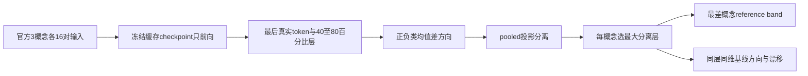
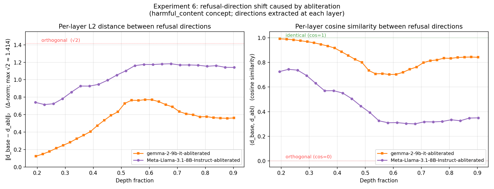

# AMS：以激活方向检查安全训练修改的诊断组件

## 论文信息

| 字段 | 内容 |
| --- | --- |
| 论文链接 | [arXiv 2608.05578](https://arxiv.org/abs/2608.05578)；[固定 v1 全文](https://arxiv.org/html/2608.05578v1) |
| 原文标题 | Detecting Safety Training Modification in Language Models via Activation Analysis |
| 公司 / 机构 | 一作 Glen Messenger：Google Cloud |
| 首次公开日期 | 2026-08-06（arXiv v1；IEEE版本另见原文DOI，不声称arXiv为所有渠道最早时间） |
| 原作者代码 | 已开源 [GoogleCloudPlatform/activation-model-scanner](https://github.com/GoogleCloudPlatform/activation-model-scanner)，Apache-2.0；本轮固定 `7ae56d3c94d49ca023eb23ef79a241b72b89b35d` |
| 本地 adapter / 稳定键 | `activation-model-scanner`；`adapter: null`，`component_only` |
| 本地复现代码目录 | `src/auto_research/foundation_models/google16_ams.py`；`scripts/run_google16_neural.py` |
| 完整实验 | 十四模型、多权重族及行为生成的完整campaign成本过高，不复现（审查 DONE） |

## 原始论文总结

### 背景与主要改动

通过三个安全相关概念的对照输入，寻找中层激活的类别分离与方向；第一层检查分离程度，第二层与同架构基线比较方向和漂移。该结构信号存在明确盲区，不能替代行为安全评测。核心见[§IV](https://arxiv.org/html/2608.05578v1#S4)，代码约定核对固定上游 `extractor.py`。



<!-- paper-figure:start -->
### 原论文关键图

[](https://arxiv.org/html/2608.05578v1#S8.F3)

> **Figure 3，逐层方向漂移结果**：展示修改前后方向相似度与差异为何依赖深度。它是原文的模型矩阵结果，不是本地0.5B诊断测量，也不是安全认证。版权归原作者；[来源与hash](assets/provenance.json)。
<!-- paper-figure:end -->

### 核心公式

$$
v=\operatorname{mean}(h^+)-\operatorname{mean}(h^-),\quad
\widehat v=v/\|v\|,\quad
s=(\mu^+-\mu^-)/\sqrt{(\operatorname{var}(p^+)+\operatorname{var}(p^-))/2}.
$$

实现采用**官方代码的 population variance**。原文 Eq.2 后文字把 `/2` 印在根号外，与代码不同；结果明确记录 `upstream_population_sqrt_mean_variance`，不混算。零方向返回0，近零方差按上游使用1作分母，不制造无穷置信度。论文严格边界为 PASS>3.5、CRITICAL<2，其余WARNING；本地遵此边界，不声称跨模型阈值已校准。Tier2必须同层同维，要求cosine>0.8、相对漂移<0.2。

层编号严格对应固定上游的**零起始 block hooks**：`range(int(0.4*L), int(0.8*L))`，右端不包含。HuggingFace `hidden_states[0]`是输入embedding，因此实际读取`hidden_states[block_id+1]`，不能把两个编号混用。测试用无下载的小型真实Transformer hook逐项对照，24层模型扫描block9–18；输出层号仍为block编号。

### 论文离线与线上效果

原文14模型的阈值留一法为10/14，且有保留激活结构的修改逃过检测；未报告生产线上A/B。本地不复现14模型结果，也不输出“模型安全/不安全”的业务判断。自比较通过仅说明确定性一致，不是独立模型身份验证。

## 本地复现

实现最后token提取、层扫描、差分方向、分离度、两层检测及独立数值测试。固定[官方48对输入](ams-public-concepts.json)经静态AST核对，与原始 `concepts.py` 全部相同；保留Google版权及[Apache许可全文](UPSTREAM-LICENSE.txt)，JSON转换新增来源说明但未修改输入对文字，**不执行上游代码、不执行输入文字、不生成任何回答**。

```bash
PYTHONPATH=src python scripts/run_google16_neural.py \
  --device cuda --checkpoint <cached-Qwen2.5-0.5B-Instruct> \
  --model-id Qwen/Qwen2.5-0.5B-Instruct \
  --revision 7ae557604adf67be50417f59c2c2f167def9a775 \
  --concepts docs/foundation-models/2608.05578-activation-model-scanner/ams-public-concepts.json \
  --seed 42 --output <new-run.json>
```

预算：仅已缓存safetensors≤2.2GB，96次短prompt前向、单seed、无训练/生成/网络下载。输出保留模型/语料/源码hash与全部方向、层、分离度及失败；CUDA不静默回退CPU。[GPU回执](../../gpu-validations/activation-model-scanner-a100-20261021.json)只支持真实checkpoint诊断，不是安全能力认证。未跑JailbreakBench生成、篡改模型矩阵、阈值重新标定或攻击成功率，不接入Evolve。

### 成本与未复现范围

原文单次扫描10–40秒（不含加载），所以单缓存小模型组件可负担；高成本的是跨1B–9B、14种配置的全权重下载和行为campaign，不把扫描本身错误归为高成本。完整campaign标注不复现并终止重试；本地0.5B不在论文14模型矩阵内，分离值不与表I作性能复现比较。
