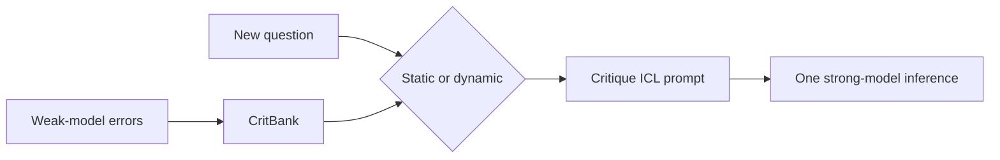
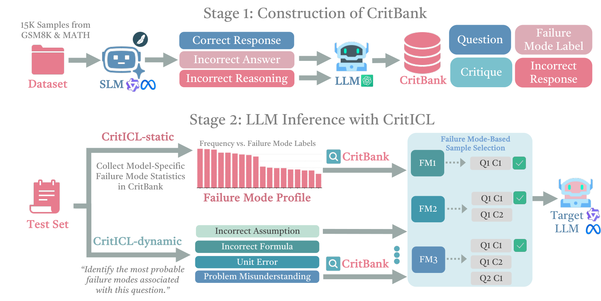

# CritICL: efficient inference prompts from weak-model failure modes

<!-- source-sha256: 896370d438ab92a70a84d972de63e97ca19ff6924c422988c3f7f42223624651 -->

[简体中文](README.md)

> **Model-agnostic core mechanism.** Implements CritBank, static/dynamic retrieval, and one-pass inference prompt construction without fabricated checkpoint results.

## Paper information

| Field | Details |
|---|---|
| Paper | [arXiv 2608.27455](https://arxiv.org/abs/2608.27455) |
| Organization | The Ohio State University, the first listed affiliation of the first author |
| First public release | 2026-08-27 (arXiv v1; COLM 2026) |
| Authors' code | The paper links [CRITICL](https://github.com/umwyf/CRITICL), but the repository was empty on 2026-08-31 and was not counted as a release. |
| Adapter / method | `criticl` |
| Local reproduction code | [`src/auto_research/foundation_methods.py`](https://github.com/daiwk/auto-research/blob/main/src/auto_research/foundation_methods.py) |

## Original paper

### Motivation and method

Weak-model errors cluster into failure modes that transfer across model sizes. CritICL builds a CritBank offline. Static retrieval uses globally common failures; dynamic retrieval selects critiques relevant to the current input. The strong model then generates an answer once.



<!-- paper-figure:start -->
### Key figure from the paper

[](https://arxiv.org/html/2608.27455v1/design.png)

> **Figure 1:** Overview of the paper's method and key components. From the [original paper](https://arxiv.org/abs/2608.27455); copyright remains with the authors.
<!-- paper-figure:end -->

### Core equations

$$
C_q=\operatorname{TopK}_{c\in CritBank}\operatorname{sim}(q,c),\qquad y\sim p_{strong}(\cdot\mid q,C_q).
$$

## Local reproduction and limits

Unit tests cover deterministic static/dynamic retrieval, deduplication of failure modes, and zero online weak-model calls. No large checkpoint was downloaded for this component diagnostic, so it publishes no accuracy. This is not a Micro-LLM architecture operator.

## Real-checkpoint GSM8K path

`auto-research criticl-eval` builds CritBank on GSM8K train only and compares zero-shot, CritICL-static, and CritICL-dynamic at equal budget on a subset of official test. Artifacts record weak/strong checkpoints and revisions, three seeds, and 95% confidence intervals.

```bash
auto-research criticl-eval --bank-examples 24 \
  --evaluation-examples 12 --seeds 42,43,44
```

Single-GPU acceptance defaults to public SmolLM2 to check the end-to-end path. Heuristic failure labels replace the frontier-LLM critic. On a small subset, a small checkpoint may score zero for all three methods. Artifacts state these limits rather than treating executable flow as a reproduction of gains. See the [sanitized CritICL A100 receipt](../../gpu-validations/criticl-checkpoint-a100-20260901.json).
