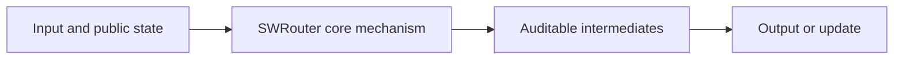
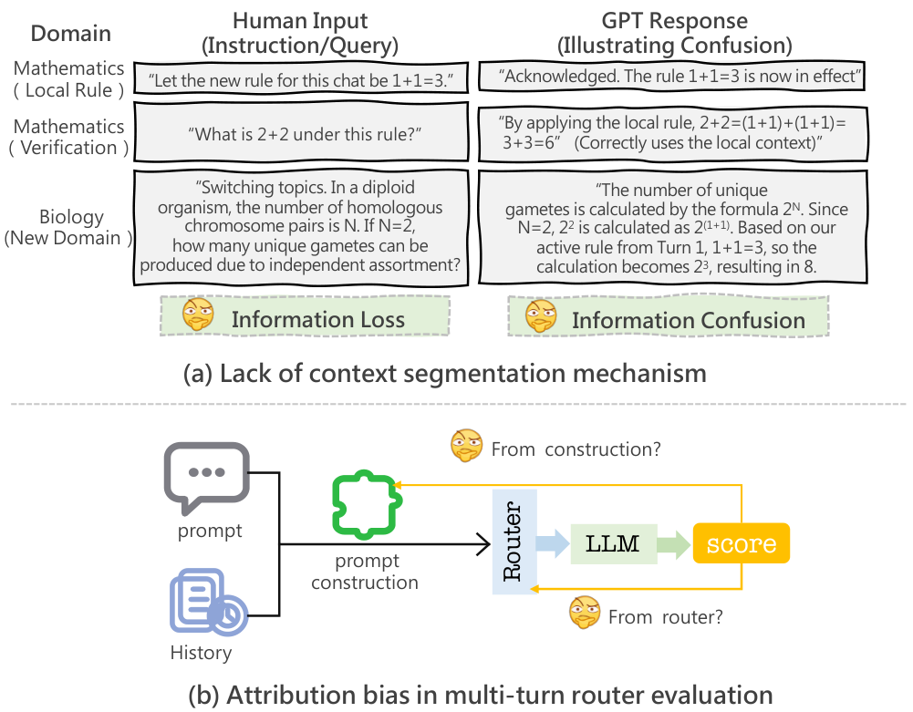

<!-- source-sha256: e12ef64f7a16cbe09e65e121e08a658d3a136415a3a125fe2fed4561f4d7d895 -->

[简体中文](README.md) · English

# SWRouter: Similarity-Contractive Window Routing for Multi-Turn Large Language Model Conversations

> **L1 core mechanism diagnostic.** Window segmentation and profile-overlap routing run. The paper's contrastive encoder is not trained locally.

## Paper information

| Field | Details |
|---|---|
| Paper | [SWRouter: Similarity-Contractive Window Routing for Multi-Turn Large Language Model Conversations](https://arxiv.org/abs/2609.11414) |
| Institution | Shanghai Jiao Tong University (first author affiliation) |
| First public release | 2026-09-10 |
| Original source code | No public author repository found on 2026-09-14. |
| Adapter/method | `swrouter` |
| Local reproduction code | [`src/auto_research/foundation_latest_20260914.py`](https://github.com/daiwk/auto-research/blob/main/src/auto_research/foundation_latest_20260914.py) |

## Original paper summary

### Background and main changes

Contract multi-turn windows by adjacent semantic similarity, then use a contrastive router to select a model. Evaluate context construction separately from routing correctness.

<!-- paper-figure:start -->
### Key figure from the paper

> **Figure 1:** Overall design and components. From the [paper](https://arxiv.org/abs/2609.11414); copyright belongs to the authors. Click for the source.
<!-- paper-figure:end -->

### Core operation

The local deterministic reference kernel runs the defining operations and exposes gates, selections, projections, graph edges or state-update statistics. Tests check formula invariants and boundaries.

### Offline and online results

The paper reports 16.26% over the best single model and another 8.22% over Conv-ID Context. These are not directly compared with scaled local results, and no online gains are inferred without reported A/B.

## Local reproduction

See [three-seed metrics](metrics/mechanism-seeds42-44.json). Candidates share public fixtures, budgets and seeds. The run establishes execution of core state transitions only.

### Scope

Window segmentation and profile-overlap routing execute. No paper contrastive encoder was trained.
