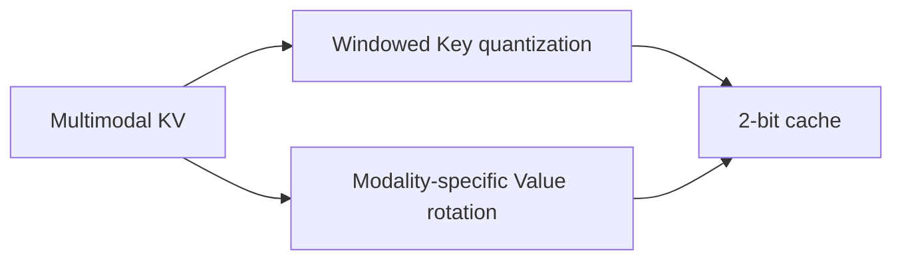
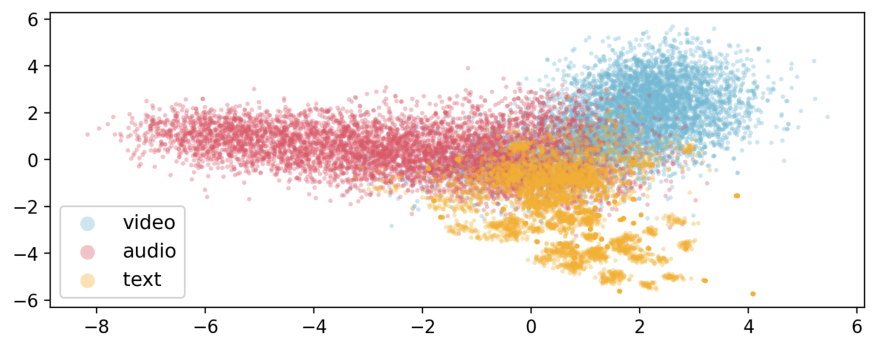

# OmniKVQuant: KV Cache Quantization for Omni-LLMs

<!-- source-sha256: 282e448cbc145db17f5786ef7f50bfb00e977fd6a476e3eec13ff211239bac3f -->

[简体中文](README.md)

> L1 NumPy 2-bit reference, not validated Triton.

## Paper information

| Field | Value |
| --- | --- |
| Paper | [OmniKVQuant: KV Cache Quantization for Omni-LLMs](https://arxiv.org/abs/2609.11582) |
| Affiliations | KAIST, first author's affiliation |
| First public release | 2026-09-10 |
| Authors' code | [OmniKVQuant](https://github.com/kaistmm/OmniKVQuant). |
| Adapter / method | `omnikvquant` |
| Local code | [`src/auto_research/foundation_latest_20260914.py`](https://github.com/daiwk/auto-research/blob/main/src/auto_research/foundation_latest_20260914.py) |

## Original paper

### Background and contribution

Short time windows determine Key quantization ranges; rotate Values separately by modality to handle temporal drift and heterogeneous geometry.

<!-- paper-figure:start -->
### Key figure from the paper

Original Figure 2: OmniKVQuant. From the [paper](https://arxiv.org/abs/2609.11582); copyright belongs to the authors. Not a local result.
<!-- paper-figure:end -->

### Core mechanism

The deterministic reference quantizes Keys by window, rotates Values by modality, and records audited projections and state. Tests check boundary conditions.

### Paper results

The paper's 2-bit Qwen2.5-Omni retains 98.1% of FP16 performance on seven audiovisual benchmarks. Not a local or inferred live result.

## Local reproduction

[Three-seed mechanism metrics](metrics/mechanism-seeds42-44.json) compare shared fixtures, budget, and seeds.

## Reproduction limits

NumPy validates operations and boundaries. A Triton claim requires A100/A30 validation.
