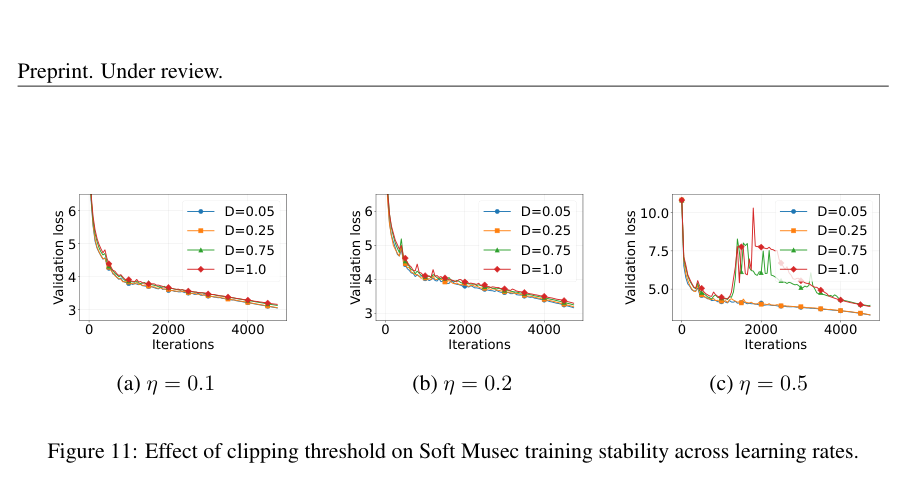

# Musec: MomentUm SpEctral Clipping for Stable Muon-type Training

<!-- source-sha256: 7477c546e71b7f4defe2757116f7646420cedda0fb1008d777bd43ce7b843395 -->

[简体中文](README.md)

> **L1 core-mechanism diagnostic.** Runs the full-SVD soft-clipping reference, not large-model training throughput.

## Paper information

| Field | Details |
|---|---|
| Paper | [Musec: MomentUm SpEctral Clipping for Stable Muon-type Training](https://arxiv.org/abs/2609.11655) |
| Organization | First-author affiliation: National University of Singapore |
| First public release | 2026-09-10 |
| Authors' code | No public author repository was found on 2026-09-14. |
| Adapter / method | `musec` |
| Local reproduction code | [`src/auto_research/foundation_latest_20260914.py`](https://github.com/daiwk/auto-research/blob/main/src/auto_research/foundation_latest_20260914.py) |

## Original paper

### Motivation and method

Smoothly clip singular values of the Muon momentum. This avoids the discontinuity of hard clipping while constraining large unstable directions.

<!-- paper-figure:start -->
### Key figure from the paper

> **Figure 11:** Training flow and key optimization steps. From the [original paper](https://arxiv.org/abs/2609.11655); copyright remains with the authors.
<!-- paper-figure:end -->

### Core computation or operation

The local code implements the decisive operation as a deterministic reference kernel and explicitly reports gate, selection, projection, graph-edge, or state-update statistics. Tests cover formula invariants and boundary conditions.

### Paper results

The paper reports improved stability across learning rates and model scales on FineWeb, OpenWebText, and C4. These are paper results, not directly comparable with the scaled-down local run. No online gains are inferred in the absence of an online A/B test.

## Local reproduction

See the [three-seed metrics](metrics/mechanism-seeds42-44.json). All candidates share the public fixtures, budget, and seeds. The results verify actual execution of core state transitions only.

### Reproduction boundaries

The full-SVD soft-clipping reference runs locally. Large-model training throughput was not reproduced.
