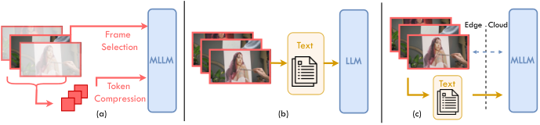

# Caption-once, Frames-on-Demand: Visual-Need Routing for Budget-Aware Agentic Long Video Understanding

<!-- source-sha256: f04bfbf87539f470b4e7c1e54846bc0a22dea142183c9e76a85a456c51680ec5 -->

[简体中文](README.md)

> **L1 core-mechanism diagnostic.** Executes a caption/query gate and top-k frame selection, not a long-video VLM.

## Paper information

| Field | Details |
|---|---|
| Paper | [Caption-once, Frames-on-Demand: Visual-Need Routing for Budget-Aware Agentic Long Video Understanding](https://arxiv.org/abs/2609.11899) |
| Organization | First-author affiliation: Queen Mary University of London |
| First public release | 2026-09-10 |
| Authors' code | No public author repository was found on 2026-09-14. |
| Adapter / method | `frames-on-demand` |
| Local reproduction code | [`src/auto_research/foundation_latest_20260914.py`](https://github.com/daiwk/auto-research/blob/main/src/auto_research/foundation_latest_20260914.py) |

## Original paper

### Motivation and method

Build caption memory once for each video. The visual-need router reads relevant frames within a fixed budget only when text evidence is insufficient.

<!-- paper-figure:start -->
### Key figure from the paper

> **Figure 1:** Overview of the paper's method and key components. From the [original paper](https://arxiv.org/abs/2609.11899); copyright remains with the authors.
<!-- paper-figure:end -->

### Core computation or operation

The local deterministic reference kernel implements the defining operation and reports gate, selection, projection, graph-edge, or state-update statistics. Tests cover formula invariants and boundaries.

### Paper results

The paper reduces visual frame use by roughly an order of magnitude while remaining competitive. This is not directly comparable to the scaled-down local run. No online gains are inferred without an online A/B test.

## Local reproduction

See the [three-seed metrics](metrics/mechanism-seeds42-44.json). All candidates share the public fixtures, budget, and seeds. These results verify actual execution of core state transitions only.

### Reproduction boundaries

The caption/query gate and top-k frame selection run locally. No long-video VLM was run.
