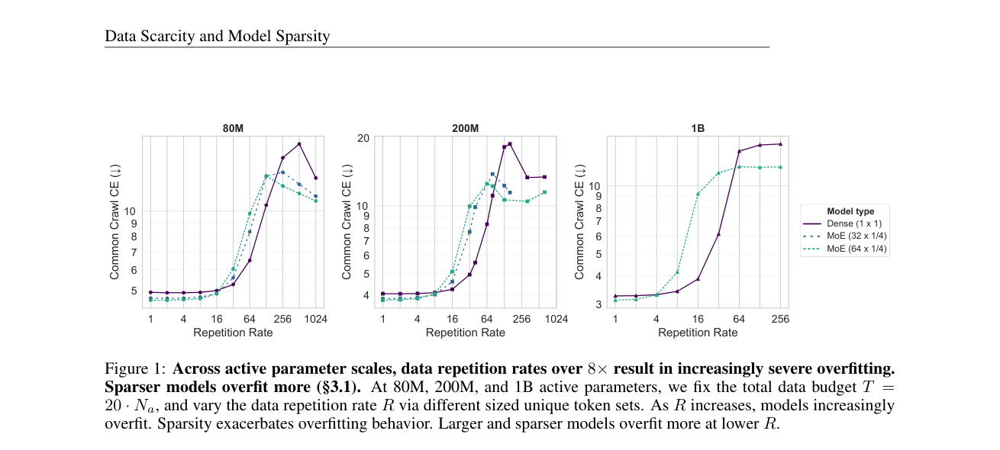

# Data Scarcity and Model Sparsity: Mixtures-of-Experts Overfit More to Repeated Data

<!-- source-sha256: 250e0824912ebcda88719549fefe964c195a0975b0a55f760a890a1a221984af -->

[简体中文](README.md)

> L1 regularization schedule diagnostic, no large-scale pretraining.

## Paper information

| Field | Details |
|---|---|
| Paper | [Data Scarcity and Model Sparsity: Mixtures-of-Experts Overfit More to Repeated Data](https://arxiv.org/abs/2609.11917) |
| Institution | Stanford University (first author). |
| First public release | 2026-09-10 |
| Author code | No public author repository found as of 2026-09-14. |
| Local adapter or method key | `repeat-aware-moe` |
| Local reproduction code | [`src/auto_research/foundation_latest_20260914.py`](https://github.com/daiwk/auto-research/blob/main/src/auto_research/foundation_latest_20260914.py) |

## Paper method and evidence

MoE can overfit repeated data sooner than dense models. Stronger masking and dropout suppress expert memorization; adjust regularization according to repetition and sparsity.

<!-- paper-figure:start -->
### Original paper figure

The original figure shows the repetition/sparsity study. From the [original paper](https://arxiv.org/abs/2609.11917); copyright remains with the authors.
<!-- paper-figure:end -->

### Reported results

With strong regularization, the paper reports that MoE can still beat dense models at 64-fold data repetition. This is not an online or local result.

## Local reproduction

[Three-seed metrics](metrics/mechanism-seeds42-44.json) use the same public fixtures, budget, and seeds. The deterministic reference exposes decisions and state transitions; tests verify invariants and boundaries. These are not capability or production results.
