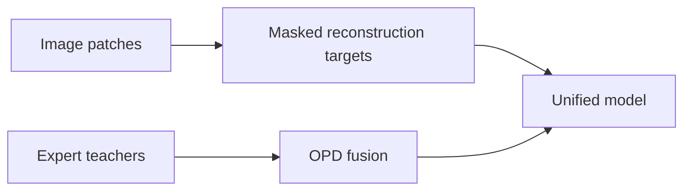
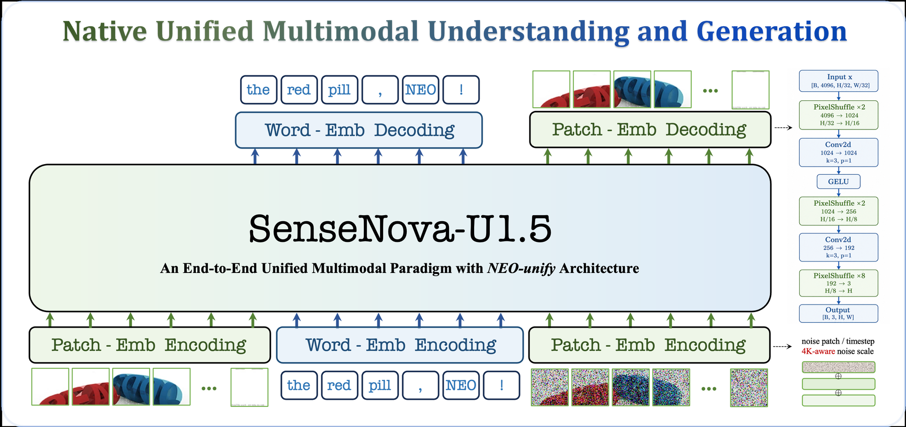

# SenseNova-U1.5: Towards Native Unified Visual Intelligence

<!-- source-sha256: c7e1833bd5a0bbda0c56fddfb603ae449967376c3570d470325c4c80ce7a45bd -->

[简体中文](README.md)

> L1 masked patch targets and expert OPD fusion, not 8B training.

## Paper information

| Field | Value |
| --- | --- |
| Paper | [SenseNova-U1.5: Towards Native Unified Visual Intelligence](https://arxiv.org/abs/2609.11929) |
| Affiliations | SenseTime Research, first author's affiliation |
| First public release | 2026-09-10 |
| Authors' code | [SenseNova-U1](https://github.com/OpenSenseNova/SenseNova-U1). |
| Adapter / method | `sensenova-u1-5` |
| Local code | [`src/auto_research/foundation_latest_20260914.py`](https://github.com/daiwk/auto-research/blob/main/src/auto_research/foundation_latest_20260914.py) |

## Original paper

### Background and contribution

Use spatial patch reconstruction instead of tokenizer/VAE, and multi-expert OPD to align understanding and generation post-training.

<!-- paper-figure:start -->
### Key figure from the paper

Original Figure 3: SenseNova-U1.5. From the [paper](https://arxiv.org/abs/2609.11929); copyright belongs to the authors. Not a local result.
<!-- paper-figure:end -->

### Core mechanism

The deterministic reference computes masked patch targets and merges expert OPD signals, with audited state and boundary checks.

### Paper results

The authors report combined understanding and generation results on the unified 8B-MoT. No local paper-scale or inferred A/B result.

## Local reproduction

[Three-seed metrics](metrics/mechanism-seeds42-44.json) use matched fixtures, budget, and seeds and verify state transitions only.

## Reproduction limits

Masked target and expert OPD only, no multistage 8B training.
