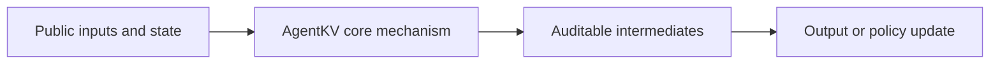
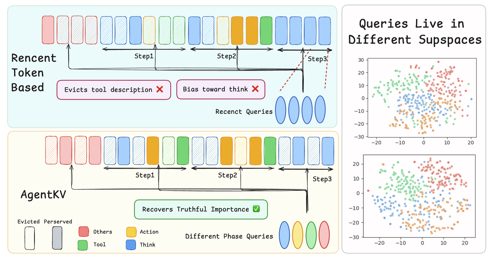

<!-- source-sha256: da0ffcbfa4a6e003404512fd4977f68b25900bc7c65082fd6c61644a08722221 -->

[简体中文](README.md) · English

# AgentKV: Phase-Aware KV Eviction for Agentic LLMs

> **L1 core mechanism diagnostic.** Phase-aware scoring runs. No SGLang changes or CUDA kernels were run.

## Paper information

| Field | Details |
|---|---|
| Paper | [AgentKV: Phase-Aware KV Eviction for Agentic LLMs](https://arxiv.org/abs/2609.14872) |
| Institution | University of Cambridge (first author affiliation) |
| First public release | 2026-09-14 (arXiv v1) |
| Original source code | Yes: [LiuTaowen-Tony/agentkv](https://github.com/LiuTaowen-Tony/agentkv) |
| Adapter/method | `agentkv` |
| Local reproduction code | [`src/auto_research/foundation_latest_20260916.py`](https://github.com/daiwk/auto-research/blob/main/src/auto_research/foundation_latest_20260916.py) |

## Original paper summary

### Background and main changes

Keep a representative query buffer for each agent phase, and use relevance across phase queries to decide KV eviction.

The local reference kernel retains defining gates, weights or state transitions and exposes auditable intermediates for comparison under a shared budget.

<!-- paper-figure:start -->
### Key figure from the paper

> **Figure 1:** Overall method and components. From the [paper](https://arxiv.org/abs/2609.14872); copyright belongs to the authors. Click for the source.
<!-- paper-figure:end -->

### Core mechanism

The implementation retains defining state transitions and emits relevant weight, gate, depth, stage or cache statistics. A fixed budget and three seeds check mechanism invariants, not paper-scale training.

### Offline and online results

Capability, speed and cost claims are attributed to the paper only. Local metrics are not directly compared or extrapolated to online gains.

## Local reproduction

See [three-seed results](metrics/mechanism-seeds42-44.json). The unified receipt marks `diagnostic_only=true`, so the public dashboard does not treat this as a full capability gain.

### Scope

Phase-aware scoring runs. SGLang was not modified and no CUDA kernels were run.
