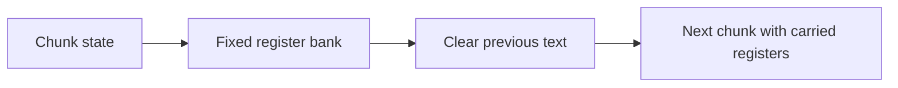
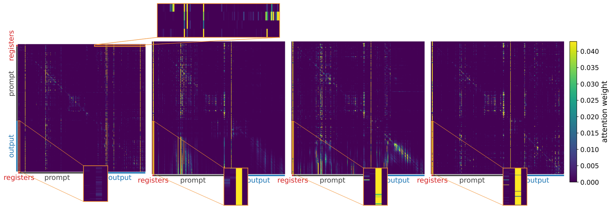

# Register Tokens for Bounded-State Reasoning in Diffusion Language Models

<!-- source-sha256: 0a936b7ae7209b9edc474a59c993339d62e9488fb8a863362a4bd0f6bb1cccb7 -->

[简体中文](README.md)

> **L1 mechanism diagnostic.** Bounded continuous carry only, without LLaDA/Dream checkpoints or diffu-GRPO.

## Paper information

| Field | Value |
| --- | --- |
| Paper | [Register Tokens for Bounded-State Reasoning in Diffusion Language Models](https://arxiv.org/abs/2609.16372) |
| Affiliations | University of Wisconsin–Madison, first author's affiliation |
| First public release | 2026-09-14 (arXiv v1) |
| Authors' code | No public author repository found as of 2026-09-16. |
| Adapter / method | `register-tokens-dllm` |
| Local code | [`src/auto_research/foundation_latest_20260916_followup.py`](https://github.com/daiwk/auto-research/blob/main/src/auto_research/foundation_latest_20260916_followup.py) |

## Original paper

### Background and contribution

Discard previous chunk text and carry a fixed number of continuous register hidden states into the next diffusion chunk, supporting cross-chunk reasoning without retaining all text.

<!-- paper-figure:start -->
### Key figure from the paper

Original Figure 5: register-token attention during denoising. From the [paper](https://arxiv.org/abs/2609.16372); copyright belongs to the authors. Not a local result.
<!-- paper-figure:end -->

### Core mechanism

The reference exposes auditable state transitions. Three-seed fixtures test invariants and bounds, not capability from random mini-suite scores.

### Paper results

The authors' accuracy, speed, loss, and benchmark results are separate from local diagnostics or online gains.

## Local reproduction

[Three-seed mechanism metrics](metrics/mechanism-seeds42-44.json) carry `diagnostic_only=true` and are not used for formal capability rankings.

## Reproduction limits

No LLaDA/Dream checkpoint or diffu-GRPO run.
