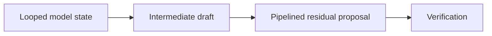
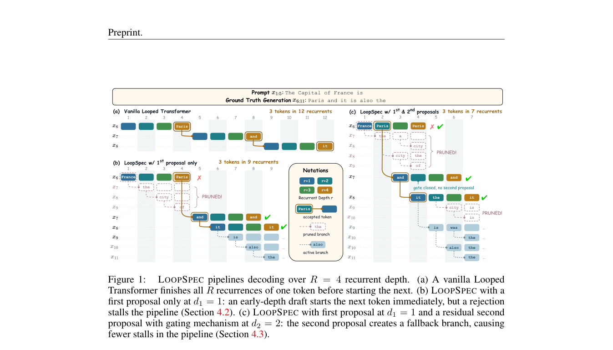

# LoopSpec: Pipelined Self-Speculative Decoding for Looped Transformers

<!-- source-sha256: 791bc00fc3c23fb9ccb926cc054f4d82a92d77d6fbdb18a2af907bf23778a23d -->

[简体中文](README.md)

> **L1 mechanism diagnostic.** Reference depth scheduling, not paper GPU throughput.

## Paper information

| Field | Value |
| --- | --- |
| Paper | [LoopSpec: Pipelined Self-Speculative Decoding for Looped Transformers](https://arxiv.org/abs/2609.17184) |
| Affiliations | Seoul National University / KAIST |
| First public release | 2026-09-15 (arXiv v1) |
| Authors' code | No public author repository found as of 2026-09-16. |
| Adapter / method | `loopspec` |
| Local code | [`src/auto_research/foundation_latest_20260916.py`](https://github.com/daiwk/auto-research/blob/main/src/auto_research/foundation_latest_20260916.py) |

## Original paper

### Background and contribution

Use intermediate predictions across recurrent depth for self-speculation. Pipeline residual proposals to hide verification latency.

<!-- paper-figure:start -->
### Key figure from the paper

Original Figure 1: self-speculation workflow. From the [paper](https://arxiv.org/abs/2609.17184); copyright belongs to the authors. Not a local result.
<!-- paper-figure:end -->

### Core mechanism

The reference preserves defining gate, weighting, and state transitions, exposing auditable scheduling/depth intermediates. Fixed-budget three-seed tests check invariants, not paper-scale training.

### Paper results

Paper capability, cost, and speed are not local evidence or production gains.

## Local reproduction

[Three-seed results](metrics/mechanism-seeds42-44.json) are `diagnostic_only=true` and not treated as full capability gains.

## Reproduction limits

Only the reference depth scheduler executes; no reproduction of paper GPU throughput.
