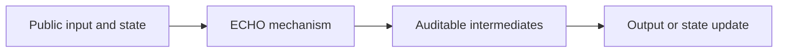
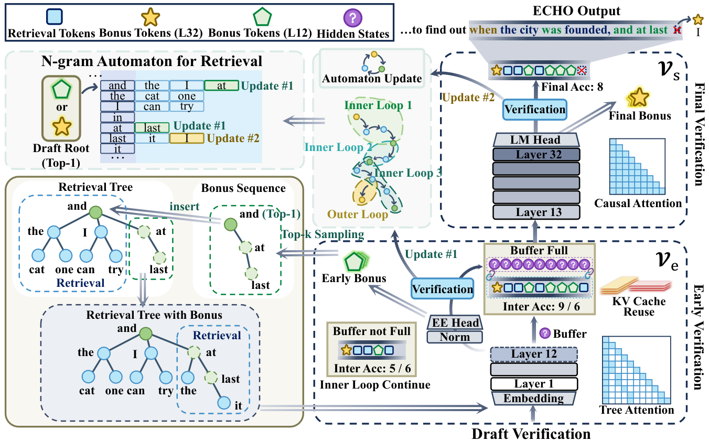

# ECHO: Early-layer Collaborative Hierarchical Orchestration with Bonus Logits in Speculative Decoding

<!-- source-sha256: 612ea730975402219340aa6afecbe1dee1eb5ce8f450b9c5931c4ad36def8f09 -->

[简体中文](README.md)

> **L1 mechanism diagnostic.** Candidate merging and lossless correction run locally; CUDA verifies the tensor path, not throughput.

## Paper information

| Field | Value |
| --- | --- |
| Paper | [ECHO: Early-layer Collaborative Hierarchical Orchestration with Bonus Logits in Speculative Decoding](https://arxiv.org/abs/2609.17241) |
| Affiliation | First author: Wuhan University |
| First public release | 2026-09-15 (arXiv v1) |
| Authors' code | [ECHO](https://github.com/whucs21Mzy/ECHO) |
| Adapter / method | `echo` |
| Local code | [foundation_latest_20260916_followup.py](https://github.com/daiwk/auto-research/blob/main/src/auto_research/foundation_latest_20260916_followup.py) |

## Original paper

### Background and contribution

A fast early-layer loop explores while a lower-frequency final-layer loop verifies. Bonus logits on both sides fill out the tree while retaining exact rejection-sampling correction.

<!-- paper-figure:start -->
### Key figure from the paper

Original architecture from the [paper](https://arxiv.org/abs/2609.17241); copyright belongs to the authors.
<!-- paper-figure:end -->

### Mechanism and evidence

The reference preserves the defining selection/gating and state changes, emitting audit statistics. Three-seed fixtures test invariants and boundaries, not paper capability. Paper accuracy, speed, training loss, or benchmark conclusions are not local or online evidence.

## Local reproduction

See [three-seed mechanism results](metrics/mechanism-seeds42-44.json), marked `diagnostic_only=true` and excluded from capability rankings. NVIDIA A100 executed CUDA; the [sanitized receipt](../../gpu-validations/echo-a100-20260916.json) omits hostnames, SSH aliases, and driver/build strings.

## Reproduction limits

Candidate merging and lossless correction, not a replication of the paper's throughput.
