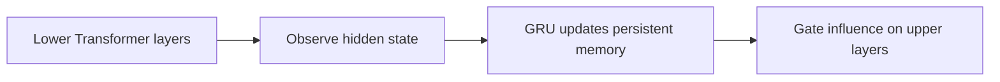
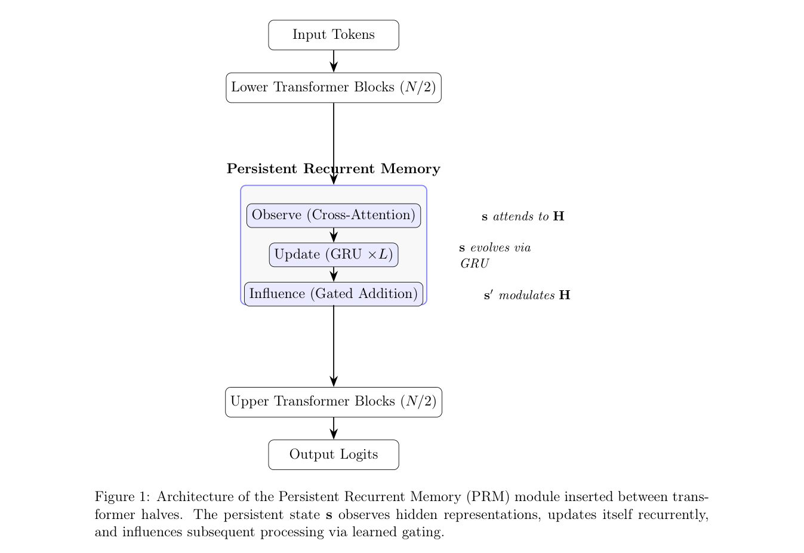

# Persistent Recurrent Memory Between Transformer Layers Improves Language Model Generalization

<!-- source-sha256: 4c03ef238302da5d29f27e9b286edcd4b05f7e64ff51df3bc53d0bc1a9f8224b -->

[简体中文](README.md)

> L1 topology reference kernel; no full TinyStories training curves.

## Paper information

| Field | Details |
|---|---|
| Paper | [Persistent Recurrent Memory Between Transformer Layers Improves Language Model Generalization](https://arxiv.org/abs/2609.17251) |
| Institution | FITec Labs / Ericsson São Paulo (first author). |
| First public release | 2026-09-15 (arXiv v1) |
| Author code | No public author repository found as of 2026-09-16. |
| Local adapter or method key | `persistent-recurrent-memory` |
| Local reproduction code | [`src/auto_research/foundation_latest_20260916_followup.py`](https://github.com/daiwk/auto-research/blob/main/src/auto_research/foundation_latest_20260916_followup.py) |

## Paper method and evidence

Insert an observe–GRU update–gated influence state path between the lower and upper Transformer halves, so recurrent memory affects later computation.

<!-- paper-figure:start -->
### Original paper figure

Figure 1 shows the recurrent path between Transformer stages. From the [original paper](https://arxiv.org/abs/2609.17251); copyright remains with the authors.
<!-- paper-figure:end -->

### Core equation

The reference preserves the state transition and gate and exposes auditable statistics.

### Reported results

Paper accuracy, speed, training losses and benchmarks are not local results.

## Local reproduction

[Three-seed mechanism results](metrics/mechanism-seeds42-44.json) are diagnostic_only=true. Fixed-budget fixtures verify the defining operator and auditable intermediate states; they are not a benchmark, production result, or capability-ranking entry.
