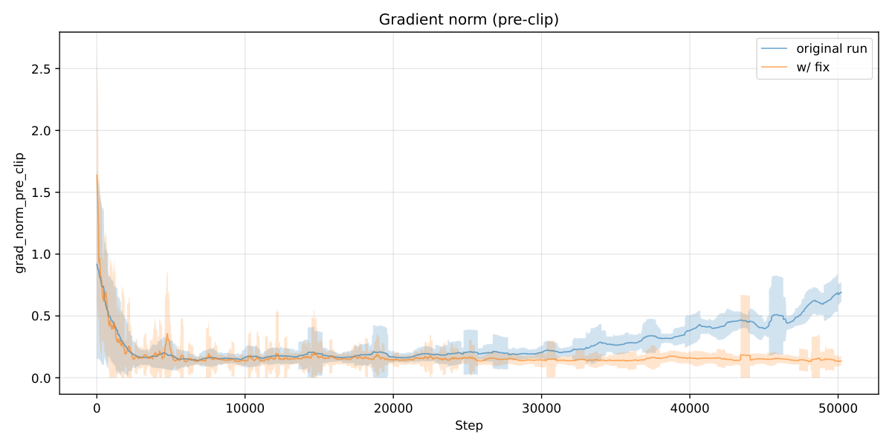

# OPEN-1B: A Fully Auditable Training Run

<!-- source-sha256: b3c439f731fc68b403bb751c80ad6513b37b2ecff581dbbeb96db401d0af749f -->

[简体中文](README.md)

> **L1 core-mechanism diagnostic.** Verifies fixed-order reduction and canonical hashing, not replay of 400B-token pretraining.

## Paper information

| Field | Details |
|---|---|
| Paper | [OPEN-1B: A Fully Auditable Training Run](https://arxiv.org/abs/2609.17380) |
| Organization | First-author affiliation: Gensyn |
| First public release | 2026-09-15 (arXiv v1) |
| Authors' code | [Public training implementation](https://github.com/gensyn-ai/open-transformers); [audit tool](https://github.com/gensyn-ai/pretraining-audit-cli) |
| Adapter / method | `open-1b-audit` |
| Local reproduction code | [`src/auto_research/foundation_latest_20260916_followup.py`](https://github.com/daiwk/auto-research/blob/main/src/auto_research/foundation_latest_20260916_followup.py) |

## Original paper

### Motivation and method

Fix the order of kernel reductions, data batches, and collective communication. Per-step state hashes enable single-step replay audits across heterogeneous hardware.

~~~mermaid
flowchart LR
  I[Public input and current state] --> M[OPEN-1B audit mechanism]
  M --> A[Auditable intermediates]
  A --> O[Output or state update]
~~~

<!-- paper-figure:start -->
### Key figure from the paper

> **Figure 5:** Method overview and components. From the [original paper](https://arxiv.org/abs/2609.17380); copyright remains with the authors.
<!-- paper-figure:end -->

### Core computation and code mapping

The reference kernel preserves decisive ranking, gating, preference direction, credit weighting, or state transitions and reports auditable statistics. Three-seed fixtures check invariants and edge cases; randomized mini-suite scores do not measure paper capability.

### Paper results

Accuracy, speed, loss, and benchmarks belong to the original paper. Local results are neither compared directly nor extrapolated to online gains.

## Local reproduction

See the [three-seed results](metrics/mechanism-seeds42-44.json). The common receipt marks `diagnostic_only=true`, ineligible for formal capability ranking.

## Reproduction boundaries

Local checks cover fixed-order reduction and canonical hashing, not a replay of 400B-token pretraining.
