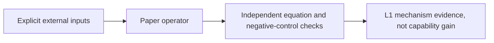
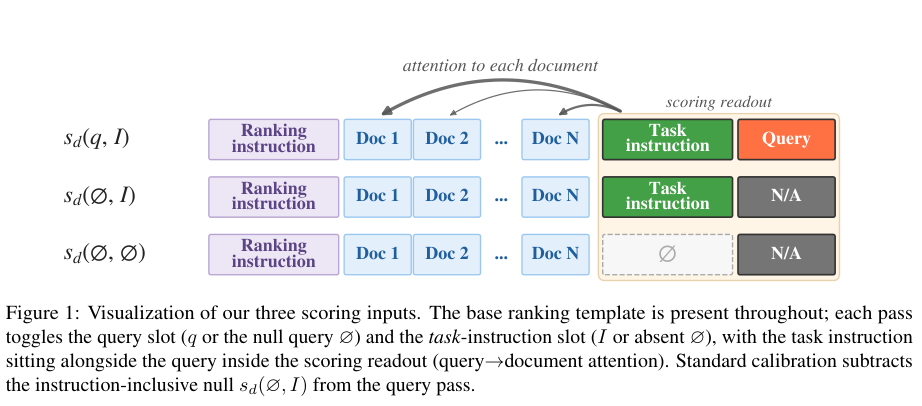

# How Calibration Content Shapes Attention-Based Reranking

<!-- source-sha256: 4149f6a705209effefe8e1fa43941b8566e4eef2e6a82054e3cdf68b176387ad -->

[简体中文](README.md)

Decompose three readouts—query with instruction, instruction-inclusive null, and bare null—and use λ to interpolate the instruction footprint to remove. λ=0 still calibrates against bare null. Only Equations 4–7 for aligned document scores are implemented; no LLM attention run, formal ranking benchmark, or industrial online A/B adapter.

## Paper information

| Field | Value |
| --- | --- |
| Paper | [arXiv 2609.17764 v1](https://arxiv.org/abs/2609.17764v1); [reviewed v1](https://arxiv.org/html/2609.17764v1) |
| Affiliations | First author Petros Karypis: UC San Diego (v1 email pkarypis@ucsd.edu; Google internship footnote). Hossein Rajaby Faghihi and Yan Zhu: Google; Peter Chen, Rui Zhu, and Noveen Sachdeva: Google DeepMind. |
| First public release | 2026-09-15 19:12:58 UTC (arXiv v1) |
| Review version | Pinned v1 |
| Authors' code | No method repository found in v1 or exact-title search; code hash/license unverified. ICR/QRHeads baseline repositories do not release this method. Paper is CC BY 4.0. |
| Adapter/key | `interpolated-null-calibration`, `adapter: null`, `component_only` |
| Local code | `src/auto_research/foundation_models/interpolated_null_calibration.py` |
| Full study | Too costly; not reproduced (review DONE); no automatic retry |

## Original paper

### Background and method

Section 3 Equations 4–7 isolate the instruction contribution. Caller supplies three actual passes and aligns document identities and order. Select λ only on validation. The paper's oracle tunes over dataset queries and is not an independent test result.



<!-- paper-figure:start -->
### Key figure from the paper

[](https://arxiv.org/pdf/2609.17764v1#page=2)

Figure 1, page 2 of [v1](https://arxiv.org/html/2609.17764v1). Original scientific content and labels retained, not redrawn. See [source, crop, and SHA256](assets/provenance.json). Copyright belongs to the authors.
<!-- paper-figure:end -->

### Core equations

For query/instruction, instruction-inclusive null, and bare null on matched documents:

$$
\Delta_N=s(\varnothing,I)-s(\varnothing,\varnothing),\quad
S_\lambda=s(q,I)-[\lambda s(\varnothing,I)+(1-\lambda)s(\varnothing,\varnothing)].
$$

$\lambda=1$ is standard ICR; $\lambda=0$ still subtracts bare null, not no calibration. Local code acts on provided scores; it does not invent attention or relevance. The paper's oracle $\lambda^\star$ maximizes dataset-query nDCG, not an independent test result.

### Paper results

The paper uses its own models, data, and protocols. The full matrix was not run locally and paper metrics are not local measurements. No production A/B was reported.

## Local reproduction

Implements Equations 4–7 and stable ranking on three scores with identical document order. No attention extractor, ICR outlier filter, QRHead selection, LLM loading, or live A/B. This is a foundation-model component, not an industrial adapter.

```bash
PYTHONPATH=src python -c 'from auto_research.foundation_models.interpolated_null_calibration import diagnostic; print(diagnostic(42))'
python -m pytest tests/test_google_emnlp25_foundation.py
```

`diagnostic(seed, device='cpu')` runs independent formula and negative controls on generated data. CUDA fails without a real device rather than falling back; acceptance requires frozen-source three-seed results and an A100/A30 receipt. Operator errors, gradient/parameter updates, or scorer controls do not establish accuracy, writing quality, cross-lingual ability, or Evolve promotion.

## Reproduction limits

The matrix uses Gemma3-4B, Qwen3-4B, Llama3.1-8B, and Qwen3-14B; top 100 documents at 130 tokens each, three 16K prefills, benchmarks, 5 folds, a λ grid, and QRHead selection on a single 40GB A100 configuration. Full loading and the matrix exceed short-component budget. **Not reproduced for cost (review DONE)** from published configuration, without launching a full probe. `diagnostic_only=true`, `promotion_eligible=false`, `evolve_integrated=false`. This is a historical lead from Google's EMNLP page, not a new publication; the venue listing is not proof of author affiliation.
