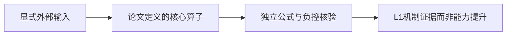
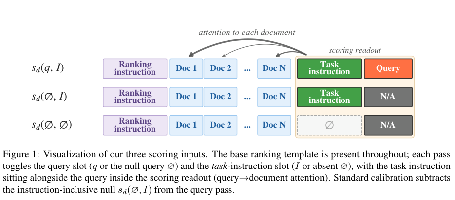

# How Calibration Content Shapes Attention-Based Reranking

将query+instruction、instruction-inclusive null、bare null三次读出分解，按λ插值应移除的instruction footprint；λ0仍是bare-null校准，不等于无校准。本地只实现对齐document分数的式4–7，不跑LLM注意力/正式排序benchmark，也不作为有线上AB的工业adapter。

## 论文信息

| 字段 | 内容 |
| --- | --- |
| 论文链接 | [arXiv 2609.17764 v1](https://arxiv.org/abs/2609.17764v1)；[固定核对版本 v1](https://arxiv.org/html/2609.17764v1) |
| 公司 / 机构 / 学校 | 一作 Petros Karypis：UC San Diego。固定v1 PDF/正文一作邮箱pkarypis@ucsd.edu、脚注Google internship；Hossein Rajaby Faghihi/Yan Zhu为Google，Peter Chen/Rui Zhu/Noveen Sachdeva为Google DeepMind。 |
| 首次公开日期 | 2026-09-15 19:12:58 UTC（arXiv v1） |
| 本轮版本 | 本轮方法核对固定v1。 |
| 原作者代码 | 固定v1及精确标题检索未找到作者方法仓库，源码SHA/许可证不可核验；不是把ICR/QRHeads基线仓库当本论文方法开源；未找到作者方法源码；论文CC BY4.0 |
| 本地 adapter / 稳定键 | `interpolated-null-calibration`；`adapter: null`；`component_only` |
| 本地复现代码目录 | `src/auto_research/foundation_models/interpolated_null_calibration.py` |
| 完整实验 | **成本过高，不复现（审查 DONE）**，不进入自动重试或实现队列 |

## 原始论文总结

### 背景与主要改动

固定v1 Section3 Eq4–7：ΔN=s(empty,I)−s(empty,empty)，Sλ=s(q,I)−[λs(empty,I)+(1−λ)s(empty,empty)]；λ1标准ICR、λ0bare-null。调用方真实三pass提分数并保证doc identity对齐；λ只能validation选。论文oracle λ对全数据查询调参，不能当独立test结果。



<!-- paper-figure:start -->
### 原论文关键图

[](https://arxiv.org/pdf/2609.17764v1#page=2)

**Figure 1**，固定v1第2页。图片来自[原论文](https://arxiv.org/html/2609.17764v1)，版权归原作者所有；保留原图科学内容与标注，未重绘。[来源、裁切与SHA256](assets/provenance.json)。
<!-- paper-figure:end -->

### 核心公式

三次真实模型pass分别为query+instruction、instruction-inclusive null和bare null，document身份/顺序须对齐：
$$
\Delta_N=s(\varnothing,I)-s(\varnothing,\varnothing),\quad
S_\lambda=s(q,I)-[\lambda s(\varnothing,I)+(1-\lambda)s(\varnothing,\varnothing)].
$$
$\lambda=1$ 是标准ICR校准，$\lambda=0$ 仍减bare null，**不是无校准**。本地只操作调用方提供的三pass分数，不伪造注意力权重或自动生成相关性。$\lambda$必须validation选择；原文oracle $\lambda^\star$ 对数据集查询最大化nDCG，不能当独立test能力结果。

### 论文离线与线上效果

原文结论来自其真实模型、数据与协议；本页未运行完整矩阵，不将原文指标抄成“本地实测”。未报告生产线上 A/B。

## 本地复现

输入是已有三次模型attention读出的、相同doc ID顺序下的分数。本地实现Eq4–7及稳定ranking，没有真实attention extractor、ICR outlier filter/QRhead选择、LLM加载或工业线上A/B；因此归基础模型研究而非工业搜广推adapter。

```bash
PYTHONPATH=src python -c 'from auto_research.foundation_models.interpolated_null_calibration import diagnostic; print(diagnostic(42))'
python -m pytest tests/test_google_emnlp25_foundation.py
```

`diagnostic(seed, device='cpu')`只执行生成数据上的独立公式/负控。CUDA路径必须由真实A100/A30执行，CUDA不可用时失败、不回退CPU；本轮验收以提交的冻结源码三种子原始结果和GPU收据为准。 指标是算子误差、梯度/参数更新或scorer对照，不是正式模型accuracy、写作质量、跨语言能力或Evolve晋级证据。

## 复现边界

Gemma3-4B/Qwen3-4B/Llama3.1-8B/Qwen3-14B，top100每doc130tokens、16Kcontext三prefill，多benchmark/5fold/λ网格/QRhead选择；单A10040GB配置。完整模型加载和广泛矩阵超短时组件预算；不宣称真实retrieval改善。

**成本过高，不复现（审查 DONE）**。以上为论文配置/资源判断，未为了测成本而启动完整试跑。本地小张量或CPU协议通过不等于完整方法/数据管线或benchmark已接入；`diagnostic_only=true`、`promotion_eligible=false`、`evolve_integrated=false`。

本轮来自Google EMNLP官方会议页的历史线索补漏，不是今天新首发，也不单凭会议页就认定作者具有Google署名；机构证据在信息块逐条注明。
