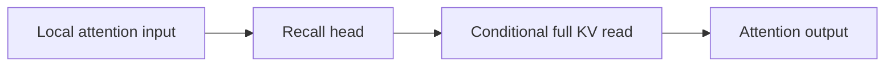
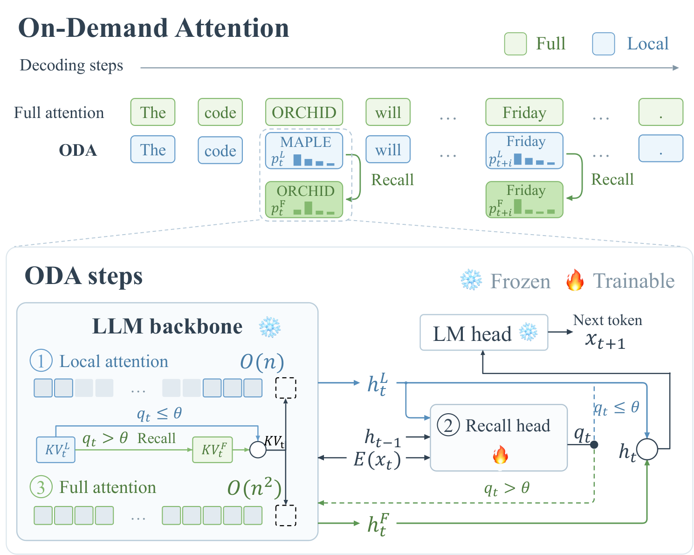

# On-Demand Attention: Efficient Long-Context Decoding with Learned Recall

<!-- source-sha256: 82ddf84a3275f1913cc20c53511bec215805e9e233240b8d7ba0b5943e9a0b8b -->

[简体中文](README.md)

> **L1 mechanism diagnostic.** Recall gating and conditional global attention execute. A100 validation covers CUDA, not vLLM throughput.

## Paper information

| Field | Value |
| --- | --- |
| Paper | [On-Demand Attention: Efficient Long-Context Decoding with Learned Recall](https://arxiv.org/abs/2609.20734) |
| Affiliations | Southern University of Science and Technology, first author's affiliation |
| First public release | 2026-09-17 (arXiv v1) |
| Authors' code | No public author implementation found as of 2026-09-19. |
| Adapter / method | `oda` |
| Local code | [`src/auto_research/foundation_latest_20260919.py`](https://github.com/daiwk/auto-research/blob/main/src/auto_research/foundation_latest_20260919.py) |

## Original paper

### Background and contribution

Read local KV by default. A lightweight recall head predicts whether global attention would help before it runs, and only high-benefit tokens trigger the full read. The full KV store is retained.

<!-- paper-figure:start -->
### Key figure from the paper

Original Figure 1: selective global recall. From the [paper](https://arxiv.org/abs/2609.20734); copyright belongs to the authors. Not a local result.
<!-- paper-figure:end -->

### Core mechanism

The reference implements the decisive gate and state transition and records intermediates. Function and test invariants document the variable-level mapping.

### Paper results

The paper's benchmark, training efficiency, inference speed, and online claims are separate from local evidence.

## Local reproduction

[Three-seed metrics](metrics/mechanism-seeds42-44.json) cover mechanism, shape, and state invariants. The CUDA path ran on a real NVIDIA A100; sanitized evidence is under `docs/gpu-validations/`.

## Reproduction limits

Recall gate and conditional attention only. The real receipt does not establish vLLM throughput.
