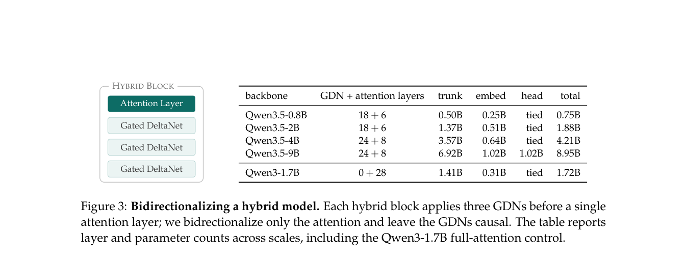

# dQwen3.5: Adapting Hybrid Language Models into Bidirectional Diffusion Language Models

<!-- source-sha256: 1f25909a5a37a42548bbb72c3aa6526027be675a8796f710388ca65244c26f3f -->

[简体中文](README.md)

> **L1 core-mechanism diagnostic.** Executes a bidirectional hybrid-state CUDA kernel without loading the 9B checkpoint or reproducing pretraining loss curves.

## Paper information

| Field | Details |
|---|---|
| Paper | [dQwen3.5](https://arxiv.org/abs/2609.20751) |
| Organization | First-author affiliation: University of Texas at Austin |
| First public release | 2026-09-17 (arXiv v1) |
| Authors' code | No public implementation repository was found as of 2026-09-19. |
| Public checkpoint | [UT-IFML/dQwen3.5-9B-Base](https://huggingface.co/UT-IFML/dQwen3.5-9B-Base) |
| Adapter / method | `dqwen35` |
| Local reproduction code | [`src/auto_research/foundation_latest_20260919.py`](https://github.com/daiwk/auto-research/blob/main/src/auto_research/foundation_latest_20260919.py) |

## Original paper

### Motivation and method

Convert Qwen3.5's attention/RNN hybrid backbone to bidirectional state propagation, then train a diffusion language model with a masked denoising objective.

~~~mermaid
flowchart LR
  I[Public input and current state] --> M[dQwen3.5 mechanism]
  M --> A[Auditable intermediates]
  A --> O[Output or state update]
~~~

<!-- paper-figure:start -->
### Key figure from the paper

> **Figure 3:** Overall method and components. From the [original paper](https://arxiv.org/abs/2609.20751); copyright remains with the authors.
<!-- paper-figure:end -->

### Core computation

The reference kernel preserves the decisive gates, weights, state transitions, or scheduling rules and records intermediates in the metrics artifact. Implementation functions and invariant assertions in tests map the relevant formulas and variables.

### Paper results

Online measurements, benchmarks, training efficiency, and inference speed reported in the paper are original results only. The [three-seed local artifact](metrics/mechanism-seeds42-44.json) checks core mechanisms, shapes, and state invariants; no direct comparison is made.

CUDA was run on a real NVIDIA A100; sanitized receipts are in `docs/gpu-validations/`.

## Reproduction boundaries

Only the bidirectional hybrid-state CUDA kernel was executed locally. No 9B checkpoint or pretraining loss curve was reproduced.
