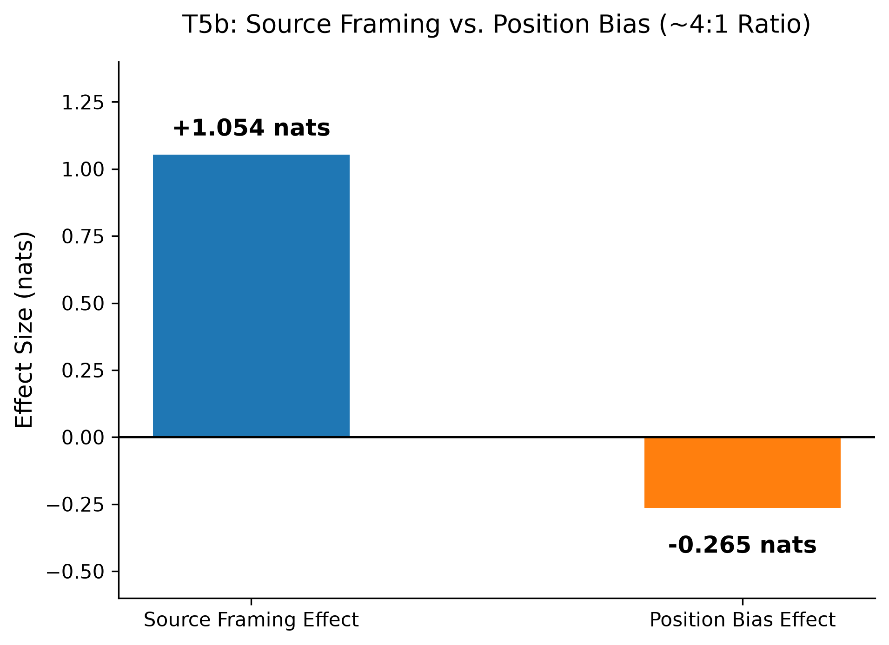

# Gemma 4: a four-cell protocol for source wording and reading order

<!-- source-sha256: 645389ebdbf527c8fb6d7e9d5248fbca2963f984bad424290343f830548f9c13 -->

[简体中文](README.md)

## Paper information

| Field | Details |
| --- | --- |
| Paper | [arXiv 2609.30716 v1](https://arxiv.org/abs/2609.30716v1); [pinned full text](https://arxiv.org/html/2609.30716v1) |
| Original title | Words Speak Louder Than Order: A Behavioral Evaluation of Gemma 4 |
| Organization | Sole author Amanda Fitch. The byline explicitly says `Affiliation: Google`; this is not inferred from use of a Gemma model. |
| First public release | 2026-09-25 02:43:40 UTC (arXiv v1). Found retrospectively in the incremental Google official-catalog scan, not an October 23 debut. |
| Authors' code | [Official author directory](https://github.com/GoogleCloudPlatform/devrel-demos/tree/fc468f2374540870042b20db1ec7e836ed205db7/ai-ml/gemma-priority-probing), pinned at `fc468f2374540870042b20db1ec7e836ed205db7`. The README declares Apache-2.0 and the directory LICENSE supplies its title and official link. |
| Local adapter / stable key | `gemma-priority-protocol`; `adapter: null`, `component_only`. Analysis protocol for externally supplied predictions only. |
| Local reproduction code | `src/auto_research/foundation_models/gemma_priority_protocol.py`; `tests/test_gemma_priority_protocol.py` |
| Experiment status | CPU L1 protocol and reanalysis of original public logs; not new model inference or a new Gemma capability evaluation |

## Original paper

### Motivation and method

The paper separates lexical preference, source wording, and presentation order in conflicting two-document prompts. The method and resources were checked: four crossed cells, ten prompt conditions, a common retained set across conditions, and an unfiltered sensitivity analysis. The scope is one model, short context, and English single-word choices. This is neither a new training algorithm nor evidence about neural circuits.

~~~mermaid
flowchart LR
  P[Two documents and two candidate words] --> C[Cross order and roles in four cells]
  C --> L[Log-probability differences from a frozen external model]
  L --> H[Orthogonal contrast decomposition]
  H --> M[Common retained set across ten conditions]
  H --> U[All-item sensitivity analysis]
  M --> S[Paired per-item contrasts, BCa and TOST]
  U --> S
~~~

<!-- paper-figure:start -->
### Key figure from the paper

Figure 1 is an unmodified copy of the [original PNG](https://arxiv.org/html/2609.30716v1/image1.png). Copyright remains with the author; the paper is CC BY 4.0. See [source and hash](assets/provenance.json). Numbers in the figure are the author's results, not local model outputs. The approximate 4:1 ratio describes that condition only.
<!-- paper-figure:end -->

### Core equations

Let $e_i=\log P(B)-\log P(A)$. The four cells are, in order: old first with old=A/new=B; new first with old=A/new=B; old first with old=B/new=A; and new first with old=B/new=A.

$$
T=\frac{e_1+e_2+e_3+e_4}{4},\quad
R=\frac{e_1+e_2-e_3-e_4}{4},\quad
O=\frac{e_1-e_2+e_3-e_4}{4},\quad
S=\frac{e_1-e_2-e_3+e_4}{4}.
$$

$T$ is lexical preference, $R$ the source-role effect, $O$ the order null control, and $S$ the actual position effect. Negative $S$ favors the first position. These are half-effects; the full range is twice as large. For mixed wording, average each cell over the full wording assignments first.

Across ten conditions, flag items with $|T|>2$ or $|O|>0.5$. All primary analyses remove the union of flagged items, while unfiltered analysis keeps every item. Compute D1 as $|R|-|S|$ per item before averaging; taking the difference of absolute means is not equivalent.

### Paper results

The author reports 784 forward passes and 14 single-token items, with 13 retained across conditions. T5b mean source-role effect is 1.054 nats, mean position effect is -0.265, and per-item D1 averages 0.774. No production online A/B test is reported. The paper documents a failed null control and sensitivity to filtering; within those limitations, its results do not establish a universal RAG ordering policy. Failure to establish equivalence is not proof of a large effect.

## Local reproduction

### Implementation and data protocol

`four_cell_effects` computes the actual four-cell linear contrasts. `analyze_cells` requires ten conditions, unique item IDs, consistent order and counts, and finite values. It returns primary and sensitivity analyses. `bca_interval` imports SciPy lazily and uses 9,999 draws, seed 42, and BCa 95%; TOST uses a 0.15-nat margin and BCa 90%. Failed BCa remains `failed`; zero variance remains `degenerate`. Both yield `equivalent=null`, with no silent percentile fallback or fabricated pass on degenerate data. This failure contract is more conservative than upstream's fallback to percentiles.

The fixture retains only four-cell observations and the existing summaries from the author's pinned FINAL.json. The complete source file SHA256 is `744bbb4f1cda3a01c30528e1391bd6b3ec9fdaf0e75e917dfcc95ca31ca608cf`. It is not answer training data and supplies neither a new model callback nor evaluator gold. Matching the author's log demonstrates agreement of local arithmetic with the supplied observations, not that the original outputs are authentic or generalize.

The current author script includes A4, but neither pinned FINAL.json summary includes an A4 field. Locally A4 is A1−A2 using the same per-item observations, and the identity is checked separately without claiming an author-log A4 interval. The other 18 contrasts and ten position means are independently aligned with the published summaries. The upstream repository also contains J-Lens, patching, and pilot files marked non-aggregable. This component does not load them or treat the repository README's circuit narrative as a paper conclusion.

~~~bash
PYTHONPATH=src python -m pytest tests/test_gemma_priority_protocol.py
PYTHONPATH=src python -c 'from auto_research.foundation_models.gemma_priority_protocol import diagnostic; print(diagnostic(42))'
~~~

### Results and limits

- [Pinned author-log reanalysis](metrics/official-log-reanalysis.json): arithmetic and statistical verification of published observations, not new model inference.
- [Three-seed synthetic contract checks](metrics/component-cpu-seeds42-44.json): seeds alter test matrices and bootstrap draws, not model training.

Fixed flags: `diagnostic_only=true`, `promotion_eligible=false`, and `evolve_integrated=false`. There is no training adapter or executable evolve operator. No Gemma, tokenizer, Jacobian, private file, or paid API is used. This CPU path needs no GPU receipt.

### Cost and unrun scope

This round read about 59 KB of author logs and the original figure, then recalculated 10 conditions × 14 items × 4 cells with a small-sample bootstrap. A Mac is sufficient. A full model rerun would need a pinned public `google/gemma-4-e4b` checkpoint, tokenizer, FP32, and 784 forward passes. Weight size and total VRAM were not determined, and no weights were downloaded or run. The full model experiment is therefore `not_run_scope_limited_protocol`, not validated capability and not labeled prohibitively costly without evidence. There is no training, hyperparameter search, or capability promotion.
