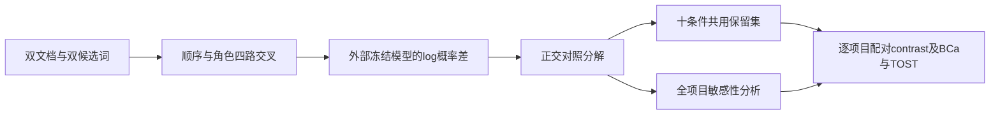
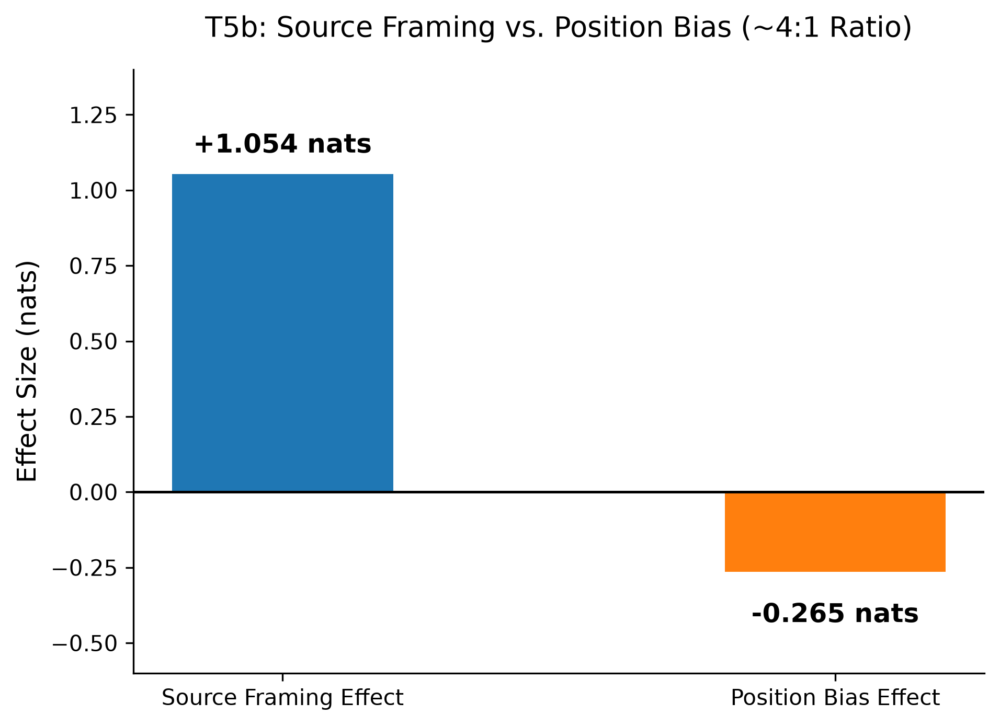

# Gemma 4：来源措辞与阅读顺序的四路对照协议

## 论文信息

| 字段 | 内容 |
| --- | --- |
| 论文链接 | [arXiv 2609.30716 v1](https://arxiv.org/abs/2609.30716v1)；[固定正文](https://arxiv.org/html/2609.30716v1) |
| 原文标题 | Words Speak Louder Than Order: A Behavioral Evaluation of Gemma 4 |
| 公司 / 机构 / 学校 | 一作及唯一作者 Amanda Fitch；原文作者栏明确写 `Affiliation: Google`，不是因使用 Gemma 模型而推断机构 |
| 首次公开日期 | 2026-09-25 02:43:40 UTC（arXiv v1）；本轮为 Google 官方目录增量发现的历史补漏，不是10月23日新首发 |
| 原作者代码 | [官方作者目录](https://github.com/GoogleCloudPlatform/devrel-demos/tree/fc468f2374540870042b20db1ec7e836ed205db7/ai-ml/gemma-priority-probing)，固定 revision `fc468f2374540870042b20db1ec7e836ed205db7`；README 声明 Apache-2.0，目录 LICENSE 为该许可标题及官方链接 |
| 本地 adapter / 稳定键 | `gemma-priority-protocol`；`adapter: null`、`component_only`，仅外部预测的分析协议 |
| 本地复现代码目录 | `src/auto_research/foundation_models/gemma_priority_protocol.py`；`tests/test_gemma_priority_protocol.py` |
| 实验状态 | CPU L1 协议/原始公开日志复算；不是新模型推理，不代表 Gemma 能力已重新评测 |

## 原始论文总结

### 背景与主要改动

论文把双文档冲突中的词偏好、来源措辞和呈现顺序分别测量。方法与资源已核：四路交叉、十种提示条件、跨条件共同保留集，以及未筛选敏感性分析。研究范围是单模型、短上下文、英文单词选择；不是新的训练算法，也不是神经回路证据。



<!-- paper-figure:start -->
### 原论文关键图

[](https://arxiv.org/html/2609.30716v1#S0.F1)

Figure 1 是[原文 PNG](https://arxiv.org/html/2609.30716v1/image1.png)的原样副本，版权归作者，原文 CC BY 4.0。[来源及哈希](assets/provenance.json)。图中数字为作者结果，不是本地模型输出；约4:1仅是该条件的描述性比值。
<!-- paper-figure:end -->

### 核心公式

令 $e_i=\log P(B)-\log P(A)$。四路依次为：旧文先且旧=A新=B、新文先且旧=A新=B、旧文先且旧=B新=A、新文先且旧=B新=A。

$$
T=\frac{e_1+e_2+e_3+e_4}{4},\quad
R=\frac{e_1+e_2-e_3-e_4}{4},\quad
O=\frac{e_1-e_2+e_3-e_4}{4},\quad
S=\frac{e_1-e_2-e_3+e_4}{4}.
$$

$T$ 是词偏好，$R$ 是来源角色效应，$O$ 是顺序零对照，$S$ 才是位置效应。负 $S$ 表示偏首；均为半效应，完整极差是两倍。混合措辞的四路值须先对完整措辞分配取平均。

跨十条件以 $|T|>2$ 或 $|O|>0.5$ 标记项目，所有主分析共用剔除并集；未筛选分析仍保留全部项目。D1 必须先逐项目计算 $|R|-|S|$ 再平均，不能用两个均值的绝对值之差代替。

### 论文离线与线上效果

作者报告784次前向、14个单token项目、共同保留13项。T5b来源角色均值1.054 nats、位置均值-0.265；逐项目D1为0.774。未报告生产线上 A/B。存在零对照失败和筛选依赖，加载正文限制后不能把结果扩展为普适的RAG排序策略；也不把无法证成等效理解为证明效应很大。

## 本地复现

### 实现与数据协议

`four_cell_effects` 执行真实四路线性对照；`analyze_cells` 要求十条件、唯一项目ID、同序同量、有限数字，并同时输出主分析和敏感性分析。`bca_interval` 延迟加载 SciPy，采用9,999次、seed42、BCa95%；TOST使用0.15 nats界限和BCa90%。BCa失败保留 `failed`，零方差保留 `degenerate`；两者 `equivalent=null`，不静默改成percentile，不把退化输入伪造成通过。这是比上游异常后回退percentile更保守的失败合同。

测试夹具只保留固定作者FINAL.json的四路观测值与既有汇总，完整源文件SHA256为 `744bbb4f1cda3a01c30528e1391bd6b3ec9fdaf0e75e917dfcc95ca31ca608cf`。它不是答案训练数据，不提供新模型回调或评测器Gold。与作者log匹配并不证明原始模型输出真实或可泛化；仅证明本地算术与给定观测一致。

作者当前脚本含A4，但固定FINAL.json两套汇总均无A4字段。本地A4来自同一逐项目观测的A1-A2，单独校验恒等式，不宣称有作者log里的A4区间参照。其他18项contrast及十条件位置均值按作者已发布汇总独立对齐。仓库另有J-Lens、patching及标为不可聚合的pilot文件，本组件不加载、不使用，也不把仓库README的回路叙事当作本论文结论。

```bash
PYTHONPATH=src python -m pytest tests/test_gemma_priority_protocol.py
PYTHONPATH=src python -c 'from auto_research.foundation_models.gemma_priority_protocol import diagnostic; print(diagnostic(42))'
```

### 结果与边界

- [固定作者日志复算](metrics/official-log-reanalysis.json)：已发表观测的算术/统计复核，不是新模型推理。
- [三seed合成合同检查](metrics/component-cpu-seeds42-44.json)：seed只改变测试矩阵与bootstrap抽样，不是三个模型训练种子。

固定 `diagnostic_only=true`、`promotion_eligible=false`、`evolve_integrated=false`；不注册训练adapter或可执行Evolve算子。不加载Gemma、tokenizer、Jacobian或私有文件，不调用付费API；CPU路径不要求GPU回执。

### 成本与未运行范围

本轮仅读取约59KB的作者日志和原图，复算规模为10条件×14项目×4路，加小样本bootstrap，Mac即可。完整模型重跑需固定 `google/gemma-4-e4b` 公开checkpoint revision、tokenizer、FP32与784次前向；本轮未解析大权重体积/总显存，也未下载或试跑。故完整模型实验记 `not_run_scope_limited_protocol`，不是已验证能力，也不在没有成本依据时硬标为“成本过高”。本项无训练、超参搜索或能力晋级。
