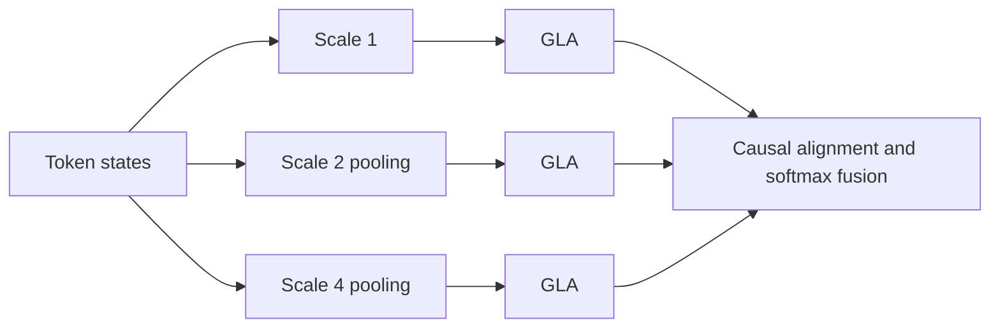
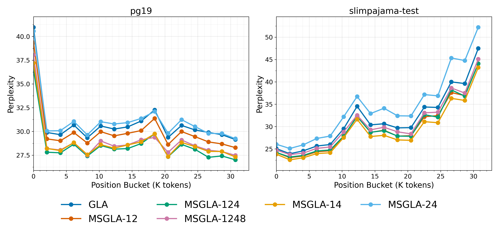

# MS-GLA: Multi-Temporal Gated Linear Attention

<!-- source-sha256: 4fcd907ffbdcf0da1e5642d96f214ad87c0824e96936ce6090adfccdc9dbdfa0 -->

[简体中文](README.md)

> **L1 architecture with real A100 forward/backward.** Multiscale decomposition, causal hold, and input-dependent fusion are implemented, not the paper's Flash kernel or matched-parameter training.

## Paper information

| Field | Value |
| --- | --- |
| Paper | [MS-GLA: Multi-Scale Gated Linear Attention for Addressing Representational Bottlenecks via Multi-Temporal Resolution](https://arxiv.org/abs/2609.35664) |
| Affiliation | First author: International Institute of Information Technology Hyderabad |
| First public release | 2026-09-28 (arXiv v1) |
| Authors' code | [prasoondev/msgla](https://github.com/prasoondev/msgla) |
| Adapter / method | `ms-gla` |
| Local code | [foundation_latest_20260930.py](https://github.com/daiwk/auto-research/blob/main/src/auto_research/foundation_latest_20260930.py) |

## Original paper

### Background and contribution

One time resolution can bottleneck linear attention. Allocate heads over scales, run nonoverlapping masked-average pooling and separate GLA branches, then align back with causal hold and fuse through input-dependent softmax routing.

<!-- paper-figure:start -->
### Key figure from the paper

Branches at different resolutions and their fusion, from the [paper](https://arxiv.org/abs/2609.35664). Copyright belongs to the authors.
<!-- paper-figure:end -->

### Core equation and evidence

A scale-$s$ masked block average is available only when its final token arrives, avoiding future leakage. $\alpha_{t,s}=\operatorname{softmax}_s(W_f h_t)$ and output $\sum_s\alpha_{t,s}\tilde o_{t,s}$. Language modeling and throughput belong to the paper. [Local metrics](metrics/mechanism-seeds42-44.json) check pooling, causal hold, normalized routes, and finite gradients.

## Local reproduction

`MultiScaleGLA` is a compact differentiable PyTorch layer. The [aggregate experiment](../../experiments/sep30-p0-p1-mechanisms-seeds42-44.json) and [sanitized NVIDIA A100 receipt](../../gpu-validations/ms-gla-a100-20260930.json) verify CUDA execution only.

## Reproduction limits

The recurrent reference favors correctness, not throughput. No Triton/Flash replication, paper-scale parameter budget, or executed Evolve integration. A registry name is not a runnable search operator.
