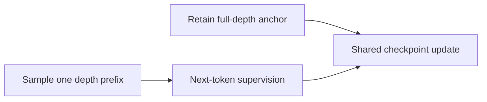
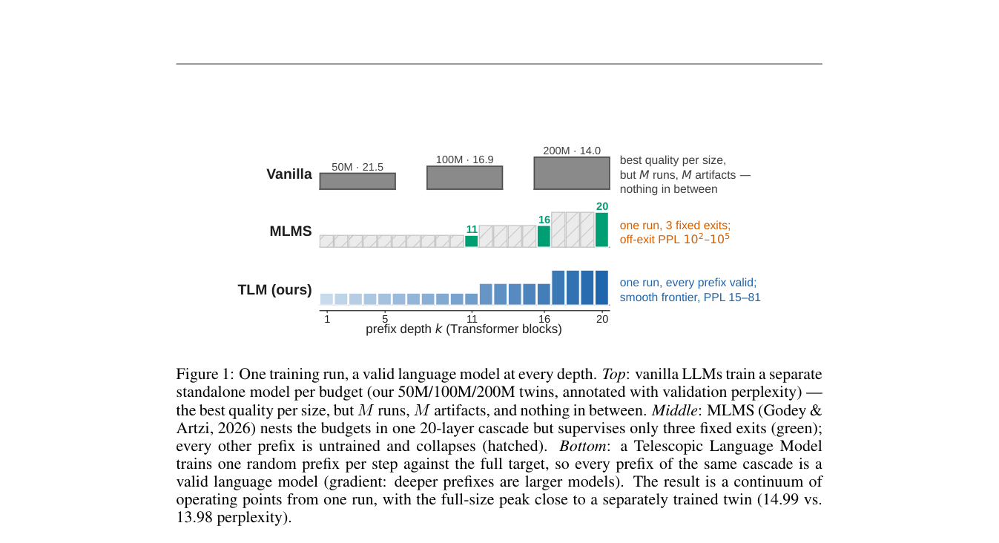

# Telescopic Language Models

<!-- source-sha256: dcffa4b00994402a02d5aba356a318aa7bc56a82188d8c4c58fcbd711df597ca -->

[简体中文](README.md)

> L1 random-depth and full-anchor gradient diagnostic; no 20B-token pretraining.

## Paper information

| Field | Details |
|---|---|
| Paper | [Telescopic Language Models](https://arxiv.org/abs/2609.35769) |
| Institution | University of Cambridge (first author). |
| First public release | 2026-09-28 (arXiv v1) |
| Author code | No public author repository found as of 2026-09-30. |
| Local adapter or method key | `telescopic-lm` |
| Local reproduction code | [`src/auto_research/foundation_latest_20260930_closure.py`](https://github.com/daiwk/auto-research/blob/main/src/auto_research/foundation_latest_20260930_closure.py) |

## Paper method and evidence

Sample a network-depth prefix each step for next-token supervision while preserving a full-depth anchor. The goal is to make every supported depth of one checkpoint usable as a language model.

<!-- paper-figure:start -->
### Original paper figure

Figure 1 shows sampled-depth and full-depth training. From the [original paper](https://arxiv.org/abs/2609.35769); copyright remains with the authors.
<!-- paper-figure:end -->

### Core equation

The reference checks both gradient paths and tests gradient isolation, type boundaries, and determinism.

### Reported results

Paper benchmarks, speed and training curves are not local fixture results.

## Local reproduction

The [three-seed reference tests](metrics/mechanism-seeds42-44.json) check the operator, shapes, boundaries, and state invariants under a fixed fixture budget. These are `diagnostic_only=true`, not paper-scale outcomes or online gains.
