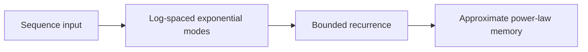
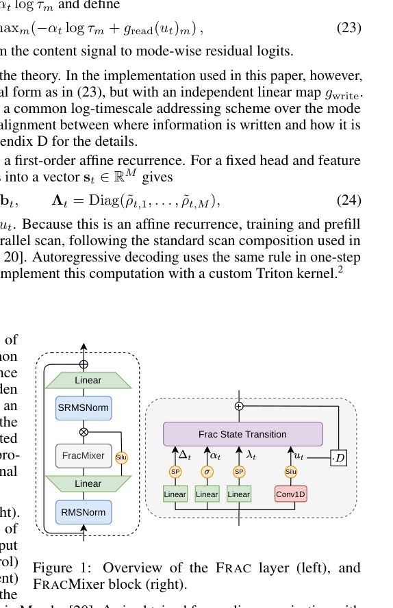

# Fractional State Space Transition for Long Sequence Modeling

<!-- source-sha256: 61866f47803ad2c1471747b6bb5ee5eb600d4a48fd4004a32c36e45037126d5c -->

[简体中文](README.md)

> L1 finite-mode recurrence and long-tail invariants, not a 1.3B LM result.

## Paper information

| Field | Details |
|---|---|
| Paper | [Fractional State Space Transition for Long Sequence Modeling](https://arxiv.org/abs/2609.36314) |
| Institution | Huawei Noah's Ark Lab, Montreal Research Center (first author). |
| First public release | 2026-09-28 (arXiv v1) |
| Author code | [anasiri/frac-ssm](https://github.com/anasiri/frac-ssm). |
| Local adapter or method key | `frac-ssm` |
| Local reproduction code | [`src/auto_research/foundation_latest_20260930_closure.py`](https://github.com/daiwk/auto-research/blob/main/src/auto_research/foundation_latest_20260930_closure.py) |

## Paper method and evidence

Approximate fractional power-law memory with finitely many logarithmically spaced exponential modes, combining long-tailed memory with bounded recurrent state and parallel training.

<!-- paper-figure:start -->
### Original paper figure

Figure 1 shows the state-space mechanism. From the [original paper](https://arxiv.org/abs/2609.36314); copyright remains with the authors.
<!-- paper-figure:end -->

### Core equation

The reference preserves recurrent transitions; tests check gradient isolation, type boundaries, and determinism.

### Reported results

Paper benchmarks, timing and learning curves are not directly comparable to fixtures.

## Local reproduction

[Three-seed mechanism results](metrics/mechanism-seeds42-44.json) are diagnostic_only=true. Fixed-budget fixtures verify the defining operator and auditable intermediate states; they are not a benchmark, production result, or capability-ranking entry.
