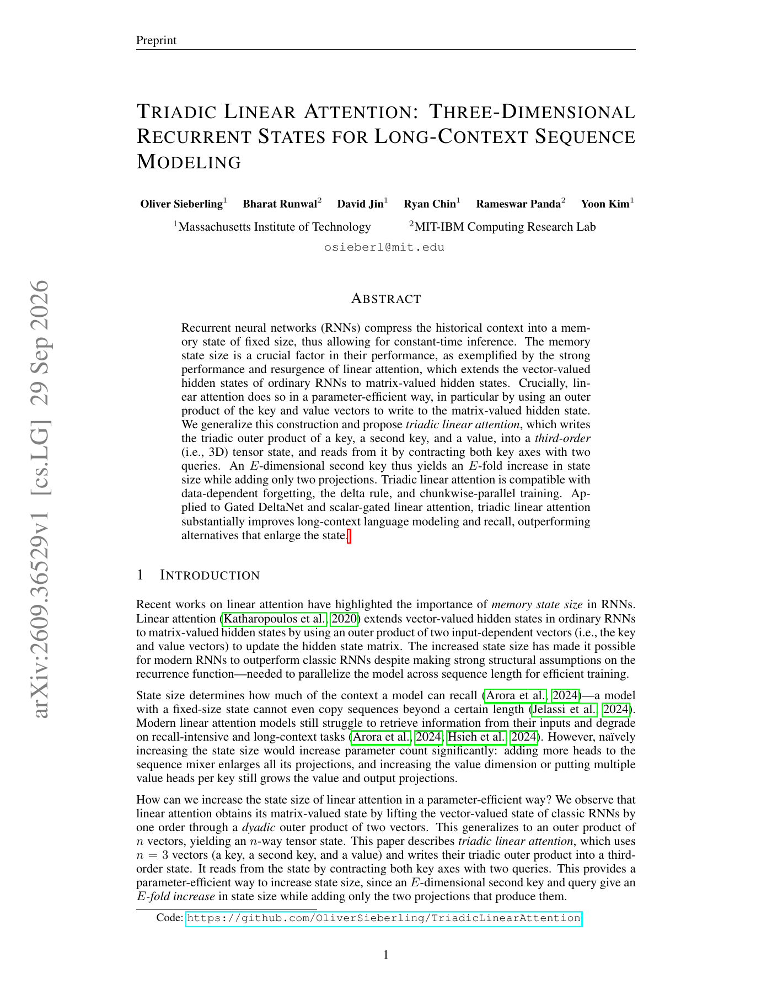

<!-- source-sha256: ed35a4ed5b7b19259d2e4b2c1fd095ddeef73a37c6ae2915ba05d309d275aaf8 -->

[简体中文](README.md) · English

# Triadic Linear Attention: A third-order recurrent state

> **L1 recurrence mechanism.** Implements writes, dual-query contraction and decay along the second key axis from Eqs. (2)–(3).

## Paper information

| Field | Details |
|---|---|
| Paper | [arXiv v1](https://arxiv.org/abs/2609.36529) |
| Institutions | MIT / MIT-IBM Watson AI Lab |
| First public release | 2026-09-29 (arXiv v1) |
| Original source code | Yes: [OliverSieberling/TriadicLinearAttention](https://github.com/OliverSieberling/TriadicLinearAttention) |
| Adapter | `triadic-linear-attention` |
| Local reproduction code | `src/auto_research/foundation_latest_20260930_followup.py` |

### Background and main changes

Ordinary linear attention writes a second-order state $k\otimes v$. Triadic attention adds another key to write $k\otimes k'\otimes v$, contracting the two key axes with $q,q'$ during reads. A second key dimension of $E$ multiplies state capacity by $E$ while adding only two projection sets. $E=1$ reduces exactly to ordinary linear attention.

<!-- paper-figure:start -->
### Key figure from the paper

> The paper's first page shows the third-order state and summarizes long-context results. From the [paper](https://arxiv.org/abs/2609.36529); copyright belongs to the authors.
<!-- paper-figure:end -->

## Local reproduction

`triadic_linear_attention` is a transparent recurrent reference. Tests compare with explicit summation and check causality, $E=1$ reduction and gradients. See [three-seed mechanism results](metrics/mechanism-seeds42-44.json). The paper's chunkwise Triton kernel, Gated DeltaNet upcycling and long-book language modeling are not reproduced. Small-tensor agreement is not reproduction of paper results.
