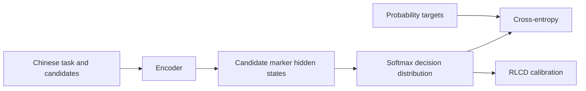
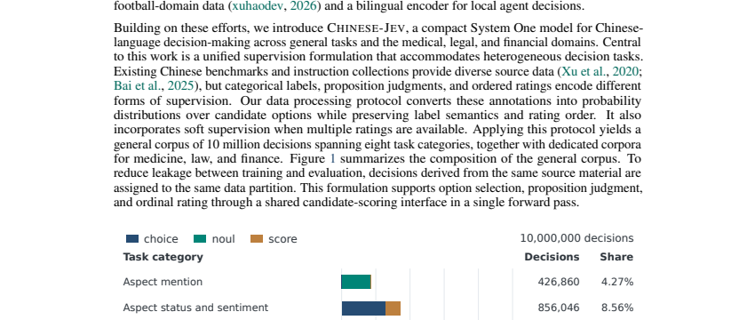

<!-- source-sha256: 95b1946bb0ba8654afe9ba987168801cc450225b50f7cfb4fe954f39d303a892 -->

[简体中文](README.md) · English

# Chinese-Jev: A Chinese System One decision model

> **L1 objective and model head.** Candidate marker representations, candidate-probability supervision and RLCD-style calibration are implemented. The paper's model trained on 10 million examples was not trained locally.

## Paper information

| Field | Details |
|---|---|
| Paper | [Chinese-Jev](https://arxiv.org/abs/2609.36965) |
| Institution | Fudan University (first author affiliation) |
| First public release | 2026-09-29 (arXiv v1) |
| Original source code | No standalone repository released; the [project page](https://gulucaptain.github.io/Chinese-Jev/) says models, data and code are planned. |
| Local adapter/method | `chinese-jev` |
| Local reproduction code | [`src/auto_research/foundation_latest_20260930.py`](https://github.com/daiwk/auto-research/blob/main/src/auto_research/foundation_latest_20260930.py) |

## Original paper summary

### Background and main changes

Chinese-Jev targets closed-output tasks such as classification, routing and candidate selection. A lightweight encoder reads Chinese context and candidates and scores hidden states at candidate markers directly. Heterogeneous labels become candidate-probability distributions. Pretraining uses 10 million general examples before separate medical, legal and finance fine-tuning.

<!-- paper-figure:start -->
### Key figure from the paper

> Figure 1 shows the composition of general Chinese decision data. From the [paper](https://arxiv.org/abs/2609.36965); copyright belongs to the authors.
<!-- paper-figure:end -->

### Core equations

Candidate $i$ receives $s_i=w^\top h_{m_i}$ and $p_i=\mathrm{softmax}(s)_i$. The local objective combines soft-label cross-entropy $-\sum_i q_i\log p_i$ with $-\log p_i$ weighted by reward-centered advantage. It preserves candidate decisions rather than autoregressive generation.

### Offline and online results

The paper reports 1.24% higher general-task accuracy than closed Jev, 20.3× speed, a 4.0% medical gain after domain fine-tuning and roughly 15ms mean latency. These are paper results. See [local three-seed mechanism metrics](metrics/mechanism-seeds42-44.json).

## Local reproduction and limits

`ChineseJevHead` runs forward and backward with probability normalization and finite-gradient checks. No paper data, full backbone, mobile INT8 deployment or paper-scale performance comparison.
