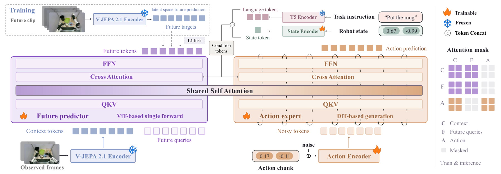

# V-JEPA Policy: Building Effective World-Action Models on Predictive Visual Latents

<!-- source-sha256: bd556faa4f657cac639e6662804d80e39267f07b903ea87423fe32239a6e1905 -->

[简体中文](README.md)

> **L1 mechanism diagnostic.** Future-latent stop-gradient and action flow matching run; no V-JEPA 2.1 weights or robot data.

## Paper information

| Field | Value |
| --- | --- |
| Paper | [arXiv 2609.37250](https://arxiv.org/abs/2609.37250) |
| Affiliations | Tsinghua University, first author's affiliation |
| First public release | 2026-09-29 (arXiv v1) |
| Authors' code | [VJEPA-Policy](https://github.com/breez3young/VJEPA-Policy) |
| Adapter / method | `vjepa-policy` |
| Local code | [`src/auto_research/foundation_latest_20261001.py`](https://github.com/daiwk/auto-research/blob/main/src/auto_research/foundation_latest_20261001.py) |

## Original paper

### Background and contribution

Freeze V-JEPA 2.1 vision encoding and jointly train an instruction-conditioned future-latent predictor and flow-matching action expert. Action generation reads the predicted future context.

<!-- paper-figure:start -->
### Key figure from the paper

Original Figure 1: predictive context and action expert. From the [paper](https://arxiv.org/abs/2609.37250); copyright belongs to the authors. Not a local result.
<!-- paper-figure:end -->

### Core mechanism

$L_{predict}=|M|^{-1}\sum_{i\in M}\|P(E(x),q)_i-sg(E(y)_i)\|_1$, optimized jointly with action velocity flow matching.

### Paper results

The 0.9B total/0.6B trainable paper model competes with representative WAM/VLA systems on LIBERO, LIBERO-Plus, and RoboCasa-GR1. No robotics checkpoint ran locally.

## Local reproduction

Compare disabled/default with enabled. [Three-seed diagnostics](metrics/mechanism-seeds42-44.json) check transitions, gradients, or scheduling only (`diagnostic_only=true`), not formal capability.

## Reproduction limits

Detachment and action flow matching only, without V-JEPA 2.1 or robotics data.
