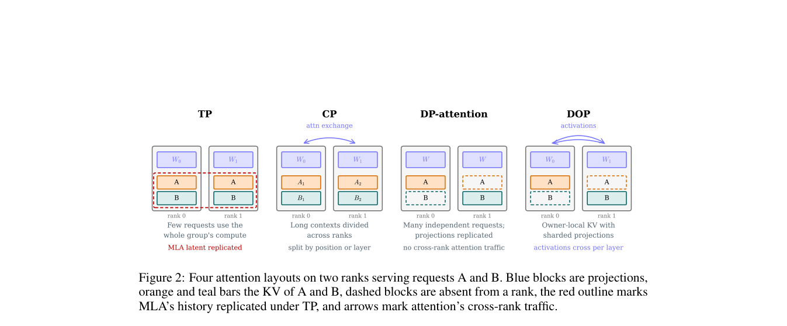

# SPLASH: Switching Parallel Layouts of Attention with Seamless Handoff for LLM Serving

<!-- source-sha256: a1eff010a6403755b46d2f401fa295977c624b88cc7c6260b96106b0e3f4a78f -->

[简体中文](README.md)

> L1 memory model and transition-aware planner, no CUDA handoff or B200/H200 performance validation.

## Paper information

| Field | Details |
|---|---|
| Paper | [arXiv 2609.37626](https://arxiv.org/abs/2609.37626) |
| Institution | Institute of Computing Technology, Chinese Academy of Sciences (first author). |
| First public release | 2026-09-29 (arXiv v1) |
| Author code | [SPLASH-sglang](https://github.com/ict-agent/SPLASH-sglang). |
| Local adapter or method key | `splash` |
| Local reproduction code | [`src/auto_research/foundation_latest_20261001.py`](https://github.com/daiwk/auto-research/blob/main/src/auto_research/foundation_latest_20261001.py) |

## Paper method and evidence

Unify attention-weight and KV-cache ownership. DOP shards weights while giving requests exclusive KV; schedule among TP, DP, CP, and DOP online, amortizing transition cost over remaining steps.

<!-- paper-figure:start -->
### Original paper figure

Figure 2 shows the layouts and handoff system. From the [original paper](https://arxiv.org/abs/2609.37626); copyright remains with the authors.
<!-- paper-figure:end -->

### Core equation

$M_{TP}=W_A/T+Bks$, $M_{DOP}=W_A/T+Bks/T$, $M_{DP}=M_{CP}=W_A+Bks/T$; the planner also amortizes switching costs.

### Reported results

Paper-reported B200/GLM-5.3 throughput is 1.3–1.73× fixed layouts, median switch overhead below 0.51% of its step. A100/A30 are not substitutes for that evidence.

## Local reproduction

Compare with the corresponding operator disabled or in its default state. [Three-seed metrics](metrics/mechanism-seeds42-44.json) are diagnostic_only=true: they verify execution and invariants, not formal gains or capability ranking.
