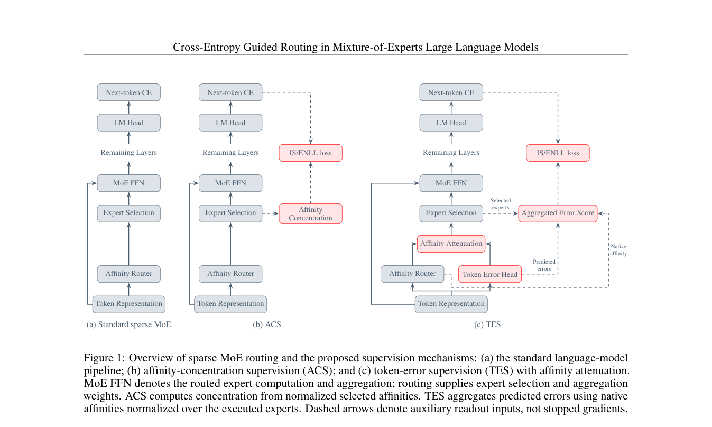

<!-- source-sha256: d15968e1cfce96c0c581f15e2709976d2fe152767bd558d524b08a8da49730ff -->

[简体中文](README.md) · English

# Cross-Entropy Guided Routing in Mixture-of-Experts Large Language Models

> **L1 core mechanism diagnostic.** Error-aware routing runs; Granite MoE was not trained.

## Paper information

| Field | Details |
|---|---|
| Paper | [arXiv 2609.37751](https://arxiv.org/abs/2609.37751) |
| Institution | Bar-Ilan University (first author affiliation) |
| First public release | 2026-09-29 (arXiv v1) |
| Original source code | No public author repository found as of 2026-10-01. |
| Adapter | `ce-guided-moe` |
| Local reproduction code | [`src/auto_research/foundation_latest_20261001.py`](https://github.com/daiwk/auto-research/blob/main/src/auto_research/foundation_latest_20261001.py) |

## Original paper summary

### Background and main changes

Add a per-expert token-error head alongside native MoE affinity. Use a shifted logarithm of predicted error to attenuate routing logits before Top-K, downweighting experts with high predicted error. Actual next-token cross-entropy supervises the error head.

<!-- paper-figure:start -->
### Key figure from the paper

> **Figure 1:** Overall workflow, stages and data flow. From the [paper](https://arxiv.org/abs/2609.37751); copyright belongs to the authors. Click for the source.
<!-- paper-figure:end -->

### Core equation

$\tilde a_{t,i}=a_{t,i}-\gamma\log(1+\hat e_{t,i}/\tau)$, then apply softmax and Top-K to $\tilde a$.

### Offline and online results

The paper's Granite MoE experiments report about 2.3 percentage points on average. The local run verifies only error-aware affinity attenuation.

## Local reproduction

> **Comparison protocol:** Disabled or default mechanism versus enabled operator. Only invariants and state transitions are checked; cross-model relative change is not applicable.

See [three-seed diagnostics](metrics/mechanism-seeds42-44.json). `diagnostic_only=true` means executable state transitions, gradients or scheduling invariants, not formal capability ranking.

## Scope

The error-aware routing equation runs; Granite MoE was not trained.
