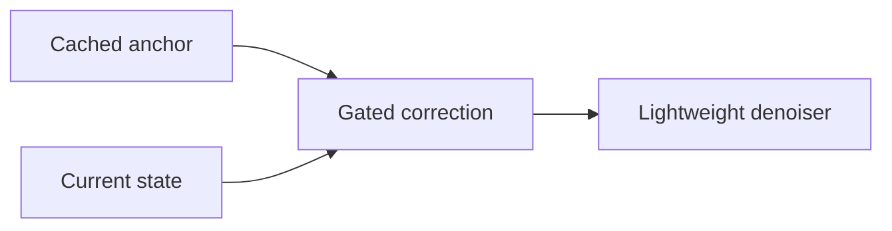
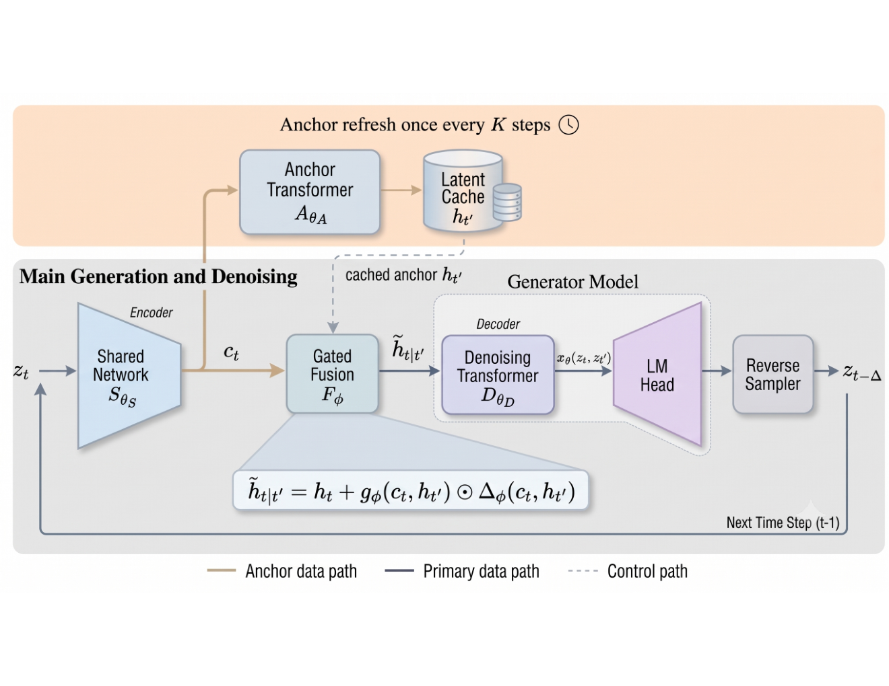

# Time-Anchored Diffusion Language Models: Latent-Space Caching for Fast Generation

<!-- source-sha256: d4fb08e4ff8c42c1499135e91921b102a157fd013258756cda768e4b78d26478 -->

[简体中文](README.md)

> **L1 mechanism diagnostic.** Stale-anchor correction, without loading DiffusionGemma-26B.

## Paper information

| Field | Value |
| --- | --- |
| Paper | [arXiv 2609.37924](https://arxiv.org/abs/2609.37924) |
| Affiliations | The University of Texas at Austin, first author's affiliation |
| First public release | 2026-09-29 (arXiv v1) |
| Authors' code | No public author repository found as of 2026-10-01. |
| Adapter / method | `tadm` |
| Local code | [`src/auto_research/foundation_latest_20261001.py`](https://github.com/daiwk/auto-research/blob/main/src/auto_research/foundation_latest_20261001.py) |

## Original paper

### Background and contribution

Cache an expensive anchor network's latent representation across reverse-diffusion steps and refresh it periodically. A small fusion module uses the current state to gate a correction before the lightweight denoiser.

<!-- paper-figure:start -->
### Key figure from the paper

Original Figure 1: anchor caching and correction. From the [paper](https://arxiv.org/abs/2609.37924); copyright belongs to the authors. Not a local result.
<!-- paper-figure:end -->

### Core mechanism

$\tilde h_{t|t'}=h_{t'}+g_\phi(c_t,h_{t'})\odot\Delta_\phi(c_t,h_{t'})$. The local component implements the gated correction.

### Paper results

The post-trained DiffusionGemma-26B variant reports roughly 49%–79% more throughput. The pretrained version reduces layer computation by up to 38% and reports up to 73% more throughput than ADLM.

## Local reproduction

Compare the disabled/default mechanism with the enabled one. [Three-seed metrics](metrics/mechanism-seeds42-44.json) are `diagnostic_only=true`, checking transitions, gradients, or scheduling, not capability or cross-model improvement.

## Reproduction limits

No DiffusionGemma-26B checkpoint run; these results do not reproduce paper throughput.
