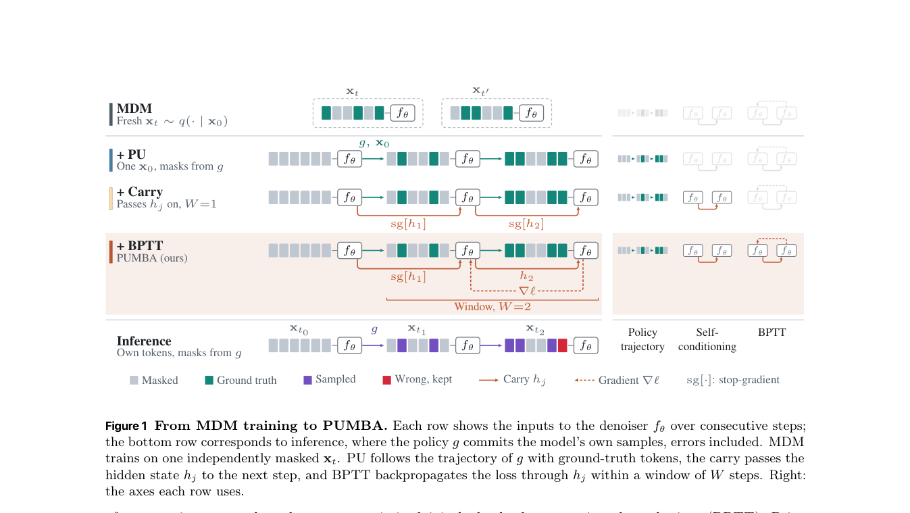

<!-- source-sha256: dab162d2a04abac883b984332ec61dc74e5cd76d49b3ede32bce8e19bd064346 -->

[简体中文](README.md) · English

# On Trajectory-Aware Training for Masked Diffusion Language Models

> **L1 core mechanism diagnostic.** Consecutive denoising carry and within-window BPTT run. LLaDA-8B was not trained.

## Paper information

| Field | Details |
|---|---|
| Paper | [arXiv 2609.37974](https://arxiv.org/abs/2609.37974) |
| Institution | Apple (first author affiliation) |
| First public release | 2026-09-29 (arXiv v1) |
| Original source code | No public author repository found as of 2026-10-01. |
| Adapter | `pumba` |
| Local reproduction code | [`src/auto_research/foundation_latest_20261001.py`](https://github.com/daiwk/auto-research/blob/main/src/auto_research/foundation_latest_20261001.py) |

## Original paper summary

### Background and main changes

During training, unroll consecutive denoising steps along the model's own progressive-unmasking trajectory. Pass a hidden carry to the next step and backpropagate through time within a fixed window, so an earlier step learns to produce a useful carry for later steps.

<!-- paper-figure:start -->
### Key figure from the paper

> **Figure 1:** Training workflow and key optimizations. From the [paper](https://arxiv.org/abs/2609.37974); copyright belongs to the authors. Click for the source.
<!-- paper-figure:end -->

### Core equation

$L_W=W^{-1}\sum_{j=1}^W CE(f_\theta(x_{t_j},h_{j-1}),x_0)$. Gradients pass through the carry within each window and stop between windows.

### Offline and online results

The paper reports about 22%–26% fewer function evaluations for LLaDA-8B at comparable quality. Only within-window BPTT is checked locally.

## Local reproduction

> **Comparison protocol:** Disabled or default mechanism versus enabled operator. Only invariants and state transitions are checked; cross-model relative change is not applicable.

See [three-seed diagnostics](metrics/mechanism-seeds42-44.json). `diagnostic_only=true` means executable state transitions, gradients or scheduling invariants, not formal capability ranking.

## Scope

Consecutive denoising carry and within-window BPTT run. LLaDA-8B was not trained.
