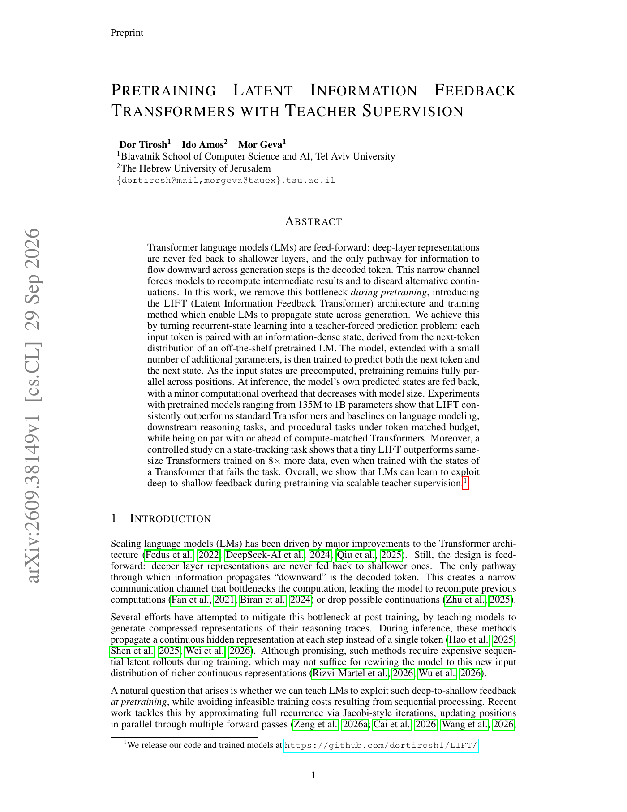

# LIFT: Latent-state feedback during pretraining

<!-- source-sha256: cee6ce4ce01f7d81e1bd5b1efed4396d61d362cdeaa4d0bc8b83ed514744edf0 -->

[简体中文](README.md)

> L1 core mechanism: top-k state, token/state SwiGLU fusion, and CE plus state KL; no training of 135M–1B models.

## Paper information

| Field | Details |
|---|---|
| Paper | [arXiv v1](https://arxiv.org/abs/2609.38149) |
| Institution | Tel Aviv University (first author). |
| First public release | 2026-09-29 (arXiv v1) |
| Author code | Yes: [dortirosh1/LIFT](https://github.com/dortirosh1/LIFT). |
| Local adapter or method key | `lift-feedback` |
| Local reproduction code | `src/auto_research/foundation_latest_20260930_followup.py` |

## Paper method and evidence

In a conventional Transformer, deep-layer information returns to the shallow layers only through the next discrete token. LIFT precomputes the teacher's next-token top-k distribution as a continuous state. During training the token and teacher state are fed in together and the model predicts both the next token and the next state. Inference feeds the model's own state back. The objective is token cross-entropy plus forward KL to the teacher's top-k distribution.

<!-- paper-figure:start -->
### Original paper figure

Figure 1 shows the information bottleneck, teacher-forced training, and feedback at inference. From the [original paper](https://arxiv.org/abs/2609.38149); copyright remains with the authors.
<!-- paper-figure:end -->

## Local reproduction

`lift_topk_state` retains and normalizes top-k logits; `lift_fuse` projects state with the shared embedding and applies residual SwiGLU; `lift_loss` combines both losses. Tests cover sparse normalization, changed output under feedback, and stop-gradient on the teacher. See the [three-seed mechanism results](metrics/mechanism-seeds42-44.json). No large-scale pretraining, prefix state dropout, or paper benchmark.
