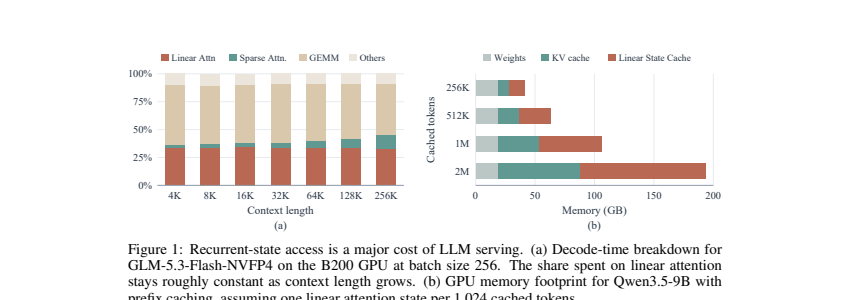

# LeapQuant: windowed quantization and compensator tokens

<!-- source-sha256: ef74f4a4d33171a2ff9116c9fbc7de7ce02677ada0a513a7098c01ab14f03a21 -->

[简体中文](README.md)

> **L1 mechanism.** Retains per-window state quantization, low-rank compensator tokens, and residual smoothing. The paper's CUDA kernel and full-model throughput were not reproduced.

## Paper information

| Field | Details |
|---|---|
| Paper | [LeapQuant](https://arxiv.org/abs/2609.38166) |
| Organization | First-author affiliation: UC Berkeley |
| First public release | 2026-09-29 (arXiv v1) |
| Authors' code | No author repository was provided as of 2026-09-30. |
| Adapter / method | `leapquant` |
| Local reproduction code | [`src/auto_research/foundation_latest_20260930.py`](https://github.com/daiwk/auto-research/blob/main/src/auto_research/foundation_latest_20260930.py) |

## Original paper

### Motivation and method

Quantizing recurrent state at every token repeatedly rounds it. LeapQuant retains a low-bit base state, buffers within-window updates at high precision, and requantizes once at the window boundary. It separates the largest outliers into a few high-precision compensator tokens, then smooths and quantizes the residual.

~~~mermaid
flowchart LR
  S[Low-bit state at window start] --> D[Separate outliers]
  D --> C[High-precision compensator tokens]
  D --> R[Smooth residual]
  R --> Q[Quantize once at window end]
  C --> O[Readout]
  Q --> O
~~~

<!-- paper-figure:start -->
### Key figure from the paper

> **Figure 1:** Decoding cost of recurrent-state access. From the [original paper](https://arxiv.org/abs/2609.38166); copyright remains with the authors.
<!-- paper-figure:end -->

### Core equations

Within a window, $S_t=Q(S_{kw})+\sum_{i=kw+1}^{t}\Delta S_i$, requantized only at $t=(k+1)w$. The local code uses truncated SVD for a rank-$r$ compensator $C=U_r\Sigma_rV_r^\top$, symmetrically quantizes $S-C$, and adds $C$ back at readout.

### Paper results

On Qwen, Kimi, and GLM families the paper reports 8-bit results near FP32, 2.05–3.70× kernel speedup, and 1.47× end-to-end speedup. These are not local results; see the separate [local metrics](metrics/mechanism-seeds42-44.json).

## Local reproduction and limits

The diagnostic checks window boundaries, compensator rank, state error, and CUDA execution. It does not implement the authors' custom kernel. See the [sanitized A100 receipt](../../gpu-validations/leapquant-a100-20260930.json).
