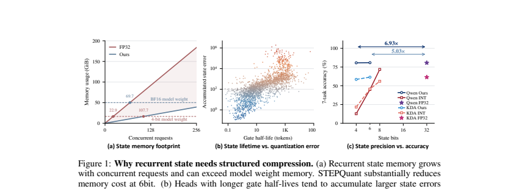

# STEPQuant: Spatiotemporal quantization of recurrent linear-attention state

<!-- source-sha256: 2785e019963f2763cb2975780c71f91024ce4276177deb877f7cacdfb8c8c23d -->

[简体中文](README.md)

> L1 lifetime-aware allocation and dual-axis scale fitting, not SGLang kernels or whole-model throughput.

## Paper information

| Field | Details |
|---|---|
| Paper | [STEPQuant](https://arxiv.org/abs/2609.38169) |
| Institution | Zhejiang University (first author). |
| First public release | 2026-09-29 (arXiv v1) |
| Author code | [Dreamer-Toby/STEPQuant](https://github.com/Dreamer-Toby/STEPQuant). |
| Local adapter or method key | `stepquant` |
| Local reproduction code | [`src/auto_research/foundation_latest_20260930.py`](https://github.com/daiwk/auto-research/blob/main/src/auto_research/foundation_latest_20260930.py) |

## Paper method and evidence

Each concurrent request retains a fixed-size delta-rule state, and quantization errors compound. Estimate remaining state lifetime and key-row impact, allocate more precision to important blocks under a fixed average budget, and fit row/column scales.

<!-- paper-figure:start -->
### Original paper figure

Figure 1 motivates quantization by linking state memory, lifetime and error. From the [original paper](https://arxiv.org/abs/2609.38169); copyright remains with the authors.
<!-- paper-figure:end -->

### Core equation

Use normalized lifetime $w_t=(T-t)/\sum_j(T-j)$ and solve $\min\sum_i w_i e_{i,b_i}$ exactly over candidate widths subject to average bits. Quantize with the geometric combination of key-row and value-column scales, not uniform INT8.

### Reported results

For Qwen3.8-27B and Kimi-Linear-48B-A3B-Instruct, the paper reports nominal 6-bit state near FP32, over 5× state compression and up to 68.7% lower serving memory. Not local results.

## Local reproduction

[Three-seed diagnostic](metrics/mechanism-seeds42-44.json) verifies bit budgets, finite scales, state MSE and CUDA forward/backward. [Sanitized A100 receipt](../../gpu-validations/stepquant-a100-20260930.json). No reproduction of throughput or model accuracy.
