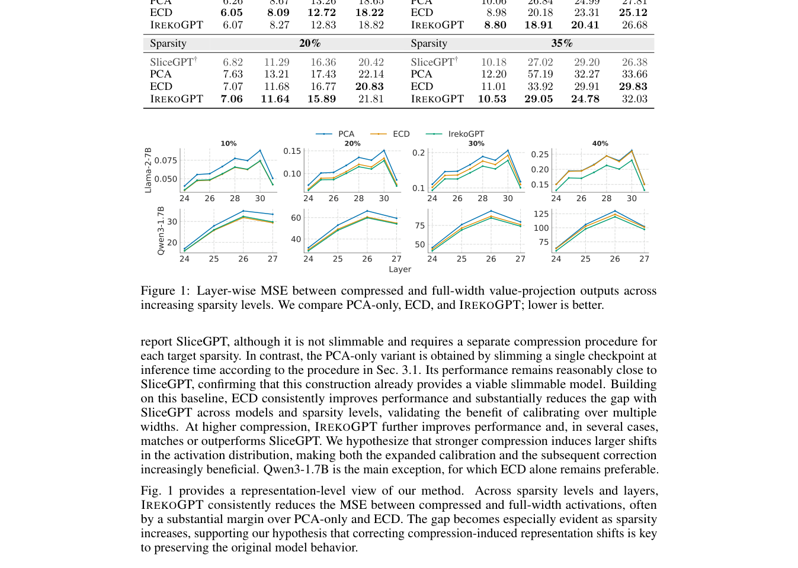

# IrekoGPT: Turning Structured Pruning into Post-Hoc Slimmable LLMs

<!-- source-sha256: 99a016f29b3b50d34df7cb90ac6297b181b15c3c3679ab771b68a163b757db0a -->

[简体中文](README.md)

> L1 nested-subnetwork contract. The original model and throughput are not reproduced.

## Paper information

| Field | Details |
|---|---|
| Paper | [arXiv v1](https://arxiv.org/abs/2610.00426) |
| Institution | University of Modena and Reggio Emilia (first author). |
| First public release | 2026-10-01 (arXiv v1) |
| Author code | [aimagelab/IrekoGPT](https://github.com/aimagelab/IrekoGPT). |
| Local adapter or method key | `irekogpt` |
| Local reproduction code | [`src/auto_research/foundation_latest_20261003.py`](https://github.com/daiwk/auto-research/tree/main/src/auto_research/foundation_latest_20261003.py) |

## Paper method and evidence

Keep SliceGPT's projection basis rather than discarding it after pruning, so one checkpoint exposes nested widths. Calibrate at multiple compression ratios and use ridge corrections for downstream linear layers.

<!-- paper-figure:start -->
### Original paper figure

Figure 1 shows the nested-width architecture. From the [original paper](https://arxiv.org/abs/2610.00426); copyright remains with the authors.
<!-- paper-figure:end -->

### Core equation

$W_k=P_{:k}^TWP_{:k}$; widths share one nested basis.

### Reported results

Preliminary author experiments on Llama and Qwen report better results than naive PCA slimming at high compression.

## Local reproduction

Compare against the mechanism disabled or in its default state. The [three-seed diagnostic](metrics/mechanism-seeds42-44.json) is `diagnostic_only=true`; no formal relative gain or capability ranking.
