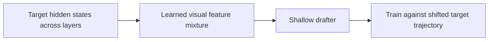
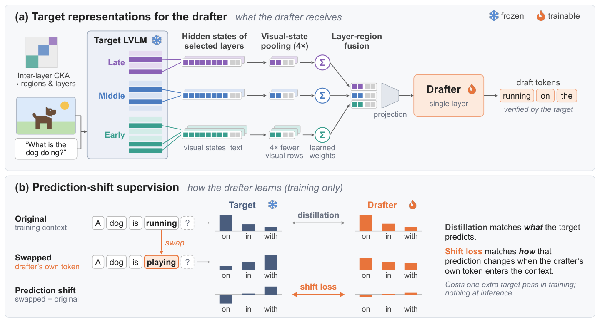

# HAWK: Rethinking Multimodal Drafting for Speculative Decoding

<!-- source-sha256: 83a3b33b59d4755694688f2de690a928f5be7a0005300eed0a350b8d6dfe37b4 -->

[简体中文](README.md)

> L1 diagnostic of layer mixing and shifted target isolation. No specialized decoding kernel.

## Paper information

| Field | Details |
|---|---|
| Paper | [arXiv v1](https://arxiv.org/abs/2610.00623) |
| Institution | The paper's first page does not list an affiliation for the first author. |
| First public release | 2026-09-30 (arXiv v1) |
| Author code | No public author implementation found as of 2026-10-03. |
| Local adapter or method key | `hawk` |
| Local reproduction code | [`src/auto_research/foundation_latest_20261003.py`](https://github.com/daiwk/auto-research/tree/main/src/auto_research/foundation_latest_20261003.py) |

## Paper method and evidence

Learn a mixture of hidden states from multiple target layers to supply compressed visual features to a shallow drafter. Train on the shifted trajectory after the drafter's own proposals.

<!-- paper-figure:start -->
### Original paper figure

Figure 1 shows the training process. From the [original paper](https://arxiv.org/abs/2610.00623); copyright remains with the authors.
<!-- paper-figure:end -->

### Core equation

$h_d=\sum_l softmax(a)_l h_l$; supervision comes from the target distribution on the shifted trajectory.

### Reported results

The authors report acceptance rates and lossless speedups for speculative decoding with LVLMs.

## Local reproduction

Compare with the mechanism disabled/default state. The [three-seed diagnostic](metrics/mechanism-seeds42-44.json) is `diagnostic_only=true`; no formal relative gain or capability ranking.
